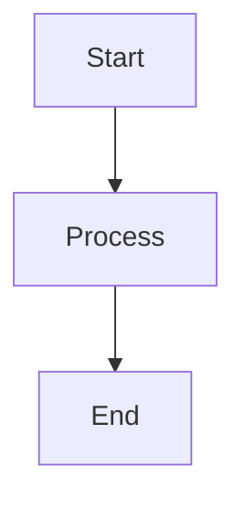

# Abundance Zone Platform v2.0 - UML Flowchart Documentation Index

Complete UML flowchart collection for the Abundance Zone Youth Management Platform v2.0 development, based on comprehensive v1.0 codebase analysis.

---

## 📋 Table of Contents

1. [Class Diagram](#01-class-diagram) - OOAD with domain entities, relationships, patterns
2. [Sequence Diagrams](#02-sequence-diagrams) - Behavioral interaction flows for 8 key scenarios
3. [State Diagrams](#03-state-diagrams) - Lifecycle and state transitions for 6 core entities
4. [Component Diagram](#04-component-diagram) - Modular architecture with Clean Architecture layers
5. [Deployment Diagram](#05-deployment-diagram) - Infrastructure on Vercel, Render, Neon, Firebase
6. [Development Workflow](#06-development-workflow) - 14-phase SDLC methodology
7. [Data Flow Diagrams](#07-data-flow-diagrams) - Structured design with DFD levels 0-2
8. [Activity Diagrams](#08-activity-diagrams) - Business process workflows for 7 key features

---

## 📚 Document Overview

### 01 - Class Diagram
**File**: [01-CLASS_DIAGRAM.md](./01-CLASS_DIAGRAM.md)

**Content**:
- Complete OOAD design with all domain entities
- **9 Core Entities**: User, Branch, Department, Youth, Event, Attendance, Pledge, Payment, Notification
- **Supporting Entities**: RefreshToken, AuditLog, AnalyticsCache
- **Enums**: Role, AttendanceStatus, PledgeStatus, EventStatus, NotificationType
- **Relationships**: One-to-Many, Many-to-Many with cardinality
- **Repository Pattern**: Interface definitions for all entities
- **Service Layer**: Business logic encapsulation
- **Domain Events**: YouthRegistered, AttendanceRecorded, PledgeSubmitted, EventCreated, ReceiptUploaded
- **Value Objects**: Email, PhoneNumber, AttendanceRate, Amount
- **External Service Adapters**: IEmailService, IPushService, IAIService implementations
- **OOAD Principles**: Encapsulation, Inheritance, Polymorphism, Abstraction, Loose Coupling, High Cohesion
- **Object Instantiation Examples**: Real-world usage scenarios

**Key Insights**: Foundation for Clean Architecture + DDD implementation

---

### 02 - Sequence Diagrams
**File**: [02-SEQUENCE_DIAGRAMS.md](./02-SEQUENCE_DIAGRAMS.md)

**Content**:
- **8 Behavioral Interaction Flows**:
  1. **JWT Authentication** with Firebase SSO integration
  2. **Youth Registration** with domain events and notifications
  3. **Bulk Attendance Marking** (500 records) with Firestore sync
  4. **AI Chat** with context injection and Gemini/OpenRouter fallback
  5. **Payment with Receipt OCR** using GPT-4o Vision
  6. **Token Refresh Flow** with rotation mechanism
  7. **Event Creation** with parallel push notifications
  8. **Attendance Risk Prediction** with ML/rule-based fallback

**Time Complexity Analysis**:
- Authentication: O(1) with Redis cache
- Bulk attendance: O(n) parallel processing
- AI chat: O(1) with context caching

**Key Insights**: Async processing patterns, external service integrations, error handling strategies

---

### 03 - State Diagrams
**File**: [03-STATE_DIAGRAMS.md](./03-STATE_DIAGRAMS.md)

**Content**:
- **6 Entity Lifecycle State Machines**:
  1. **Youth Membership**: 8 states (Pending → Active → AtRisk → Suspended → Inactive → Archived)
  2. **Attendance Record**: 5 states (PendingCheckIn → CheckedIn → Present/EarlyDeparture/Absent)
  3. **Pledge Payment**: 7 states (Pledged → PartiallyPaid → Overdue → FullyPaid → Defaulted)
  4. **Event Lifecycle**: 6 states (Draft → Scheduled → InProgress → Completed → Archived)
  5. **Notification**: 6 states (Queued → Sending → Sent/Failed → Retrying → PermanentFailure)
  6. **User Session**: 7 states (Unauthenticated → Authenticating → Authenticated → TokenExpired → RefreshingToken)

**Automatic Transitions**:
- Event state changes triggered by Celery Beat (every 5-15 minutes)
- Youth status changes via ML prediction (daily batch)
- Token expiration (15 minutes for access, 30 days for refresh)

**Key Insights**: State persistence in PostgreSQL with audit trail, Firestore mirrors for mobile sync

---

### 04 - Component Diagram
**File**: [04-COMPONENT_DIAGRAM.md](./04-COMPONENT_DIAGRAM.md)

**Content**:
- **High-Level Component Architecture**: 4-layer Clean Architecture
- **11 Feature Modules** (63 total endpoints):
  1. Auth Module - 7 endpoints
  2. Youth Module - 8 endpoints
  3. Event Module - 6 endpoints
  4. Attendance Module - 7 endpoints
  5. Pledge Module - 6 endpoints
  6. Payment Module - 7 endpoints
  7. Notification Module - 5 endpoints
  8. Branch Module - 5 endpoints
  9. Department Module - 5 endpoints
  10. Analytics Module - 4 endpoints
  11. AI/ML Module - 3 endpoints

**Clean Architecture Layers**:
- Domain Layer: Pure business logic (zero dependencies)
- Application Layer: Use cases and DTOs
- Infrastructure Layer: External service adapters
- Presentation Layer: FastAPI routers and middleware

**Cross-Cutting Concerns**:
- Security: App Check, Rate Limiting, RBAC, JWT
- Observability: Logging, Metrics, Tracing
- Data Sync: Firestore, Redis Cache, Event Bus
- Background Jobs: 4 Celery workers

**Module Dependency Graph**: Shows dependencies between 11 modules

**Key Insights**: Modular monolith architecture ready for microservices migration

---

### 05 - Deployment Diagram
**File**: [05-DEPLOYMENT_DIAGRAM.md](./05-DEPLOYMENT_DIAGRAM.md)

**Content**:
- **Production Deployment Architecture**:
  - **Frontend**: Vercel (Next.js 14, Global CDN, 70+ edge locations)
  - **Backend**: Render (3 FastAPI instances, auto-scaling, 2 Celery workers)
  - **Database**: Neon PostgreSQL 16 (Primary + 2 read replicas, automated backups)
  - **Cache/Queue**: Upstash Redis 7 (10 GB, RDB + AOF persistence)
  - **Mobile Backend**: Firebase (Auth, Firestore, FCM, Storage)
  - **AI Services**: Google Gemini 1.5 Pro, OpenRouter, OpenAI GPT-4o Vision

**Infrastructure Specifications**:
- Backend: 2 vCPU, 4 GB RAM per instance, 4 Gunicorn workers
- Database: 100 max connections, PgBouncer pooling
- Redis: allkeys-lru eviction, 5-minute snapshots
- Celery: 4 workers/instance, 8 total concurrent tasks

**Network Architecture**:
- TLS 1.3 encryption for all connections
- Private VPC for database and Redis
- IP whitelisting for Neon
- DDoS protection via Cloudflare + Vercel

**CI/CD Pipeline**:
- Frontend: Git push → Vercel auto-deploy (2 min build)
- Backend: Git push → Docker build → Zero-downtime deploy (5 min build)
- Database: Alembic migrations auto-run on deployment

**Monitoring Stack**: Sentry, LogTail, UptimeRobot, Prometheus

**Estimated Monthly Cost**: $424/month

**Performance Targets**:
- API Response Time: <200ms (p95)
- Page Load Time: <2s (FCP)
- Database Query Time: <50ms (p95)
- Cache Hit Rate: >80%
- Uptime: 99.9% SLA
- Concurrent Users: 1000+

**Key Insights**: Multi-region deployment with automated failover and disaster recovery

---

### 06 - Development Workflow
**File**: [06-DEVELOPMENT_WORKFLOW.md](./06-DEVELOPMENT_WORKFLOW.md)

**Content**:
- **Complete 14-Phase SDLC Flowchart**:
  - **Planning & Design** (Phases 1-3): System Architecture, Database Design, Schema Implementation
  - **Specification** (Phases 4-5): API Specification, Project Structure
  - **Backend Core** (Phases 6-9): Core Infrastructure, Domain Models, Backend Architecture, API Implementation
  - **Integration & Testing** (Phases 10-11): External Integrations, Testing Strategy
  - **Frontend & Deployment** (Phases 12-14): Frontend Development, Deployment Pipeline, Documentation

**Phase-by-Phase Details**:
- Each phase with detailed flowchart showing sub-tasks and decision points
- Deliverables listed for every phase
- Quality gates between phases (code review, tests, coverage, documentation)

**Git Workflow**: Feature branches → develop → main with semantic versioning

**Development Timeline**: 60-day estimate from planning to production launch

**Quality Gates**:
- Code review by 1+ team members
- All tests passing (unit, integration, E2E)
- Minimum 80% code coverage
- Documentation complete

**Key Insights**: Sequential phases with strict quality criteria before phase transition

---

### 07 - Data Flow Diagrams
**File**: [07-DATA_FLOW_DIAGRAMS.md](./07-DATA_FLOW_DIAGRAMS.md)

**Content**:
- **Structured Design Methodology**:
  - **Level 0 DFD**: Context diagram showing external entities and system boundary
  - **Level 1 DFD**: 8 major processes (Auth, Youth, Event, Attendance, Financial, Notification, Analytics, AI)
  - **Level 2 DFD**: Detailed sub-processes for 6 critical flows

**Detailed Level 2 DFDs**:
1. **Authentication & Authorization**: 5 sub-processes (Validate, Generate JWT, Verify, RBAC Check, Refresh)
2. **Youth Management**: 7 sub-processes (Validate, Check Duplicates, Create, Domain Events, Get Details, Query, Predict Risk)
3. **Attendance Tracking**: 11 sub-processes (Validate QR, Check Existing, Record Check-in, Sync Firestore, Record Check-out, Determine Status, Mark Present/Early, Update Stats, Bulk Processing, Queue Task)
4. **Financial Management**: 11 sub-processes (Create Pledge, Schedule Reminders, Upload Receipt, OCR Processing, Validate Payment, Record, Update Status, Mark Paid, Generate Report)
5. **Notification System**: 10 sub-processes (Create, Resolve Segment, Build List, Queue Task, Prepare Messages, Send Push/Email, Track Delivery, Retry, Mark Failed)

**Module Hierarchy**: Structured design showing module decomposition

**Data Dictionary**:
- 9 key entities with primary/foreign keys
- 8 critical data flows with frequency and volume metrics

**Key Insights**: Clean Architecture data flow patterns with async processing and caching strategies

---

### 08 - Activity Diagrams
**File**: [08-ACTIVITY_DIAGRAMS.md](./08-ACTIVITY_DIAGRAMS.md)

**Content**:
- **7 Business Process Workflows**:
  1. **Youth Registration**: Coordinator registers youth with profile validation and duplicate checking
  2. **Event Creation**: Create event with QR code generation and automated notifications
  3. **Attendance Marking (QR Code)**: Mobile app check-in/out flow with real-time sync
  4. **Bulk Attendance Marking**: Coordinator marks attendance for multiple youths with async processing
  5. **Pledge Payment**: Youth records payment with receipt OCR and automatic pledge updates
  6. **AI Chat Assistant**: User interacts with AI for insights with fallback handling
  7. **Financial Report Generation**: Coordinator generates reports with flexible filters and export formats

**Activity Characteristics**:
- **Swimlanes**: Multi-role activities showing user vs system responsibilities
- **Decision Points**: Business logic expressed as diamond-shaped decisions
- **Parallel Activities**: Concurrent operations with fork/join nodes
- **Error Handling**: Alternative flows for validation failures and exceptions
- **System Integration**: External service calls highlighted (Firebase, Gemini, OpenAI)
- **User Experience**: Clear success/error messages and confirmation steps

**Business Rules Documented**:
- Validation rules (age 10-30 for youth, unique phone/email)
- RBAC requirements per activity
- Async processing thresholds (>100 records → Celery)
- OCR extraction and auto-approval logic
- Rate limiting (AI chat: 20 queries/hour)

**Key Insights**: User-centric workflows with system automation and async processing for scale

---

## 🎯 Diagram Usage Guide

### For Developers
- **Start with**: 01 Class Diagram (understand domain model) → 04 Component Diagram (understand architecture)
- **For implementation**: 02 Sequence Diagrams (understand interactions) → 07 Data Flow Diagrams (understand data movement)
- **For deployment**: 05 Deployment Diagram (understand infrastructure)

### For Product Managers
- **Start with**: 08 Activity Diagrams (understand user flows) → 06 Development Workflow (understand timeline)
- **For feature planning**: 03 State Diagrams (understand entity lifecycles)

### For DevOps Engineers
- **Start with**: 05 Deployment Diagram (understand infrastructure) → 06 Development Workflow (understand CI/CD)
- **For monitoring**: Component Diagram section on observability

### For QA Engineers
- **Start with**: 08 Activity Diagrams (understand test scenarios) → 02 Sequence Diagrams (understand integration points)
- **For test planning**: 06 Development Workflow Phase 11 (testing strategy)

---

## 📊 Diagram Statistics

| Diagram Type | File Count | Mermaid Diagrams | Key Entities | External Services |
|--------------|-----------|------------------|--------------|-------------------|
| **Class** | 1 | 7 | 14 entities | 6 adapters |
| **Sequence** | 1 | 8 | 11 modules | 4 services |
| **State** | 1 | 6 | 6 entities | 3 services |
| **Component** | 1 | 12 | 11 modules | 8 integrations |
| **Deployment** | 1 | 4 | 7 tiers | 6 providers |
| **Workflow** | 1 | 15 | 14 phases | N/A |
| **Data Flow** | 1 | 9 | 9 entities | 4 services |
| **Activity** | 1 | 7 | 7 processes | 4 services |
| **Total** | **8** | **68** | **14 unique** | **8 unique** |

---

## 🔗 Cross-References

### Architecture Patterns
- **Clean Architecture**: See 01 Class Diagram, 04 Component Diagram, 07 Data Flow Diagrams
- **Domain-Driven Design**: See 01 Class Diagram (domain events, value objects, aggregates)
- **Repository Pattern**: See 01 Class Diagram, 04 Component Diagram
- **CQRS**: See 07 Data Flow Diagrams (read vs write paths)
- **Event-Driven**: See 01 Class Diagram (domain events), 02 Sequence Diagrams

### Technology Stack
- **Backend**: FastAPI 0.115.5, Python 3.12.9, SQLAlchemy, Alembic, Celery 5.4.0
- **Frontend**: Next.js 14.2.35, React 18, Tailwind CSS, shadcn/ui
- **Database**: PostgreSQL 16 (Neon), Redis 7 (Upstash), Firestore
- **AI**: Google Gemini 1.5 Pro, OpenRouter, OpenAI GPT-4o Vision
- **DevOps**: Docker, Render, Vercel, GitHub Actions, Sentry, LogTail

### Key Features
- **63 API Endpoints**: See 02 Sequence Diagrams, 04 Component Diagram
- **4-Tier RBAC**: See 01 Class Diagram, 08 Activity Diagrams
- **Real-time Sync**: See 02 Sequence Diagrams (Firestore), 05 Deployment Diagram
- **Bulk Operations**: See 02 Sequence Diagrams (bulk attendance), 08 Activity Diagrams
- **AI Integration**: See 02 Sequence Diagrams (AI chat, risk prediction), 08 Activity Diagrams
- **Receipt OCR**: See 02 Sequence Diagrams, 08 Activity Diagrams (payment flow)

---

## 📝 Document Conventions

### Mermaid Diagram Format
All diagrams use Mermaid.js notation for GitHub/GitLab compatibility:

### Color Coding
- 🔵 **Blue (#87CEEB)**: Youth-related entities and processes
- 🟡 **Yellow (#FFD700)**: Attendance-related entities and processes
- 🔴 **Red (#FFB6C1)**: Authentication and security
- 🟢 **Green (#90EE90)**: Success states and events
- 🟣 **Purple (#DDA0DD)**: Financial entities and processes
- 🟠 **Orange (#FFA07A)**: Analytics and reporting

### Notation Standards
- **Entities**: Rectangles with rounded corners
- **Processes**: Rectangles
- **Decisions**: Diamonds
- **Data Stores**: Cylinders
- **External Systems**: Rectangles with dashed borders
- **Actors**: Stick figures or labeled boxes

---

## 🔄 Version History

| Version | Date | Changes | Author |
|---------|------|---------|--------|
| v2.0.0 | 2026-10-08 | Initial comprehensive UML documentation for v2.0 development | Kiro AI Agent |
| v1.0.0 | 2026-05-20 | v1.0 codebase analysis and key findings | Development Team |

---

## 📚 Related Documentation

- **v1.0 Source Code**: `/abundance-zone-platform v1.0/`
- **v1.0 Phase Documentation**: `/abundance-zone-platform v1.0/docs/phases/`
- **v2.0 Changes**: `/docs/CHANGE.md` (Neon database migration)
- **API Documentation**: Generated from OpenAPI spec (Swagger UI)
- **Deployment Runbook**: See 05 Deployment Diagram

---

## 🚀 Getting Started

1. **Understand the Domain**: Start with [01-CLASS_DIAGRAM.md](./01-CLASS_DIAGRAM.md)
2. **Understand the Architecture**: Read [04-COMPONENT_DIAGRAM.md](./04-COMPONENT_DIAGRAM.md)
3. **Understand the Workflow**: Review [06-DEVELOPMENT_WORKFLOW.md](./06-DEVELOPMENT_WORKFLOW.md)
4. **Pick a Feature**: Choose a feature from [08-ACTIVITY_DIAGRAMS.md](./08-ACTIVITY_DIAGRAMS.md)
5. **Implement**: Follow [02-SEQUENCE_DIAGRAMS.md](./02-SEQUENCE_DIAGRAMS.md) for the feature
6. **Deploy**: Use [05-DEPLOYMENT_DIAGRAM.md](./05-DEPLOYMENT_DIAGRAM.md) as deployment guide

---

## 📧 Questions or Feedback?

This documentation was generated by Kiro AI Agent based on comprehensive analysis of the Abundance Zone Platform v1.0 codebase. For questions or updates, refer to the project repository.

---

**Last Updated**: October 8, 2026  
**Document Status**: ✅ Complete  
**Total Pages**: 8 comprehensive UML diagram files  
**Total Diagrams**: 68 Mermaid diagrams covering all aspects of the platform
