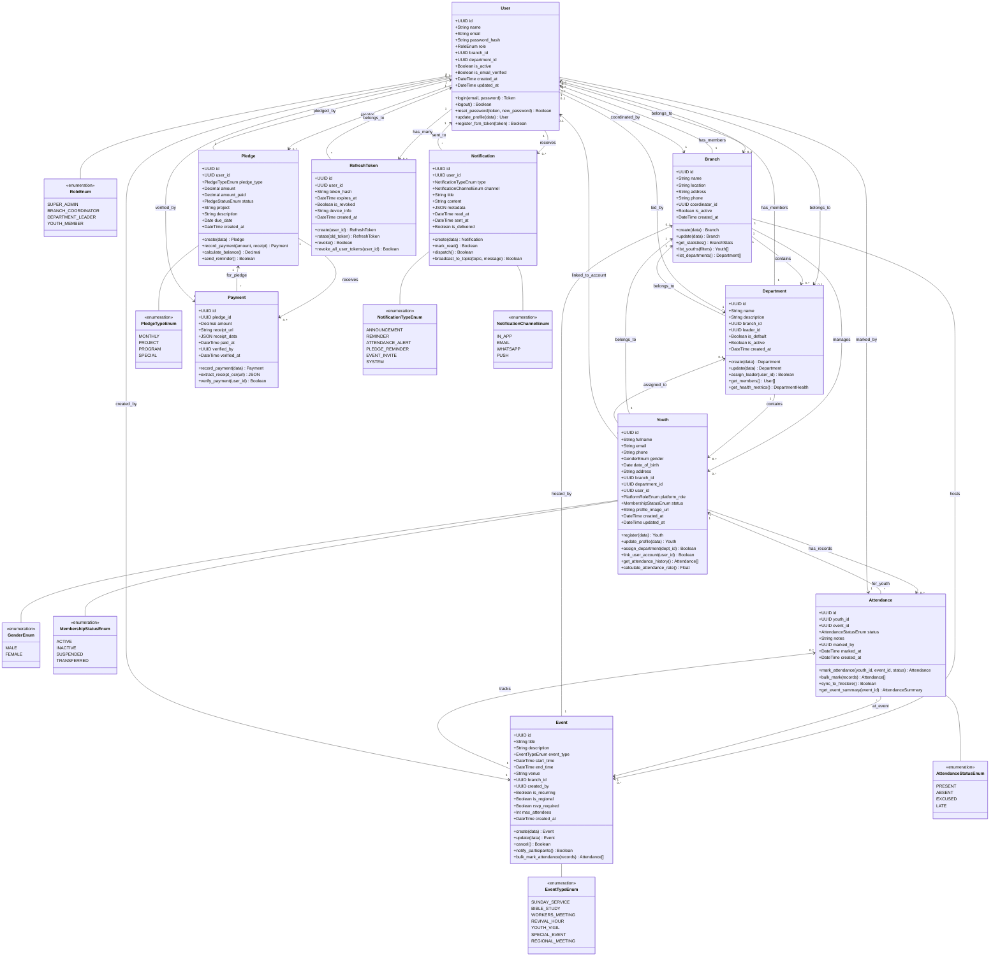
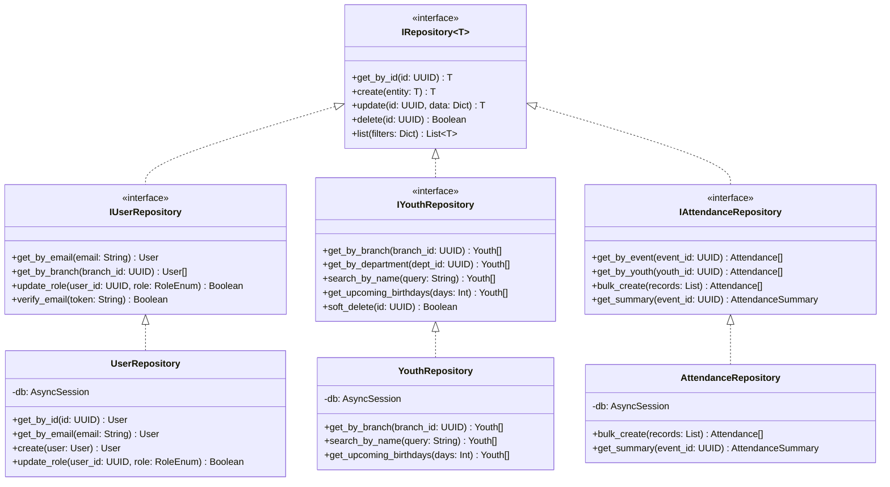
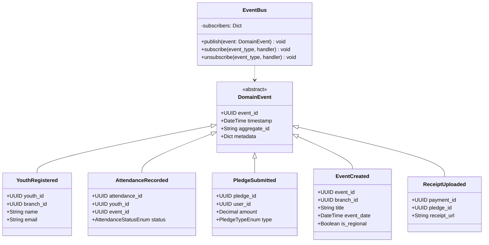
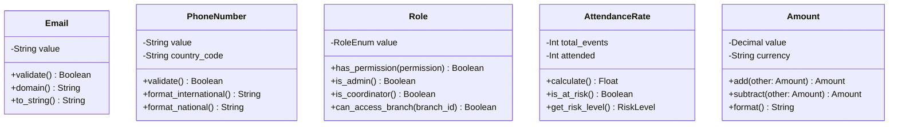
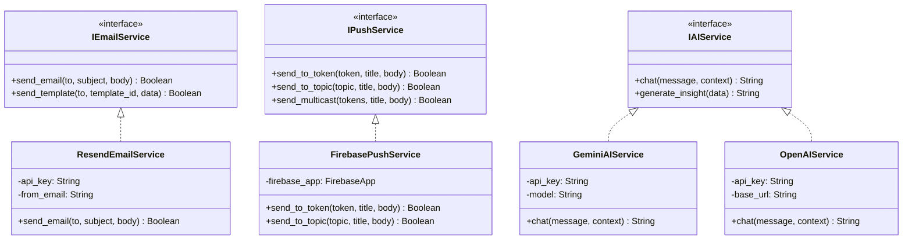

# Class Diagram - Object-Oriented Analysis & Design (OOAD)

## Abundance Zone Youth Management Platform v2.0

**Diagram Type:** UML Structural Diagram
**Purpose:** Show all domain entities, their properties, methods, and relationships
**Notation:** UML 2.5 Class Diagram

---

## 1. Complete Domain Model Class Diagram



---

## 2. Repository Pattern Interfaces



---

## 3. Service Layer Pattern

```mermaid
classDiagram
    class AuthService {
        -user_repo: IUserRepository
        -jwt_handler: JWTHandler
        -email_service: EmailService
        +login(email, password) LoginResponse
        +register(data) User
        +refresh_token(refresh_token) TokenPair
        +logout(refresh_token) Boolean
        +forgot_password(email) Boolean
        +reset_password(token, new_password) Boolean
        +firebase_signin(firebase_token) LoginResponse
    }

    class YouthService {
        -youth_repo: IYouthRepository
        -storage_service: StorageService
        -event_bus: EventBus
        +create_youth(data) Youth
        +list_youths(filters) Tuple~Youth[], Int~
        +update_youth(id, data) Youth
        +remove_youth(id) Boolean
        +upload_profile_image(id, file) String
        +get_upcoming_birthdays(days) Youth[]
    }

    class AttendanceService {
        -attendance_repo: IAttendanceRepository
        -firestore_service: FirestoreService
        -event_bus: EventBus
        +mark_attendance(youth_id, event_id, status) Attendance
        +bulk_mark_attendance(event_id, records) Attendance[]
        +get_event_attendance(event_id) Attendance[]
        +get_youth_history(youth_id) Attendance[]
        +predict_risk(youth_id, features) RiskPrediction
    }

    class FinanceService {
        -pledge_repo: IPledgeRepository
        -payment_repo: IPaymentRepository
        -ocr_service: ReceiptOCRService
        -notification_service: NotificationService
        +create_pledge(data) Pledge
        +record_payment(pledge_id, amount, receipt) Payment
        +extract_receipt_data(image_url) JSON
        +send_pledge_reminder(user_id) Boolean
        +get_financial_summary(branch_id) FinancialSummary
    }

    class NotificationService {
        -notification_repo: INotificationRepository
        -email_service: EmailService
        -push_service: PushService
        -whatsapp_service: WhatsAppService
        +create_notification(data) Notification
        +dispatch_notification(notification_id) Boolean
        +broadcast_to_branch(branch_id, message) Boolean
        +send_to_topic(topic, message) Boolean
        +mark_read(notification_id) Boolean
    }

    class AIService {
        -gemini_client: GeminiClient
        -openai_client: OpenAIClient
        -cache: RedisCache
        +chat_with_assistant(message, context) String
        +generate_analytics_insight(data) String
        +get_bible_guidance(query) BibleResponse
        +get_daily_verses() VerseResponse
        +extract_receipt_data(image_url) JSON
    }

    class AnalyticsService {
        -analytics_repo: IAnalyticsRepository
        -cache: RedisCache
        +get_branch_overview(branch_id) BranchStats
        +get_attendance_trend(branch_id, months) TrendData
        +get_global_overview() GlobalStats
        +generate_department_leaderboard() LeaderboardData
    }

    AuthService ..> IUserRepository
    YouthService ..> IYouthRepository
    AttendanceService ..> IAttendanceRepository
    FinanceService ..> IPledgeRepository
    NotificationService ..> INotificationRepository
```



---

## 4. Domain Events (Event-Driven Architecture)



---

## 5. Value Objects



---

## 6. External Service Adapters (Adapter Pattern)



---

## Key OOAD Principles Applied

### 1. **Encapsulation**

- All entity properties are private/protected
- Access through public methods only
- Business logic encapsulated in domain entities

### 2. **Inheritance**

- Repository pattern: specific repos inherit from IRepository~T~
- Domain events inherit from abstract DomainEvent
- Service classes inherit common service behaviors

### 3. **Polymorphism**

- Multiple AI service implementations (Gemini, OpenAI) via IAIService interface
- Repository pattern allows swapping database implementations
- Notification channels (Email, Push, WhatsApp) implement common interface

### 4. **Abstraction**

- Repository interfaces abstract data access
- Service layer abstracts business logic from presentation
- Domain layer has no dependencies on infrastructure

### 5. **Loose Coupling**

- Services depend on interfaces, not concrete implementations
- Domain events decouple modules (EventBus pattern)
- Adapter pattern decouples external services

### 6. **High Cohesion**

- Each class has single responsibility
- Related methods grouped in same class
- Domain entities contain their own business rules

---

## Object Instantiation Examples

```python
# Creating instances (objects) from classes

# User instance
admin_user = User(
    id=uuid4(),
    name="Regional Leader",
    email="admin@abundancezone.org",
    role=RoleEnum.SUPER_ADMIN,
    branch_id=None  # Super admin has no branch restriction
)

# Youth instance
youth_member = Youth(
    id=uuid4(),
    fullname="Emmanuel Oladipo",
    email="emmanuel@email.com",
    gender=GenderEnum.MALE,
    date_of_birth=date(2000, 5, 15),
    branch_id=lagos_branch.id,
    department_id=choir_dept.id,
    status=MembershipStatusEnum.ACTIVE
)

# Attendance instance
attendance_record = Attendance(
    id=uuid4(),
    youth_id=youth_member.id,
    event_id=sunday_service.id,
    status=AttendanceStatusEnum.PRESENT,
    marked_by=admin_user.id,
    marked_at=datetime.now()
)

# Service usage
youth_service = YouthService(
    youth_repo=YouthRepository(db),
    storage_service=StorageService(),
    event_bus=EventBus()
)

created_youth = await youth_service.create_youth(youth_data)
```

---

**Document Purpose:** This class diagram serves as the blueprint for the entire system's object-oriented design, showing how all domain entities, services, repositories, and value objects relate to each other.

**For Kiro:** Use this diagram to understand:

- What classes exist in the system
- What properties and methods each class has
- How classes relate to each other (composition, aggregation, inheritance)
- How to instantiate objects and call their methods

**Reference:** Phase 03 Database Schema + Phase 08 Backend Architecture
