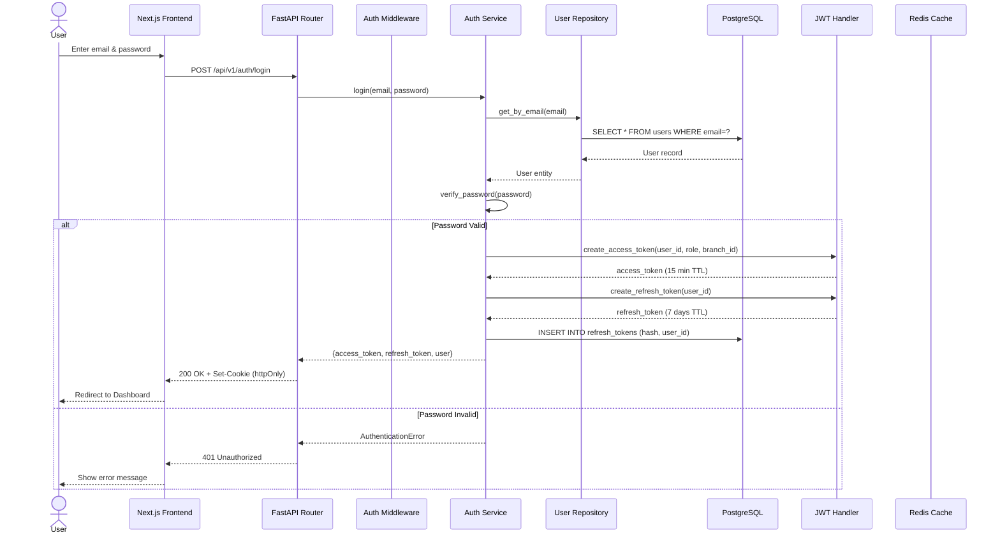
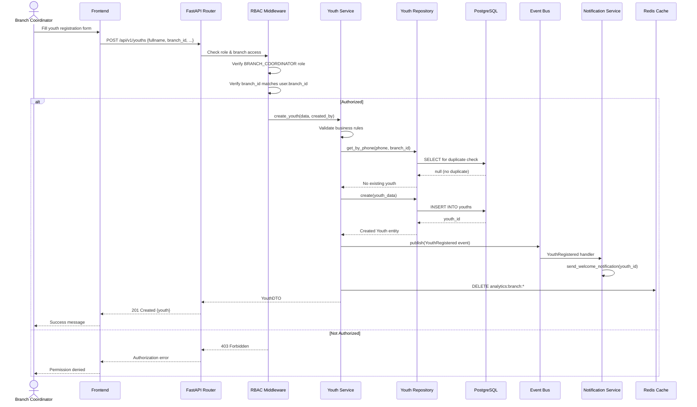
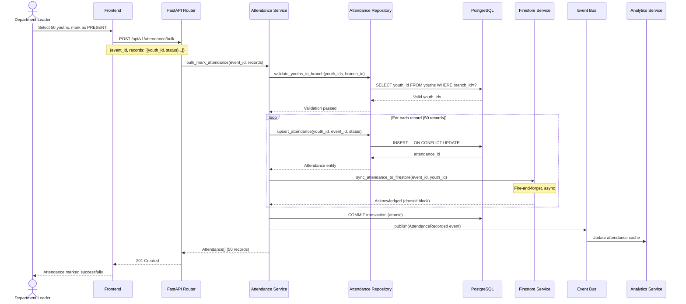
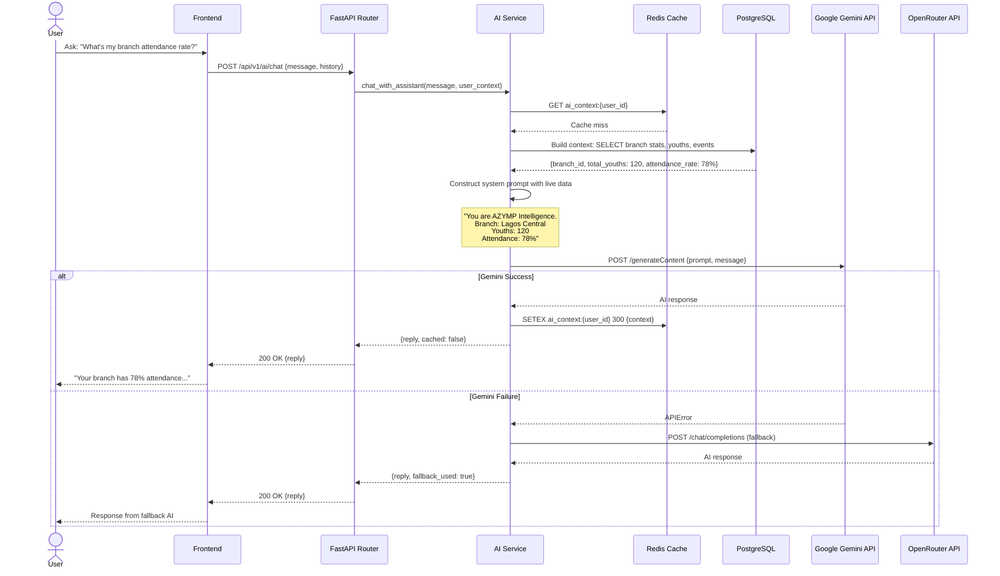
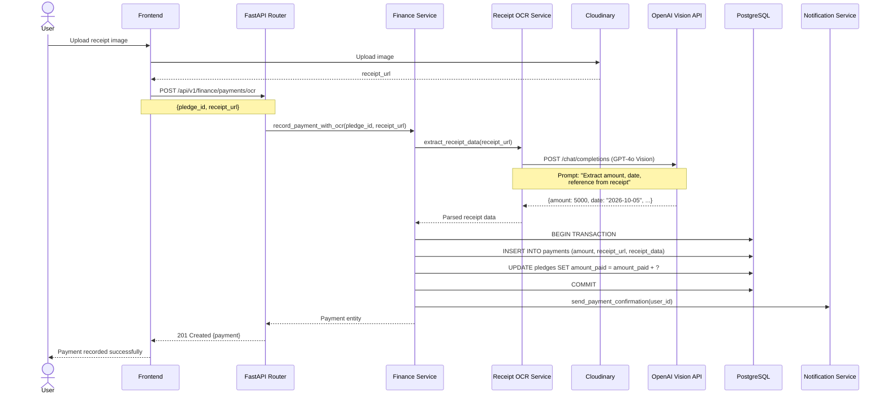
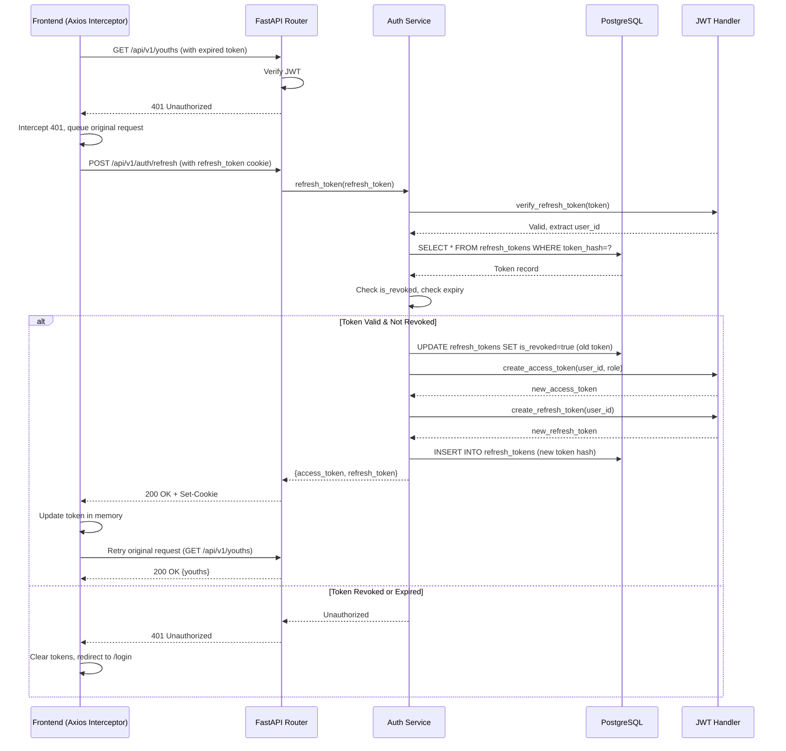
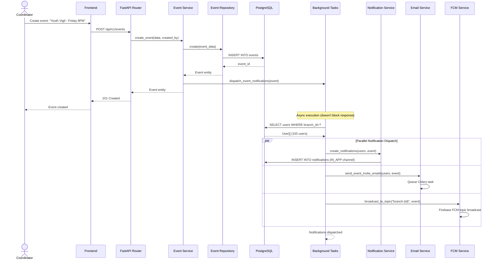
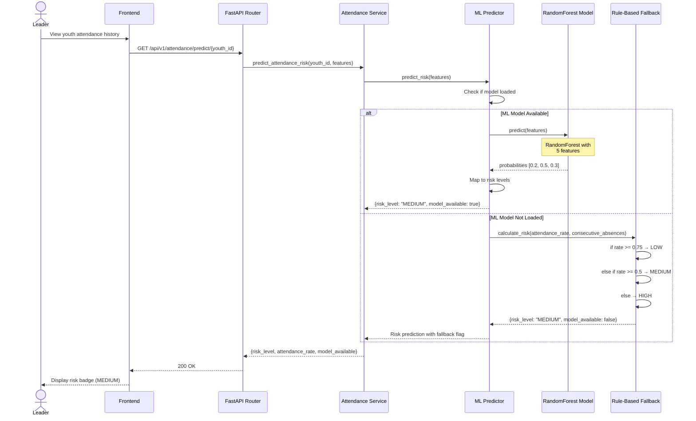

# Sequence Diagrams - Behavioral UML

## Abundance Zone Youth Management Platform v2.0

**Diagram Type:** UML Behavioral Diagram (Interaction Diagram)
**Purpose:** Show how objects interact over time for key use cases
**Notation:** UML 2.5 Sequence Diagram

---

## 1. User Authentication Flow (JWT + Firebase SSO)

---

## 2. Youth Registration Flow (with Domain Events)

---

## 3. Bulk Attendance Marking Flow

---

## 4. AI Chat with Context Injection

---

## 5. Payment with Receipt OCR Flow

---

## 6. Token Refresh Flow (Silent Refresh)

---

## 7. Event Creation with Notifications

---

## 8. Attendance Risk Prediction Flow

---

## Key Behavioral Patterns Demonstrated

### 1. **Synchronous Communication**

- Request-Response pattern (HTTP REST)
- Direct method calls between objects

### 2. **Asynchronous Communication**

- Background tasks (FastAPI BackgroundTasks)
- Event Bus (publish-subscribe pattern)
- Fire-and-forget Firestore sync

### 3. **Error Handling**

- Try-catch with fallbacks (AI services)
- Graceful degradation (Firestore optional)
- Token refresh on 401

### 4. **Transaction Management**

- Database transactions (BEGIN/COMMIT)
- Atomic bulk operations
- Rollback on errors

### 5. **Caching Strategy**

- Check cache first, then database
- Write-through cache invalidation
- TTL-based expiry

### 6. **Authentication & Authorization**

- JWT token validation
- Role-based access control (RBAC)
- Branch isolation checks

---

## Time Complexity Analysis

| Sequence                      | Average Time | Notes                               |
| ----------------------------- | ------------ | ----------------------------------- |
| Login                         | 200-400ms    | Database query + JWT generation     |
| Youth Registration            | 100-200ms    | Single INSERT + event dispatch      |
| Bulk Attendance (500 records) | 2-5 seconds  | Sequential inserts + Firestore sync |
| AI Chat (first request)       | 3-8 seconds  | Context building + LLM API call     |
| AI Chat (cached)              | 50-100ms     | Redis cache hit                     |
| Token Refresh                 | 100-150ms    | Token rotation + database update    |
| Event Creation                | 150-300ms    | INSERT + background task dispatch   |
| Risk Prediction (ML)          | 50-100ms     | Model inference                     |

---

**Document Purpose:** These sequence diagrams show the dynamic behavior of the system - how objects interact over time to accomplish specific use cases.

**For Kiro:** Use these diagrams to understand:

- The exact order of method calls for each feature
- Which objects communicate with each other
- Where errors can occur and how they're handled
- Async vs sync operations
- Performance bottlenecks

**Reference:** Phase 05 Auth Flow + Phase 06 Core Modules
