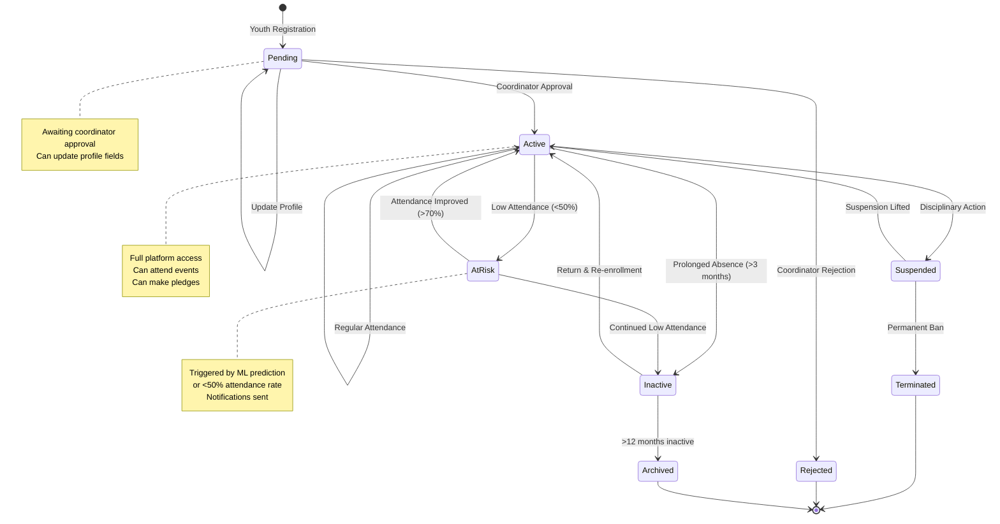
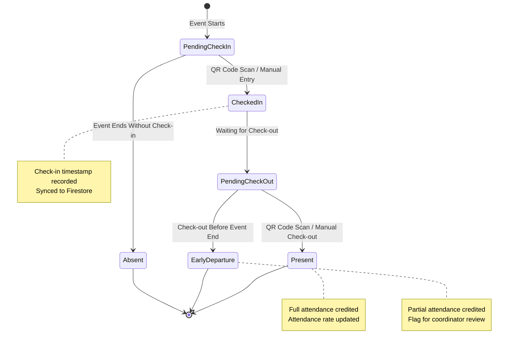
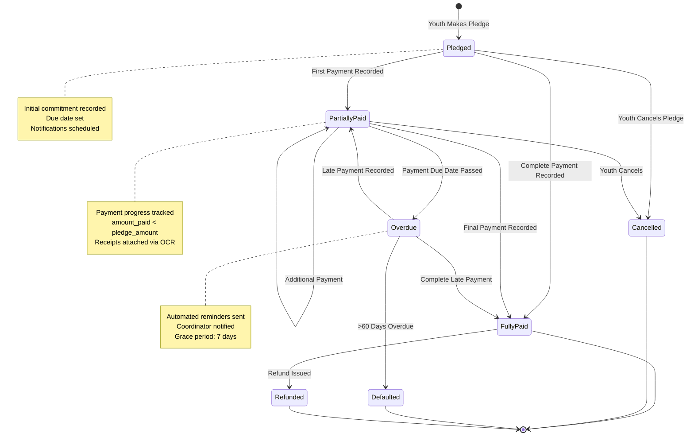
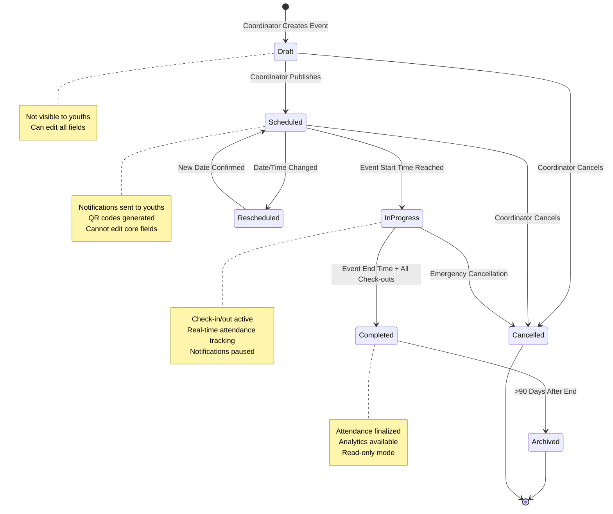
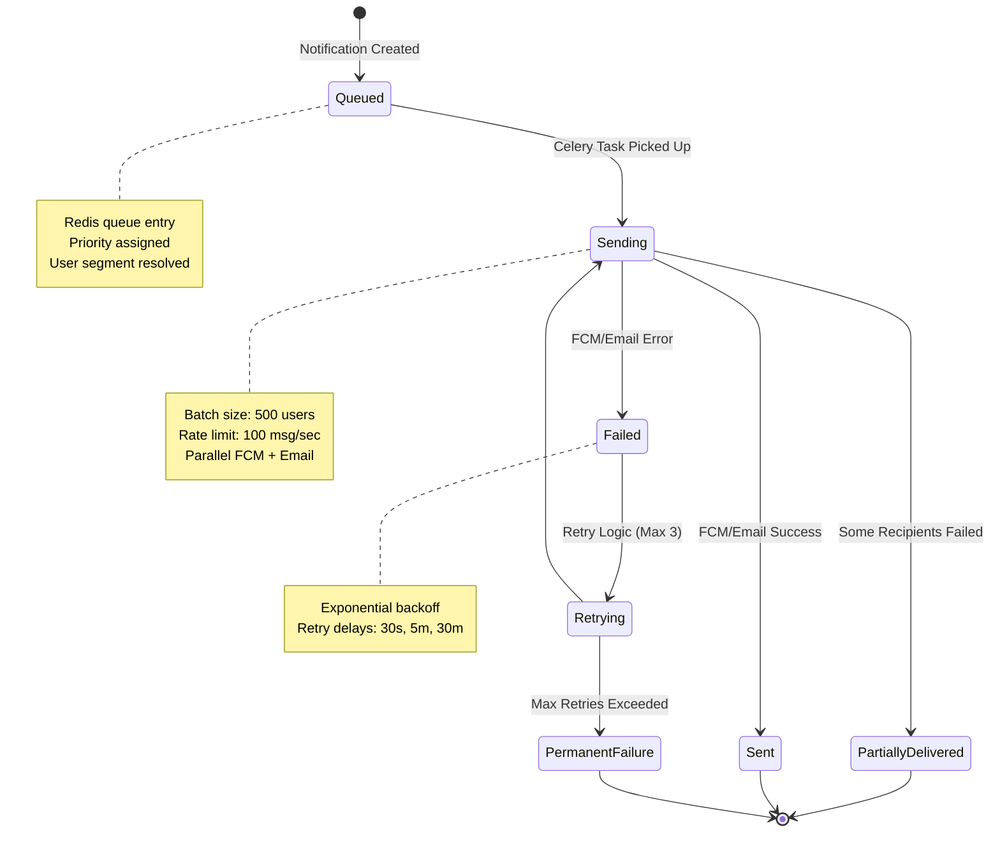
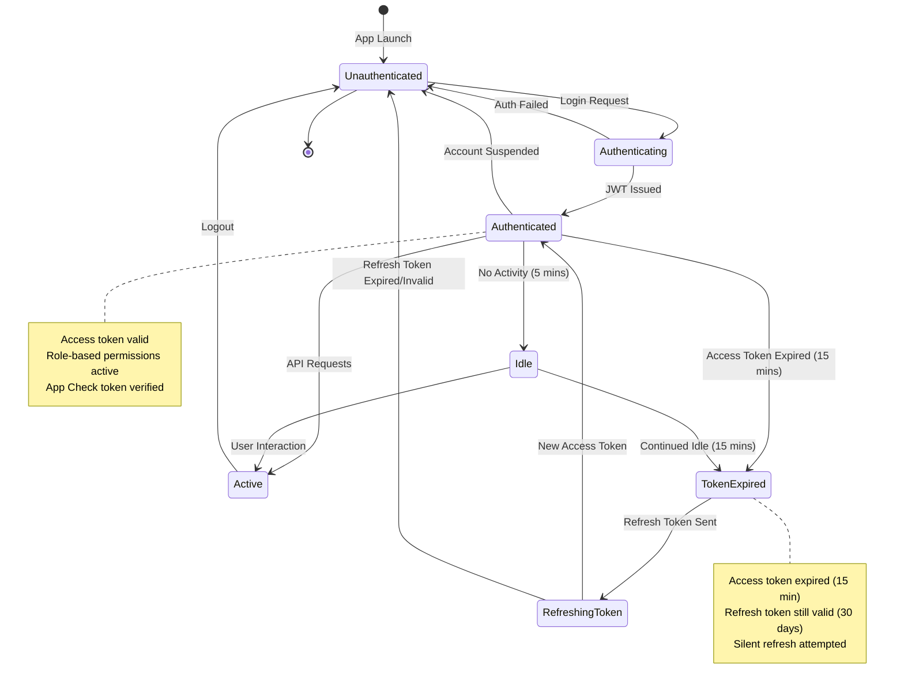

# 03 - State Diagrams

State diagrams show the lifecycle and state transitions of key domain entities in the Abundance Zone Platform v2.0.

---

## 1. Youth Membership Lifecycle State Diagram



**State Descriptions:**

| State | Description | Triggers | Exit Conditions |
|-------|-------------|----------|-----------------|
| **Pending** | Initial registration awaiting approval | Youth submits registration form | Coordinator approves/rejects |
| **Active** | Full membership with platform access | Approval or suspension lifted | Suspension, prolonged absence, at-risk detection |
| **AtRisk** | Low engagement warning state | Attendance <50% or ML prediction | Attendance improves or continues declining |
| **Suspended** | Temporary disciplinary suspension | Coordinator action for policy violation | Suspension period ends or permanent ban |
| **Inactive** | No activity for extended period | No attendance for >3 months | Re-enrollment or archival |
| **Archived** | Historical record only | Inactive for >12 months | Final state |
| **Rejected** | Registration denied | Coordinator rejection | Final state |
| **Terminated** | Permanent ban from platform | Severe policy violation | Final state |

---

## 2. Attendance Record State Diagram



**State Transitions:**

- **PendingCheckIn → CheckedIn**: Youth scans QR code or coordinator marks present
- **CheckedIn → Present**: Youth completes full event duration and checks out
- **CheckedIn → EarlyDeparture**: Youth leaves before event end time
- **PendingCheckIn → Absent**: Event ends without check-in record

**Business Rules:**
- Early departure flagged if checkout time < (event_end_time - 30 minutes)
- Bulk operations can skip PendingCheckIn for manual marking
- Firestore sync occurs immediately on state change
- Attendance rate recalculated on every Present/Absent/EarlyDeparture final state

---

## 3. Pledge Payment State Diagram



**Payment State Logic:**

```python
def calculate_pledge_state(pledge: Pledge, payments: list[Payment]) -> PledgeState:
    total_paid = sum(p.amount for p in payments if p.status == "VERIFIED")
    
    if total_paid == 0:
        if datetime.now() > pledge.due_date + timedelta(days=60):
            return PledgeState.DEFAULTED
        elif datetime.now() > pledge.due_date:
            return PledgeState.OVERDUE
        return PledgeState.PLEDGED
    
    elif total_paid < pledge.amount:
        if datetime.now() > pledge.due_date:
            return PledgeState.OVERDUE
        return PledgeState.PARTIALLY_PAID
    
    elif total_paid >= pledge.amount:
        if any(p.is_refunded for p in payments):
            return PledgeState.REFUNDED
        return PledgeState.FULLY_PAID
```

---

## 4. Event Lifecycle State Diagram



**Automatic State Transitions (Celery Beat Tasks):**

| Transition | Trigger | Frequency | Action |
|------------|---------|-----------|--------|
| Scheduled → InProgress | `datetime.now() >= event.start_time` | Every 5 minutes | Enable QR code scanning |
| InProgress → Completed | `datetime.now() >= event.end_time + 1 hour` | Every 15 minutes | Finalize attendance, send summary notifications |
| Completed → Archived | `datetime.now() >= event.end_time + 90 days` | Daily at 2 AM | Archive event data, compress analytics |

---

## 5. Notification State Diagram



**Notification Priority Levels:**

- **CRITICAL**: Security alerts, payment confirmations (immediate delivery)
- **HIGH**: Event reminders, attendance alerts (5-minute delay)
- **NORMAL**: General announcements, birthday wishes (hourly batch)
- **LOW**: Analytics reports, monthly summaries (daily batch)

---

## 6. User Session State Diagram



**Token Lifetimes:**
- **Access Token**: 15 minutes
- **Refresh Token**: 30 days (rotated on use)
- **Firebase App Check Token**: 1 hour (auto-renewed)

---

## State Diagram Summary

### Key Insights

1. **Youth Membership**: 8 distinct states with automated risk detection
2. **Attendance**: 5 states supporting partial attendance and bulk operations
3. **Pledge Payments**: 7 states with overdue handling and OCR integration
4. **Events**: 6 states with automatic time-based transitions
5. **Notifications**: 6 states with retry logic and priority queues
6. **User Sessions**: 7 states with token refresh and security checks

### State Management Implementation

**Domain Events Triggered on State Changes:**
- `YouthStatusChanged(youth_id, old_state, new_state, reason)`
- `AttendanceStatusChanged(attendance_id, event_id, youth_id, status)`
- `PledgeStatusChanged(pledge_id, youth_id, old_state, new_state, amount_paid)`
- `EventStatusChanged(event_id, old_state, new_state, timestamp)`
- `NotificationStatusChanged(notification_id, status, recipients_count, failed_count)`

**State Persistence:**
- All states stored in PostgreSQL (Neon) with audit trail
- State transitions logged in `audit_logs` table
- Firestore mirrors attendance and event states for mobile app
- Redis caches current states for high-frequency reads

---

*Reference: Based on v1.0 backend state machines in `app/models/` and service layer logic*
