# 04 - Component Diagram

Component diagrams show the modular architecture, dependencies, and Clean Architecture layers of the Abundance Zone Platform v2.0.

---

## 1. High-Level Component Architecture

```mermaid
graph TB
    subgraph "Presentation Layer"
        NextJS[Next.js 14 Frontend]
        MobileApp[React Native Mobile App]
    end
    
    subgraph "API Gateway Layer"
        FastAPI[FastAPI Application]
        Middleware[Security Middleware]
        RateLimiter[Rate Limiter]
    end
    
    subgraph "Application Layer - 11 Feature Modules"
        AuthModule[Auth Module]
        YouthModule[Youth Module]
        EventModule[Event Module]
        AttendanceModule[Attendance Module]
        PledgeModule[Pledge Module]
        PaymentModule[Payment Module]
        NotificationModule[Notification Module]
        BranchModule[Branch Module]
        DeptModule[Department Module]
        AnalyticsModule[Analytics Module]
        AIModule[AI/ML Module]
    end
    
    subgraph "Domain Layer"
        DomainModels[Domain Models]
        DomainEvents[Domain Events]
        ValueObjects[Value Objects]
        DomainServices[Domain Services]
    end
    
    subgraph "Infrastructure Layer"
        PostgreSQL[(PostgreSQL/Neon)]
        Redis[(Redis Cache)]
        Firestore[(Firestore)]
        Celery[Celery Workers]
        FCM[Firebase Cloud Messaging]
        EmailService[Email Service]
    end
    
    subgraph "External Services"
        Firebase[Firebase Auth]
        GeminiAI[Google Gemini AI]
        OpenRouter[OpenRouter API]
        OpenAI[OpenAI GPT-4o]
        CloudStorage[Cloud Storage]
    end
    
    NextJS -->|REST API| FastAPI
    MobileApp -->|REST API| FastAPI
    
    FastAPI --> Middleware
    Middleware --> RateLimiter
    RateLimiter --> AuthModule
    RateLimiter --> YouthModule
    RateLimiter --> EventModule
    RateLimiter --> AttendanceModule
    RateLimiter --> PledgeModule
    RateLimiter --> PaymentModule
    RateLimiter --> NotificationModule
    RateLimiter --> BranchModule
    RateLimiter --> DeptModule
    RateLimiter --> AnalyticsModule
    RateLimiter --> AIModule
    
    AuthModule --> DomainModels
    YouthModule --> DomainModels
    EventModule --> DomainModels
    AttendanceModule --> DomainModels
    PledgeModule --> DomainModels
    PaymentModule --> DomainModels
    
    DomainModels --> DomainEvents
    DomainModels --> ValueObjects
    DomainServices --> DomainModels
    
    AuthModule --> PostgreSQL
    YouthModule --> PostgreSQL
    EventModule --> PostgreSQL
    AttendanceModule --> PostgreSQL
    PledgeModule --> PostgreSQL
    PaymentModule --> PostgreSQL
    
    AuthModule --> Redis
    AttendanceModule --> Firestore
    EventModule --> Firestore
    
    NotificationModule --> Celery
    Celery --> FCM
    Celery --> EmailService
    
    AuthModule --> Firebase
    AIModule --> GeminiAI
    AIModule --> OpenRouter
    PaymentModule --> OpenAI
    YouthModule --> CloudStorage
```

---

## 2. Clean Architecture Layers - Detailed Component View

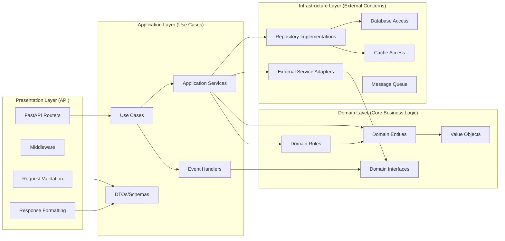

**Dependency Rule:** 
- Domain Layer has ZERO dependencies (pure business logic)
- Application Layer depends ONLY on Domain
- Infrastructure implements Domain interfaces
- Presentation depends on Application, never Infrastructure directly

---

## 3. 11 Feature Modules - Component Breakdown

### Module 1: Auth Module

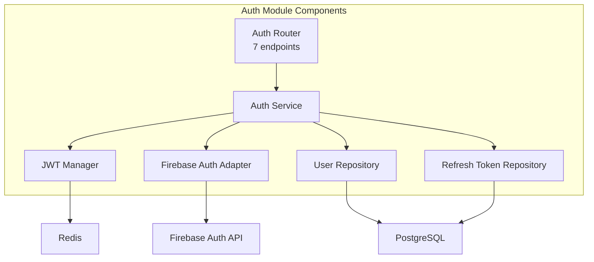

**Endpoints:** Login, Logout, Refresh Token, Verify Token, Password Reset, Register, Profile

---

### Module 2: Youth Module

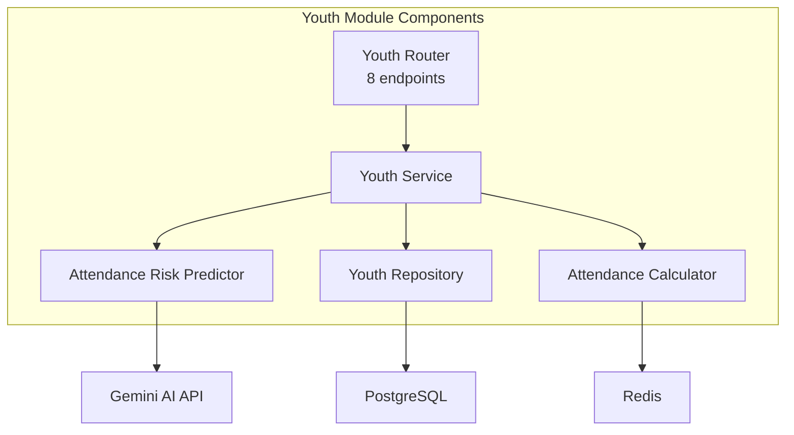

**Endpoints:** Create Youth, Get Youth, Update Youth, Delete Youth, List Youths, Get Youth Stats, Predict Risk, Bulk Import

---

### Module 3: Event Module

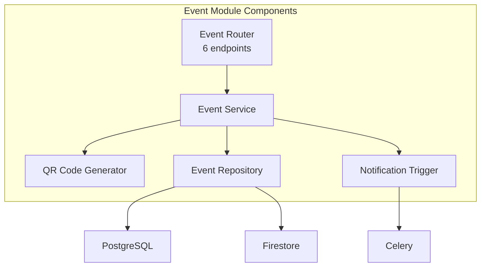

**Endpoints:** Create Event, Update Event, Delete Event, Get Event, List Events, Generate QR

---

### Module 4: Attendance Module

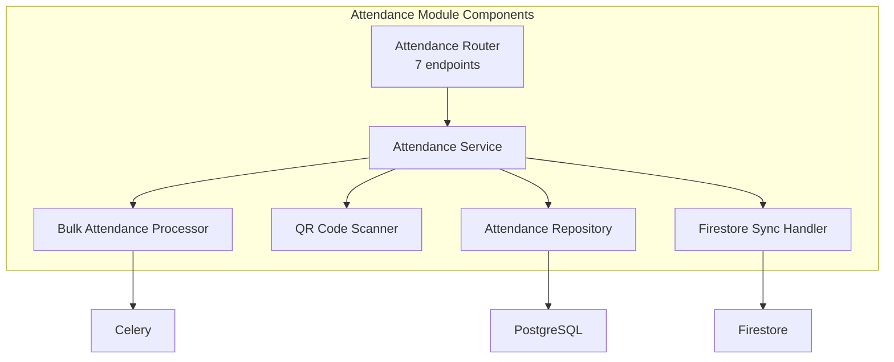

**Endpoints:** Mark Attendance, Bulk Mark, Get Attendance, List Attendance, Get Stats, Check-in, Check-out

---

### Module 5: Pledge Module

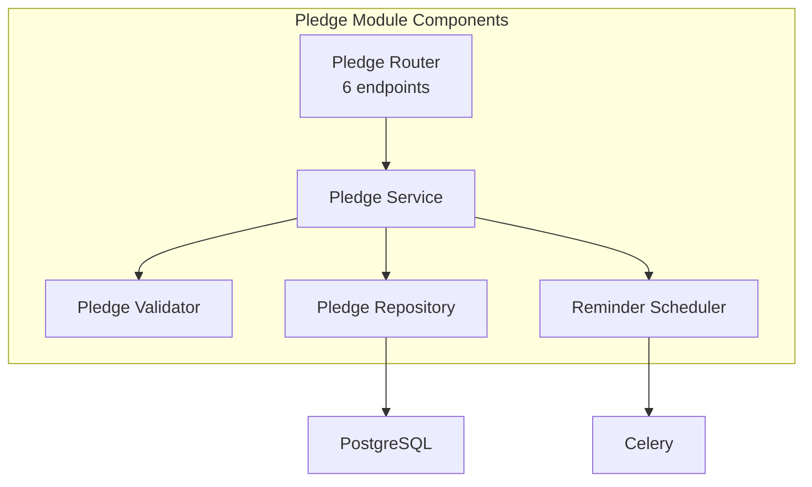

**Endpoints:** Create Pledge, Update Pledge, Delete Pledge, Get Pledge, List Pledges, Get Stats

---

### Module 6: Payment Module

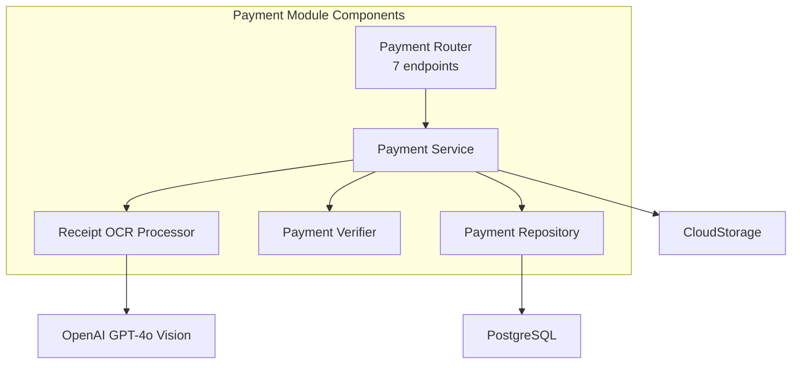

**Endpoints:** Record Payment, Upload Receipt, Verify Payment, Get Payment, List Payments, Get Stats, Refund

---

### Module 7: Notification Module

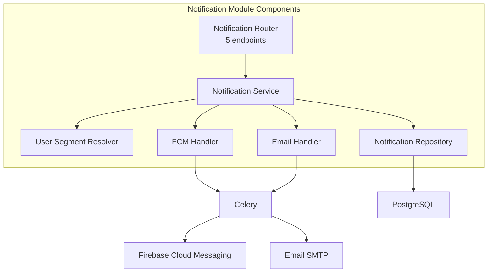

**Endpoints:** Send Notification, Send Bulk, Get Notification, List Notifications, Get Stats

---

### Module 8: Branch Module

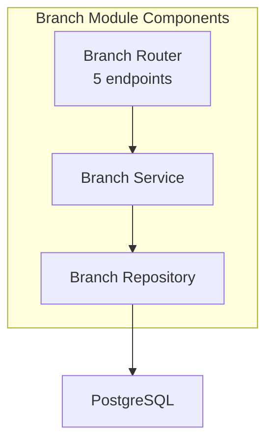

**Endpoints:** Create Branch, Update Branch, Delete Branch, Get Branch, List Branches

---

### Module 9: Department Module

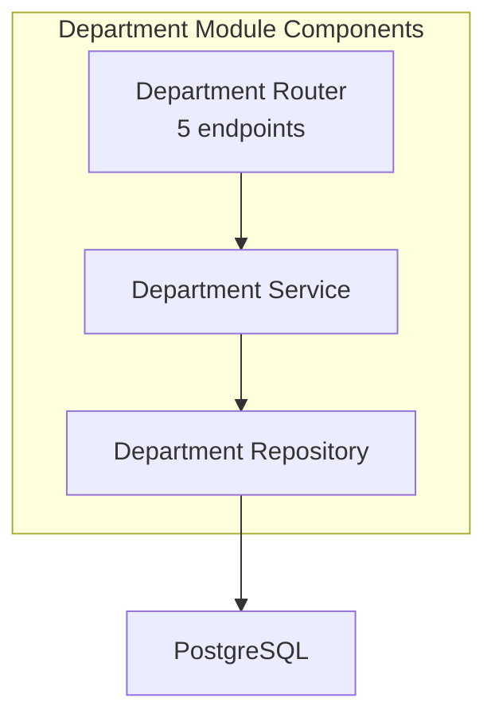

**Endpoints:** Create Department, Update Department, Delete Department, Get Department, List Departments

---

### Module 10: Analytics Module

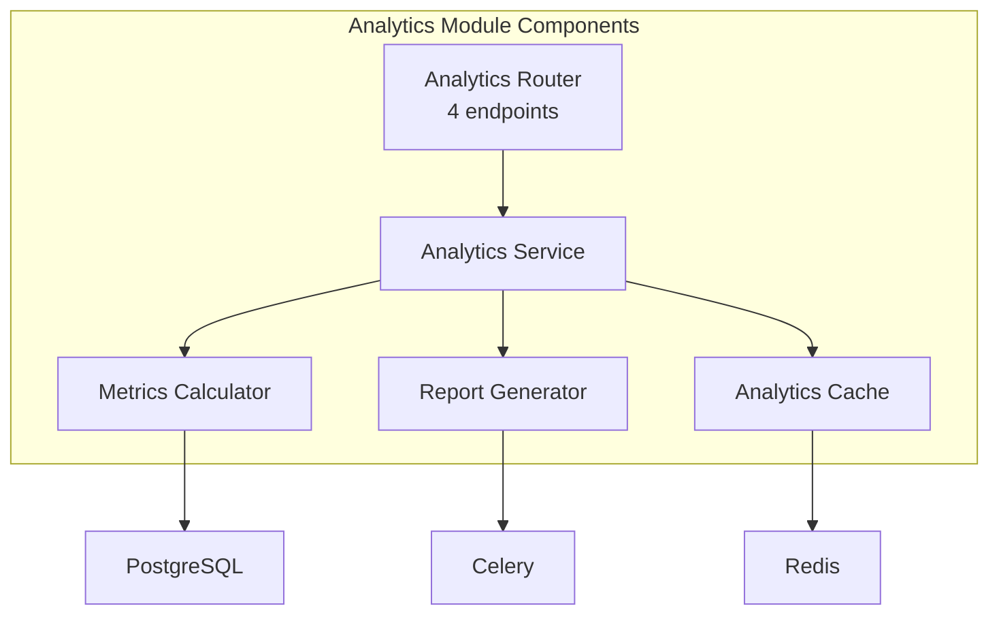

**Endpoints:** Get Dashboard Stats, Get Youth Analytics, Get Financial Analytics, Generate Report

---

### Module 11: AI/ML Module

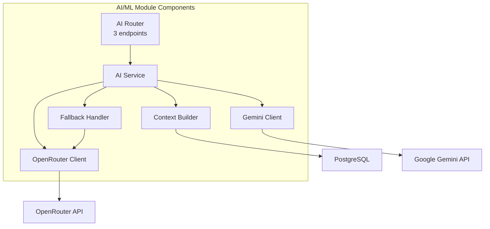

**Endpoints:** Chat with AI, Get AI Insights, Predict Attendance Risk

---

## 4. Cross-Cutting Concerns Components

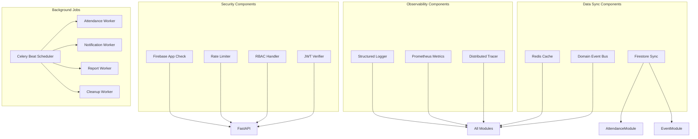

---

## 5. Module Dependency Graph

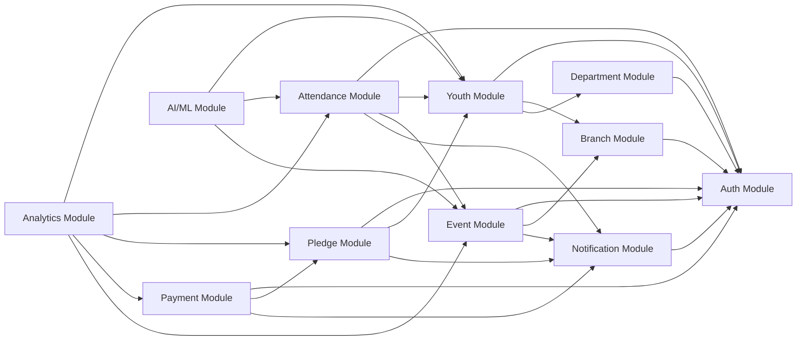

**Dependency Rules:**
- Auth module has zero internal dependencies (foundation layer)
- Branch and Department modules depend only on Auth
- Youth module depends on Auth, Branch, Department
- Event, Pledge modules depend on Auth and related entities
- Attendance module depends on Youth and Event
- Payment module depends on Pledge
- Analytics and AI modules depend on multiple data modules (read-only)
- Notification module is dependency-inverted (other modules trigger it via events)

---

## 6. API Gateway Component Details

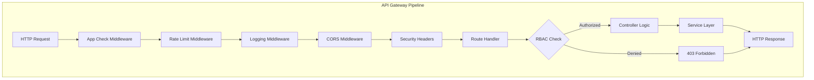

**Middleware Stack Order:**
1. **App Check Middleware**: Verifies Firebase App Check token
2. **Rate Limit Middleware**: Redis-based rate limiting (100 req/min per IP)
3. **Logging Middleware**: Structured logging with request ID
4. **CORS Middleware**: Cross-origin resource sharing headers
5. **Security Headers**: CSP, HSTS, X-Frame-Options
6. **Route Handler**: Matches endpoint and invokes controller
7. **RBAC Check**: Role-based authorization at controller level

---

## Component Summary

### Total Component Count
- **11 Feature Modules**: 63 total endpoints
- **4 Architectural Layers**: Domain, Application, Infrastructure, Presentation
- **6 Cross-Cutting Concerns**: Security, Observability, Data Sync, Background Jobs, Error Handling, Validation
- **8 External Service Integrations**: Firebase, Gemini AI, OpenRouter, OpenAI, FCM, Email, Neon PostgreSQL, Firestore

### Key Architectural Principles
1. **Clean Architecture**: Strict layer separation with dependency inversion
2. **Domain-Driven Design**: Rich domain models with business logic encapsulation
3. **Modular Monolith**: 11 independent feature modules, ready for microservices migration
4. **Event-Driven**: Domain events for cross-module communication
5. **Async Processing**: Celery for background jobs and notifications
6. **Multi-Database**: PostgreSQL (source of truth), Redis (cache), Firestore (mobile sync)

---

*Reference: Based on v1.0 backend architecture in `app/api/v1/` and Clean Architecture implementation*
