# 06 - Development Workflow

Complete Software Development Life Cycle (SDLC) flowchart for Abundance Zone Platform v2.0 following the v1.0 14-phase methodology.

---

## 1. Complete SDLC Flowchart (14 Phases)

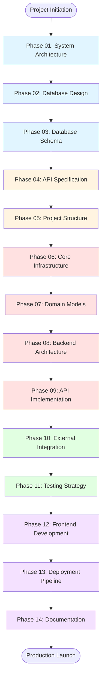

**Phase Color Legend:**
- 🔵 Blue: Planning & Design (Phases 1-3)
- 🟡 Yellow: Specification (Phases 4-5)
- 🔴 Red: Backend Core (Phases 6-9)
- 🟢 Green: Integration & Testing (Phases 10-11)
- 🟣 Purple: Frontend & Deployment (Phases 12-14)

---

## 2. Phase-by-Phase Detailed Workflow

### Phase 01: System Architecture Design

```mermaid
flowchart TD
    Start01([Start Phase 01]) --> Req[Gather Requirements]
    Req --> Arch[Design System Architecture]
    
    Arch --> CleanArch{Choose<br/>Architecture Pattern}
    CleanArch -->|Selected| CA[Clean Architecture +<br/>Domain-Driven Design]
    
    CA --> Layers[Define Layers]
    Layers --> L1[Domain Layer]
    Layers --> L2[Application Layer]
    Layers --> L3[Infrastructure Layer]
    Layers --> L4[Presentation Layer]
    
    L1 & L2 & L3 & L4 --> TechStack[Select Tech Stack]
    
    TechStack --> Backend[Backend: FastAPI + Python 3.12]
    TechStack --> Frontend[Frontend: Next.js 14]
    TechStack --> Database[Database: PostgreSQL 16]
    TechStack --> Cache[Cache: Redis 7]
    TechStack --> Mobile[Mobile Sync: Firestore]
    
    Backend & Frontend & Database & Cache & Mobile --> Doc01[Document Architecture]
    Doc01 --> Review01{Stakeholder<br/>Review}
    Review01 -->|Approved| End01([Complete Phase 01])
    Review01 -->|Revisions| Arch
    
    style CA fill:#90EE90
```

**Deliverables:**
- System Architecture Document (phase-01-system-architecture.md)
- Technology Stack Selection
- Layer Dependency Diagram
- Component Interaction Overview

---

### Phase 02: Database Design (ERD)

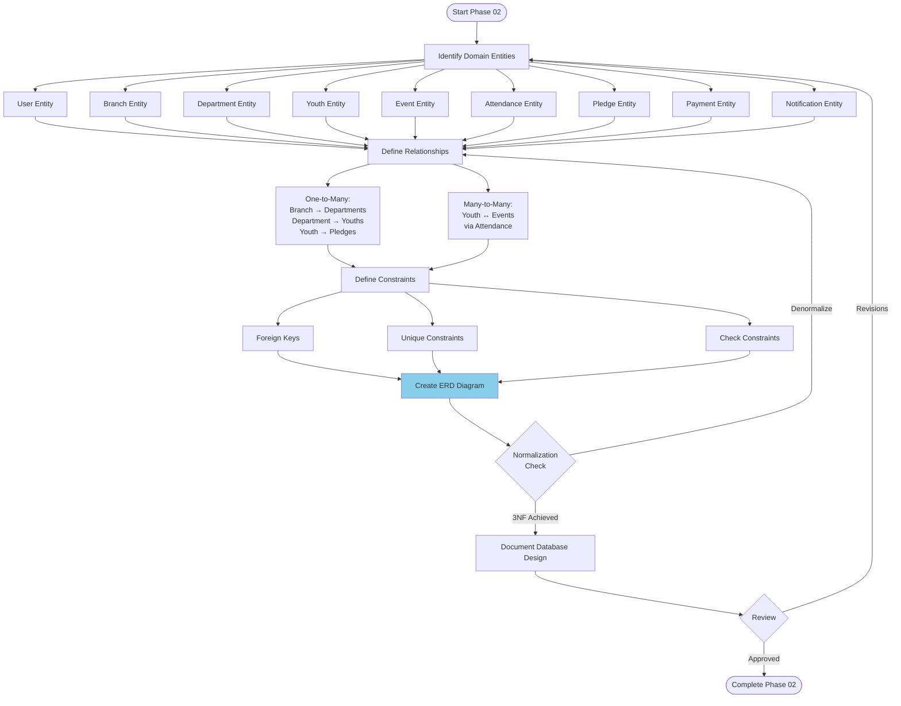

**Deliverables:**
- Entity-Relationship Diagram (phase-02-database-design.md)
- 14 Core Entities Defined
- Relationship Cardinality Documented
- Normalization Analysis (3NF)

---

### Phase 03: Database Schema Implementation

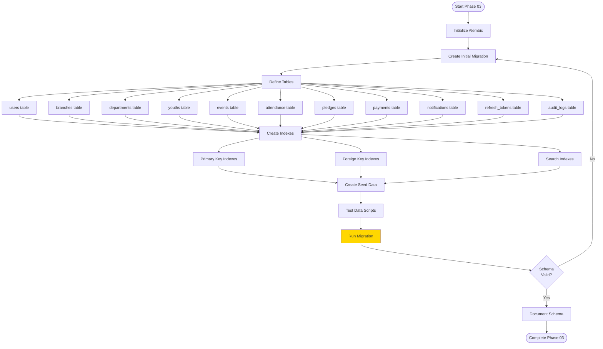

**Deliverables:**
- Alembic Migration Scripts (alembic/versions/)
- Database Schema SQL
- Seed Data Scripts
- Schema Documentation (phase-03-database-schema.md)

---

### Phase 04: API Specification (OpenAPI)

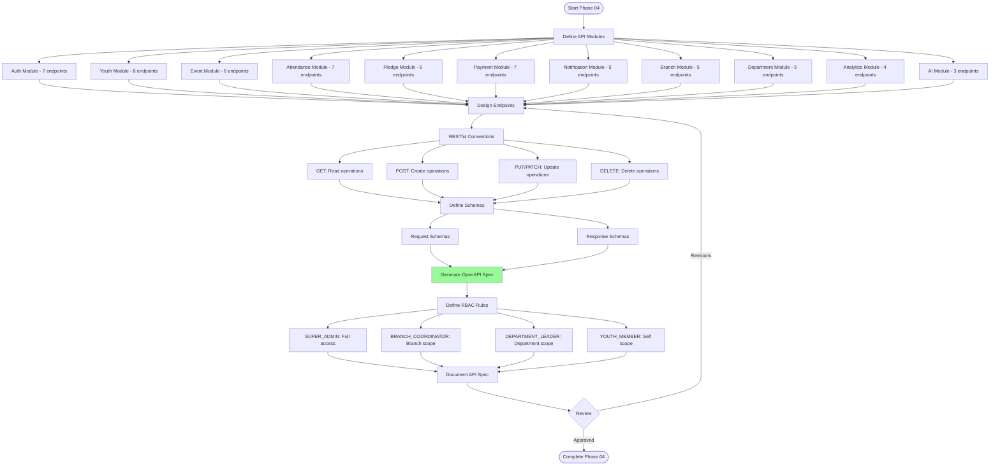

**Deliverables:**
- OpenAPI 3.0 Specification (openapi.yaml)
- 63 Total Endpoints Defined
- Request/Response Schemas
- RBAC Matrix Document (phase-04-api-specification.md)

---

### Phase 05: Project Structure Setup

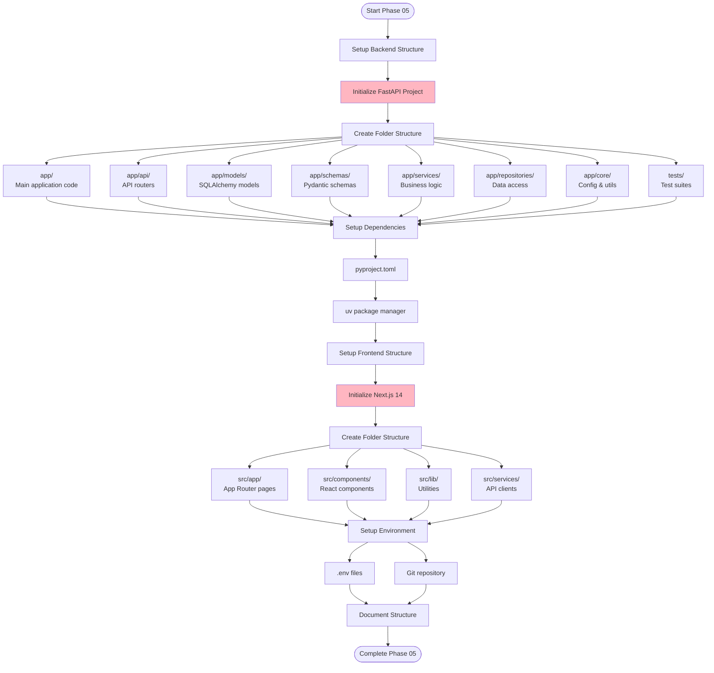

**Deliverables:**
- Backend Folder Structure (app/, tests/, alembic/)
- Frontend Folder Structure (src/app/, src/components/)
- pyproject.toml with dependencies
- package.json with dependencies
- .env.example files
- Git repository initialized (phase-05-project-structure.md)

---

### Phase 06: Core Infrastructure Setup

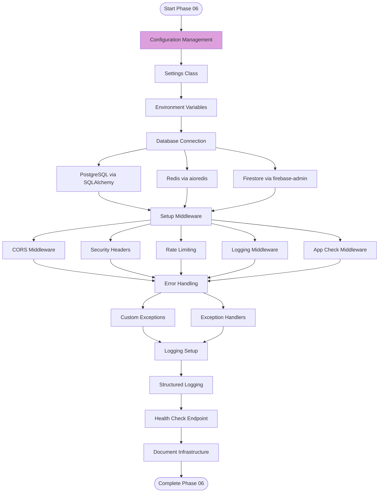

**Deliverables:**
- app/core/config.py (Settings class)
- app/core/database.py (DB connections)
- app/api/middleware/ (All middleware)
- app/core/exceptions.py (Custom exceptions)
- app/core/logging.py (Logging config)
- Health check endpoint (phase-06-core-infrastructure.md)

---

### Phase 07: Domain Models Implementation

```mermaid
flowchart TD
    Start07([Start Phase 07]) --> Models[Create SQLAlchemy Models]
    
    Models --> BaseModel[Base Model Class]
    BaseModel --> TimestampMixin[Timestamp Mixin]
    
    TimestampMixin --> EntityModels[Entity Models]
    EntityModels --> User[User Model]
    EntityModels --> Branch[Branch Model]
    EntityModels --> Department[Department Model]
    EntityModels --> Youth[Youth Model]
    EntityModels --> Event[Event Model]
    EntityModels --> Attendance[Attendance Model]
    EntityModels --> Pledge[Pledge Model]
    EntityModels --> Payment[Payment Model]
    
    User & Branch & Department & Youth & Event & Attendance & Pledge & Payment --> Relations[Define ORM Relations]
    
    Relations --> Relationships[relationship() definitions]
    Relations --> BackPopulates[back_populates attributes]
    
    Relationships & BackPopulates --> ValueObjects[Value Objects]
    ValueObjects --> Email[Email Value Object]
    ValueObjects --> PhoneNumber[PhoneNumber Value Object]
    ValueObjects --> Role[Role Enum]
    
    Email & PhoneNumber & Role --> DomainEvents[Domain Events]
    DomainEvents --> YouthRegistered[YouthRegistered Event]
    DomainEvents --> AttendanceRecorded[AttendanceRecorded Event]
    
    YouthRegistered & AttendanceRecorded --> Doc07[Document Domain Layer]
    Doc07 --> End07([Complete Phase 07])
    
    style BaseModel fill:#F0E68C
```

**Deliverables:**
- app/models/ (All SQLAlchemy models)
- app/domain/value_objects.py
- app/domain/events.py
- app/domain/enums.py
- Domain layer documentation (phase-07-domain-models.md)

---

### Phase 08: Backend Architecture Layer

```mermaid
flowchart TD
    Start08([Start Phase 08]) --> Repository[Repository Pattern]
    
    Repository --> BaseRepo[Base Repository]
    BaseRepo --> CRUD[CRUD Operations]
    
    CRUD --> Create[create()]
    CRUD --> Read[get(), list()]
    CRUD --> Update[update()]
    CRUD --> Delete[delete()]
    
    Create & Read & Update & Delete --> SpecificRepos[Specific Repositories]
    SpecificRepos --> UserRepo[UserRepository]
    SpecificRepos --> YouthRepo[YouthRepository]
    SpecificRepos --> EventRepo[EventRepository]
    
    UserRepo & YouthRepo & EventRepo --> ServiceLayer[Service Layer]
    
    ServiceLayer --> AuthService[AuthService]
    ServiceLayer --> YouthService[YouthService]
    ServiceLayer --> EventService[EventService]
    ServiceLayer --> AttendanceService[AttendanceService]
    
    AuthService & YouthService & EventService & AttendanceService --> DTOs[DTOs/Schemas]
    
    DTOs --> PydanticSchemas[Pydantic Schemas]
    PydanticSchemas --> RequestSchemas[Request Schemas]
    PydanticSchemas --> ResponseSchemas[Response Schemas]
    
    RequestSchemas & ResponseSchemas --> Validation[Validation Logic]
    Validation --> FieldValidators[Field Validators]
    
    FieldValidators --> Doc08[Document Architecture]
    Doc08 --> End08([Complete Phase 08])
    
    style ServiceLayer fill:#87CEFA
```

**Deliverables:**
- app/repositories/ (All repositories)
- app/services/ (All services)
- app/schemas/ (All Pydantic schemas)
- Repository pattern documentation (phase-08-backend-architecture.md)

---

### Phase 09: API Implementation (63 Endpoints)

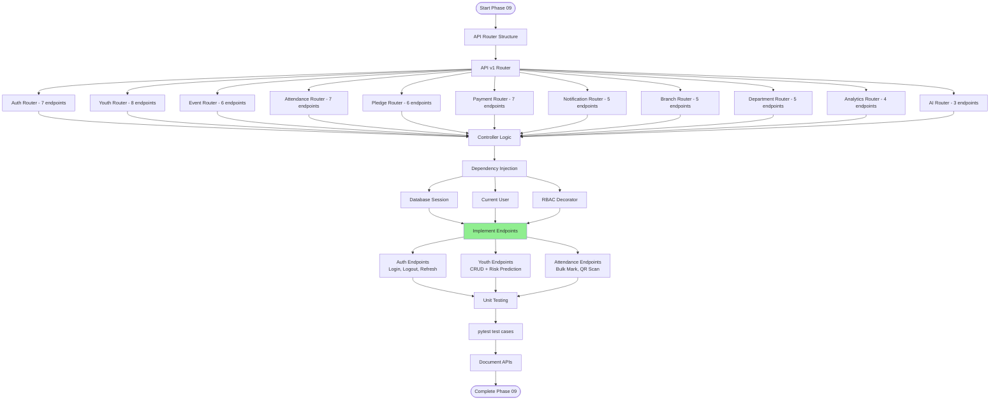

**Deliverables:**
- app/api/v1/ (All routers)
- app/api/deps.py (Dependencies)
- 63 endpoint implementations
- Unit tests for each endpoint
- API implementation documentation (phase-09-api-implementation.md)

---

### Phase 10: External Service Integration

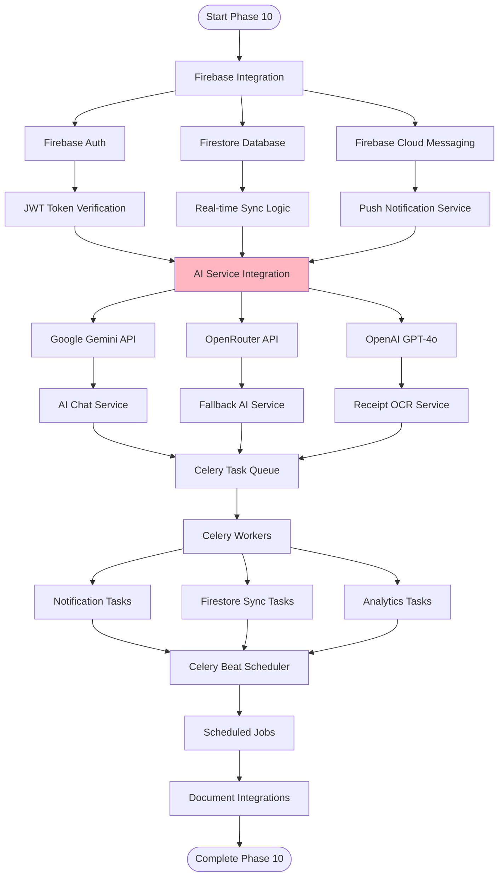

**Deliverables:**
- app/services/firebase/ (Firebase adapters)
- app/services/ai/ (AI service clients)
- app/tasks/ (Celery tasks)
- Celery configuration
- Integration documentation (phase-10-external-integration.md)

---

### Phase 11: Testing Strategy

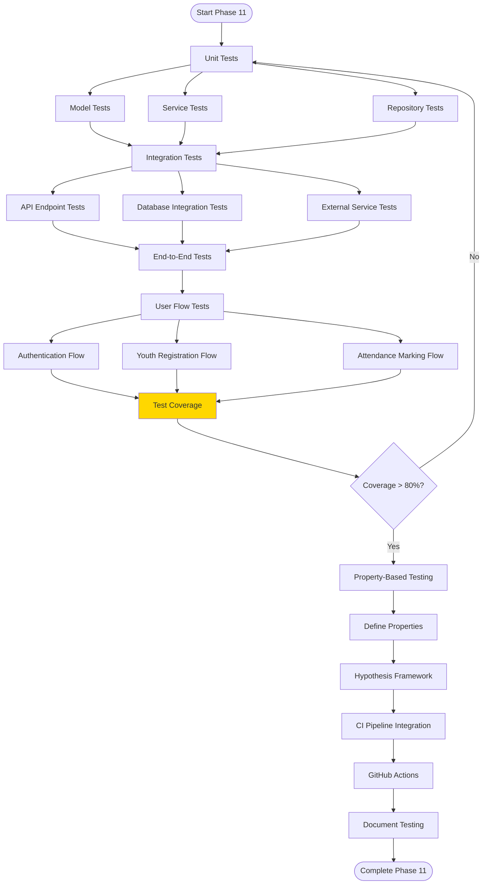

**Deliverables:**
- tests/unit/ (Unit tests)
- tests/integration/ (Integration tests)
- tests/e2e/ (End-to-end tests)
- pytest configuration
- Coverage reports (>80%)
- Testing documentation (phase-11-testing-strategy.md)

---

### Phase 12: Frontend Development

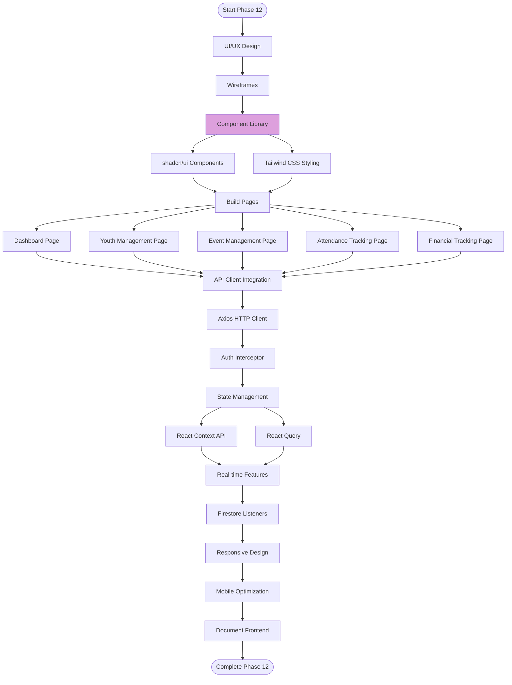

**Deliverables:**
- src/app/ (All Next.js pages)
- src/components/ (React components)
- src/lib/api.ts (API client)
- src/hooks/ (Custom React hooks)
- Responsive design implementation
- Frontend documentation (phase-12-frontend-development.md)

---

### Phase 13: Deployment Pipeline

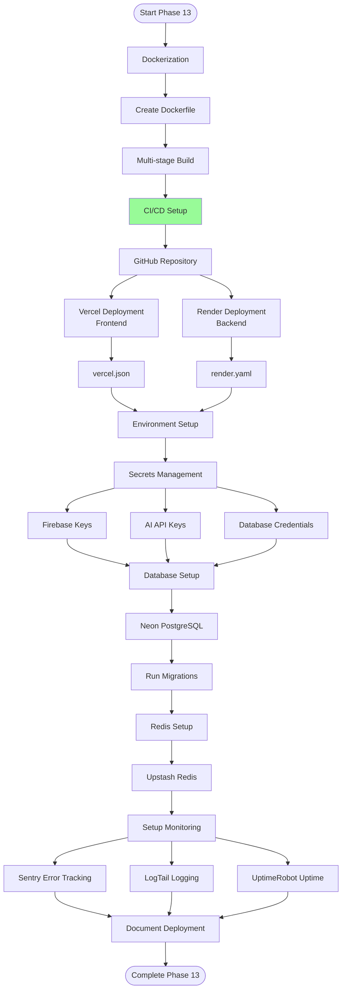

**Deliverables:**
- Dockerfile
- render.yaml (backend deployment)
- vercel.json (frontend deployment)
- CI/CD pipeline configuration
- Environment variable documentation
- Deployment runbook (phase-13-deployment-pipeline.md)

---

### Phase 14: Documentation & Launch

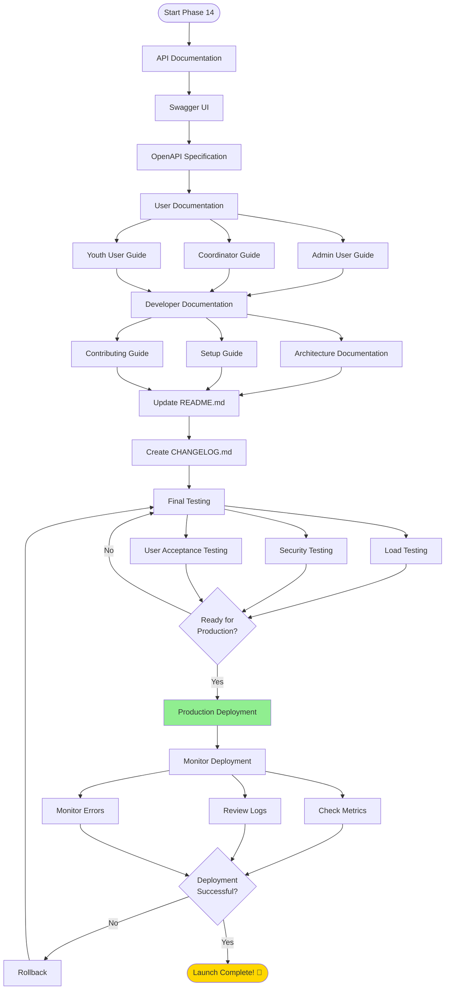

**Deliverables:**
- Complete API documentation (Swagger + README)
- User guides (Admin, Coordinator, Youth)
- Developer documentation
- README.md with setup instructions
- CHANGELOG.md
- Production deployment
- Monitoring dashboards (phase-14-documentation.md)

---

## 3. Git Workflow

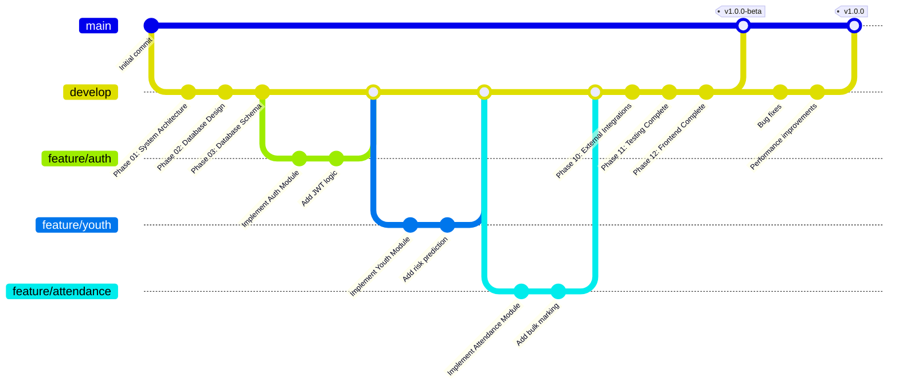

**Branch Strategy:**
- `main`: Production-ready code
- `develop`: Integration branch
- `feature/*`: Feature branches
- `bugfix/*`: Bug fix branches
- `hotfix/*`: Critical production fixes

---

## 4. Development Timeline (Estimated)

| Phase | Duration | Dependencies | Key Milestone |
|-------|----------|--------------|---------------|
| **Phase 01** | 3 days | None | Architecture approved |
| **Phase 02** | 2 days | Phase 01 | ERD complete |
| **Phase 03** | 2 days | Phase 02 | Database live |
| **Phase 04** | 3 days | Phase 03 | API spec finalized |
| **Phase 05** | 1 day | Phase 04 | Project scaffold ready |
| **Phase 06** | 2 days | Phase 05 | Infrastructure working |
| **Phase 07** | 3 days | Phase 06 | Domain models complete |
| **Phase 08** | 4 days | Phase 07 | Repos & services ready |
| **Phase 09** | 10 days | Phase 08 | All 63 endpoints live |
| **Phase 10** | 5 days | Phase 09 | Integrations working |
| **Phase 11** | 5 days | Phase 10 | Tests passing (>80% coverage) |
| **Phase 12** | 14 days | Phase 11 | Frontend complete |
| **Phase 13** | 3 days | Phase 12 | Deployed to production |
| **Phase 14** | 3 days | Phase 13 | Documentation complete |
| **Total** | **60 days** | - | **Production launch** |

---

## 5. Quality Gates

Each phase must pass these quality gates before proceeding:

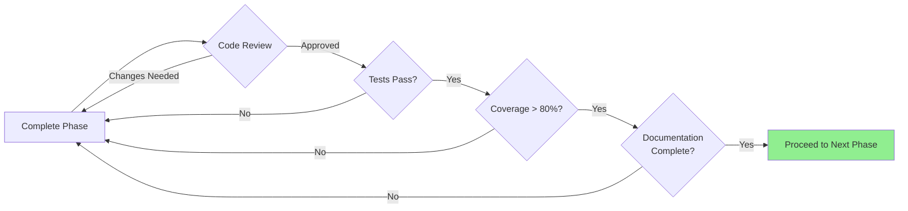

**Quality Criteria:**
1. **Code Review**: All code reviewed by 1+ team members
2. **Tests Passing**: All unit, integration, E2E tests pass
3. **Coverage**: Minimum 80% code coverage
4. **Documentation**: Phase deliverables documented
5. **No Blockers**: Critical bugs resolved

---

## Workflow Summary

### Key Principles
1. **Sequential Phases**: Each phase builds on previous work
2. **Quality Gates**: Strict criteria before phase transition
3. **Clean Architecture**: Maintained throughout all phases
4. **Test-Driven**: Tests written alongside implementation
5. **Documentation**: Continuous documentation, not post-hoc
6. **Git Workflow**: Feature branches merged to develop, tagged releases to main

### Critical Success Factors
- **Phase 01-03**: Solid foundation (architecture, database design)
- **Phase 06-08**: Clean separation of concerns (layers, patterns)
- **Phase 09**: Complete API implementation (63 endpoints)
- **Phase 11**: Comprehensive testing (>80% coverage)
- **Phase 13**: Smooth deployment pipeline

### Tools & Technologies
- **Backend**: FastAPI, SQLAlchemy, Alembic, Celery, pytest
- **Frontend**: Next.js, React, Tailwind CSS, shadcn/ui
- **Database**: PostgreSQL (Neon), Redis (Upstash), Firestore
- **DevOps**: Docker, Render, Vercel, GitHub Actions
- **Monitoring**: Sentry, LogTail, UptimeRobot

---

*Reference: Based on v1.0 14-phase development methodology in docs/phases/*
