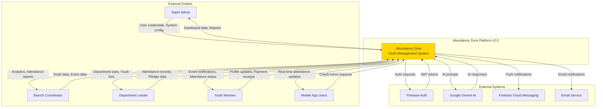
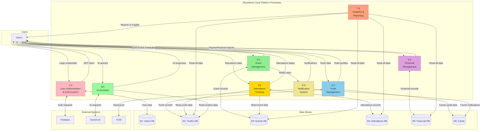
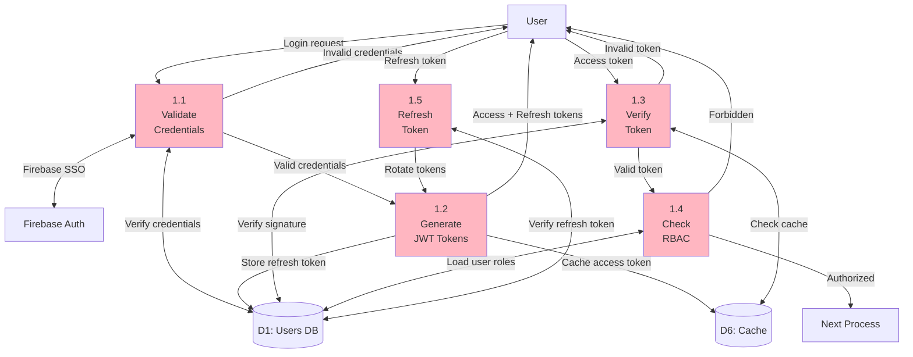
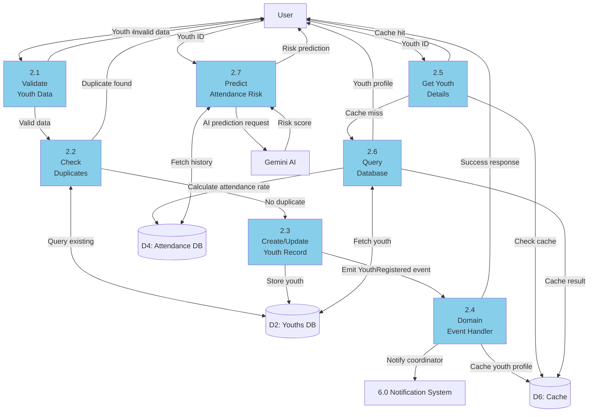
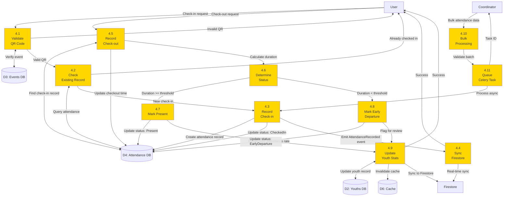
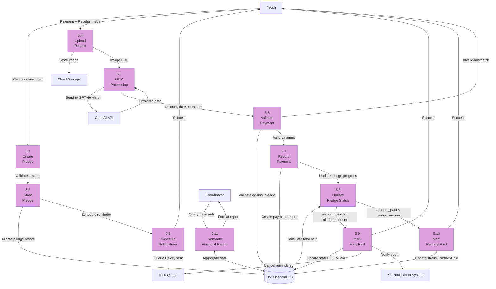
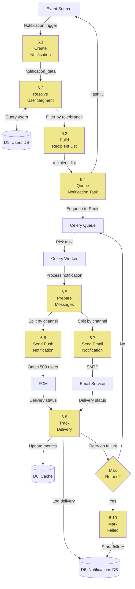

# 07 - Data Flow Diagrams

Data Flow Diagrams (DFD) show how data moves through the Abundance Zone Platform v2.0 using structured design methodology.

---

## 1. Context Diagram (Level 0 DFD)

**Key Insights:**
- 4 user roles with distinct data flows
- 4 external system integrations
- Bidirectional data flow for all interactive users

---

## 2. Level 1 DFD - Major Processes

---

## 3. Level 2 DFD - Authentication & Authorization Process

**Data Elements:**
- **Input**: email, password, firebase_token
- **Output**: access_token (JWT, 15 min), refresh_token (30 days)
- **Storage**: users table, refresh_tokens table, Redis cache

---

## 4. Level 2 DFD - Youth Management Process

**Data Elements:**
- **Input**: first_name, last_name, phone, email, branch_id, department_id, date_of_birth
- **Output**: youth_id, platform_role, attendance_rate, risk_score
- **Storage**: youths table, Redis cache (5 min TTL)
- **Events**: YouthRegistered, YouthUpdated, YouthStatusChanged

---

## 5. Level 2 DFD - Attendance Tracking Process

**Data Elements:**
- **Input**: qr_code_data, youth_id, event_id, check_in_time, check_out_time
- **Output**: attendance_id, status (Present/Absent/EarlyDeparture), duration
- **Storage**: attendance table, Firestore collection, Redis cache
- **Events**: AttendanceRecorded, AttendanceUpdated, YouthStatsChanged
- **Async**: Bulk operations via Celery (500 records per batch)

---

## 6. Level 2 DFD - Financial Management Process

**Data Elements:**
- **Input**: pledge_amount, due_date, receipt_image, payment_amount
- **Output**: pledge_id, payment_id, ocr_extracted_data, pledge_status
- **Storage**: pledges table, payments table, Cloud Storage (images)
- **External**: OpenAI GPT-4o Vision for OCR
- **Async**: Scheduled reminders via Celery Beat

---

## 7. Level 2 DFD - Notification System Process

**Data Elements:**
- **Input**: title, body, user_segment, priority, channel (push/email)
- **Output**: notification_id, delivery_status, recipients_count, failed_count
- **Storage**: notifications table, Redis queue
- **External**: Firebase FCM, Email SMTP
- **Retry Logic**: Max 3 retries with exponential backoff (30s, 5m, 30m)

---

## 8. Module Hierarchy (Structured Design)

```mermaid
graph TB
    Main[Main Application<br/>FastAPI App] --> Auth[Auth Module]
    Main --> Youth[Youth Module]
    Main --> Event[Event Module]
    Main --> Attendance[Attendance Module]
    Main --> Pledge[Pledge Module]
    Main --> Payment[Payment Module]
    Main --> Notification[Notification Module]
    Main --> Branch[Branch Module]
    Main --> Dept[Department Module]
    Main --> Analytics[Analytics Module]
    Main --> AI[AI Module]
    
    Auth --> AuthService[Auth Service]
    Auth --> JWTManager[JWT Manager]
    Auth --> UserRepo[User Repository]
    
    Youth --> YouthService[Youth Service]
    Youth --> YouthRepo[Youth Repository]
    Youth --> RiskPredictor[Risk Predictor]
    
    Attendance --> AttendanceService[Attendance Service]
    Attendance --> BulkProcessor[Bulk Processor]
    Attendance --> FirestoreSync[Firestore Sync]
    Attendance --> AttendanceRepo[Attendance Repository]
    
    Payment --> PaymentService[Payment Service]
    Payment --> OCRProcessor[OCR Processor]
    Payment --> PaymentRepo[Payment Repository]
    
    Notification --> NotificationService[Notification Service]
    Notification --> FCMHandler[FCM Handler]
    Notification --> EmailHandler[Email Handler]
    
    Analytics --> AnalyticsService[Analytics Service]
    Analytics --> MetricsCalc[Metrics Calculator]
    Analytics --> ReportGen[Report Generator]
    
    AI --> AIService[AI Service]
    AI --> GeminiClient[Gemini Client]
    AI --> OpenRouterClient[OpenRouter Client]
    
    style Main fill:#FFD700
    style Auth fill:#FFB6C1
    style Youth fill:#87CEEB
    style Attendance fill:#FFD700
    style Payment fill:#DDA0DD
    style Notification fill:#F0E68C
    style Analytics fill:#FFA07A
    style AI fill:#98FB98
```

**Module Coupling:**
- **Low coupling**: Modules communicate via domain events
- **High cohesion**: Each module encapsulates related functionality
- **Dependency direction**: Always toward domain layer (Clean Architecture)

---

## 9. Data Dictionary

### Key Data Entities

| Entity | Primary Key | Foreign Keys | Description |
|--------|-------------|--------------|-------------|
| **User** | user_id (UUID) | branch_id, department_id | Platform users (all roles) |
| **Youth** | youth_id (UUID) | user_id, branch_id, department_id | Youth members |
| **Event** | event_id (UUID) | branch_id, created_by (user_id) | Events/activities |
| **Attendance** | attendance_id (UUID) | youth_id, event_id | Attendance records |
| **Pledge** | pledge_id (UUID) | youth_id | Financial pledges |
| **Payment** | payment_id (UUID) | pledge_id | Pledge payments |
| **Notification** | notification_id (UUID) | user_id | Sent notifications |
| **Branch** | branch_id (UUID) | None | Organization branches |
| **Department** | department_id (UUID) | branch_id | Branch departments |

### Key Data Flows

| Flow | Source | Destination | Frequency | Volume |
|------|--------|-------------|-----------|--------|
| **User Login** | User → System → Firebase | JWT tokens | Per session | ~100/day |
| **Youth Registration** | Coordinator → System → DB | Youth record | Daily | ~10/day |
| **Attendance Check-in** | Youth → System → DB + Firestore | Attendance record | Per event | ~500/event |
| **Bulk Attendance** | Coordinator → System → Celery → DB | Batch attendance | Weekly | ~500 records/batch |
| **Payment Receipt** | Youth → System → OpenAI → DB | Payment + OCR data | Weekly | ~50/week |
| **Push Notification** | System → Celery → FCM → Users | Push message | Daily | ~1000/day |
| **Analytics Query** | Coordinator → System → DB | Report data | Daily | ~20/day |
| **AI Chat** | User → System → Gemini | AI response | Hourly | ~100/day |

---

## Data Flow Summary

### Key Insights
1. **Clean Architecture**: All data flows respect layer boundaries
2. **Async Processing**: Heavy operations (bulk attendance, notifications, OCR) use Celery
3. **Caching Strategy**: Redis caches frequently accessed data (users, youth profiles, attendance rates)
4. **Real-time Sync**: Firestore mirrors critical data for mobile app
5. **External Integrations**: 4 external services (Firebase, Gemini, OpenAI, FCM)
6. **Event-Driven**: Domain events trigger cross-module communication

### Performance Optimizations
- **Cache-first reads**: Check Redis before database
- **Bulk operations**: Batch processing for attendance (500 records)
- **Async tasks**: Background workers for notifications and sync
- **Read replicas**: Database read scaling via Neon replicas
- **CDN delivery**: Static assets via Vercel CDN

---

*Reference: Based on v1.0 data flow patterns and structured design principles*
