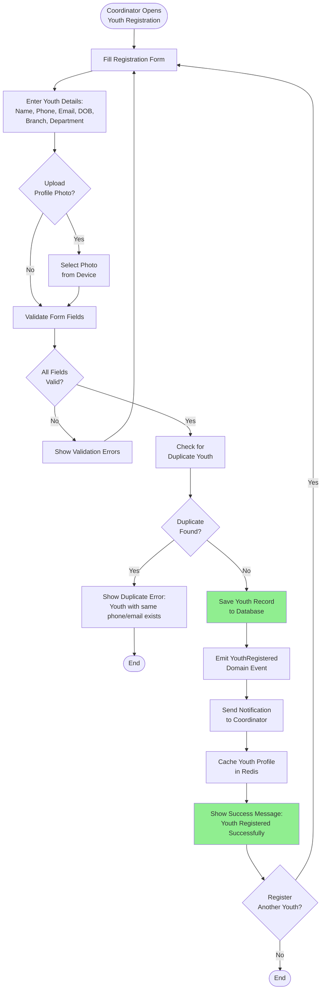
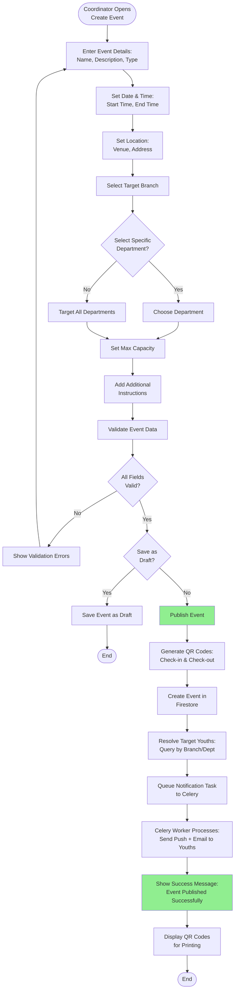
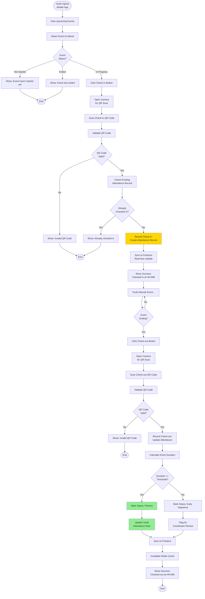
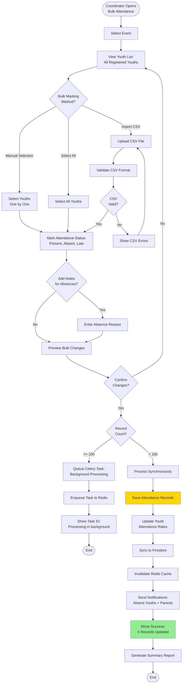
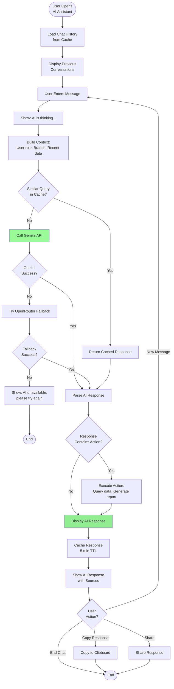
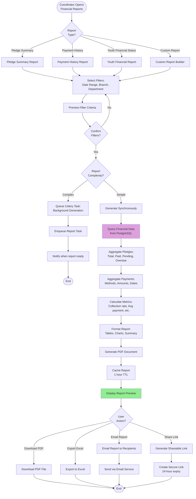

# 08 - Activity Diagrams

Activity diagrams show the business process workflows and user interactions for key features in Abundance Zone Platform v2.0.

---

## 1. Youth Registration Activity Diagram

**Business Rules:**
- Phone and email must be unique across all youths
- Age must be between 10-30 years
- Branch and department must exist
- Profile photo max size: 5MB
- Registration requires BRANCH_COORDINATOR role

---

## 2. Event Creation Activity Diagram

**Business Rules:**
- Event start time must be in the future
- End time must be after start time
- Max capacity optional (0 = unlimited)
- QR codes valid only during event window
- Notifications sent only to youths in target branch/department
- Requires BRANCH_COORDINATOR role

---

## 3. Attendance Marking Activity Diagram (QR Code)

**Business Rules:**
- Check-in allowed only during event window (start_time to end_time + 30 min)
- Check-out required within 1 hour after event end
- Early departure if duration < (event_duration - 30 minutes)
- Attendance rate recalculated immediately
- Real-time sync to Firestore for coordinator dashboard

---

## 4. Bulk Attendance Marking Activity Diagram (Coordinator)

**Business Rules:**
- Max 500 records per synchronous operation
- >500 records processed asynchronously via Celery
- CSV format: youth_id, status, notes
- Notifications sent only to absent youths
- Attendance rate recalculated for all affected youths
- Requires BRANCH_COORDINATOR or DEPARTMENT_LEADER role

---

## 5. Pledge Payment Activity Diagram

```mermaid
flowchart TD
    Start([Youth Opens<br/>My Pledges]) --> ViewPledges[View Active Pledges]
    
    ViewPledges --> SelectPledge[Select Pledge<br/>to Pay]
    SelectPledge --> CheckStatus{Pledge<br/>Status?}
    
    CheckStatus -->|Fully Paid| ShowPaidMsg[Show: Already fully paid]
    ShowPaidMsg --> End1([End])
    
    CheckStatus -->|Active| EnterAmount[Enter Payment Amount]
    CheckStatus -->|Overdue| ShowOverdueWarning[Show Overdue Warning]
    ShowOverdueWarning --> EnterAmount
    
    EnterAmount --> ValidateAmount{Amount<br/>Valid?}
    ValidateAmount -->|No| ShowAmountError[Show: Invalid amount or<br/>exceeds remaining balance]
    ShowAmountError --> EnterAmount
    
    ValidateAmount -->|Yes| SelectMethod{Payment<br/>Method?}
    SelectMethod -->|Cash| ChooseCash[Cash Payment]
    SelectMethod -->|Bank Transfer| ChooseBank[Bank Transfer]
    SelectMethod -->|Mobile Money| ChooseMobile[Mobile Money]
    
    ChooseCash --> UploadReceipt
    ChooseBank --> UploadReceipt
    ChooseMobile --> UploadReceipt
    
    UploadReceipt[Upload Receipt Image]
    UploadReceipt --> TakePhoto{Take Photo<br/>or Gallery?}
    
    TakePhoto -->|Camera| CapturePhoto[Capture Receipt Photo]
    TakePhoto -->|Gallery| SelectFromGallery[Select from Gallery]
    
    CapturePhoto --> CompressImage
    SelectFromGallery --> CompressImage[Compress Image<br/>Max 2MB]
    
    CompressImage --> UploadToStorage[Upload to<br/>Cloud Storage]
    UploadToStorage --> ShowUploading[Show: Uploading receipt...]
    
    ShowUploading --> InitiateOCR[Initiate OCR Processing:<br/>Send to GPT-4o Vision]
    InitiateOCR --> ShowOCRProcessing[Show: Extracting payment details...]
    
    ShowOCRProcessing --> OCRComplete[OCR Extracts:<br/>Amount, Date, Merchant]
    OCRComplete --> ValidateOCR{Extracted<br/>Amount Matches?}
    
    ValidateOCR -->|No| ShowMismatch[Show Mismatch Warning:<br/>Manual Review Required]
    ShowMismatch --> ManualReview{Proceed<br/>Anyway?}
    ManualReview -->|No| UploadReceipt
    ManualReview -->|Yes| FlagManualReview[Flag for Manual Review]
    
    ValidateOCR -->|Yes| AutoApprove[Auto-approve Payment]
    FlagManualReview --> CreatePayment
    AutoApprove --> CreatePayment[Create Payment Record]
    
    CreatePayment --> UpdatePledge[Update Pledge Progress]
    UpdatePledge --> CheckComplete{Pledge<br/>Fully Paid?}
    
    CheckComplete -->|Yes| MarkFullyPaid[Mark Pledge: Fully Paid]
    CheckComplete -->|No| MarkPartial[Mark Pledge: Partially Paid]
    
    MarkFullyPaid --> CancelReminders[Cancel Scheduled Reminders]
    MarkPartial --> UpdateReminders[Update Reminder Schedule]
    
    CancelReminders --> NotifySuccess
    UpdateReminders --> NotifySuccess[Send Confirmation<br/>Notification]
    
    NotifySuccess --> ShowPaymentSuccess[Show Success:<br/>Payment recorded successfully]
    ShowPaymentSuccess --> DisplayReceipt[Display Payment Receipt]
    
    DisplayReceipt --> End2([End])
    
    style CreatePayment fill:#DDA0DD
    style MarkFullyPaid fill:#90EE90
    style ShowPaymentSuccess fill:#90EE90
```

**Business Rules:**
- Payment amount cannot exceed remaining balance
- Receipt image required for all payments
- OCR extraction triggers automatic approval if amount matches
- Manual review required if OCR amount ≠ entered amount
- Reminders canceled when pledge fully paid
- Confirmation notification sent to youth

---

## 6. AI Chat Assistant Activity Diagram

**Business Rules:**
- Context limited to user's role and branch (RBAC)
- Responses cached for 5 minutes (same query)
- Fallback to OpenRouter if Gemini fails
- Max 10 messages in context window
- Sources cited for data-driven answers
- Rate limit: 20 queries per hour per user

---

## 7. Financial Report Generation Activity Diagram

**Business Rules:**
- Reports cached for 1 hour (same filters)
- Complex reports (>1000 records) processed asynchronously
- PDF and Excel export formats supported
- Shareable links expire after 24 hours
- Email reports as PDF attachments
- Requires BRANCH_COORDINATOR or SUPER_ADMIN role

---

## Activity Diagram Summary

### Key Business Processes

1. **Youth Registration**: Coordinator registers new youth with profile validation and duplicate checking
2. **Event Creation**: Coordinator creates events with QR code generation and automated notifications
3. **Attendance Marking (QR)**: Youth checks in/out via mobile app QR scanning with real-time sync
4. **Bulk Attendance**: Coordinator marks attendance for multiple youths with async processing for large batches
5. **Pledge Payment**: Youth records payments with receipt OCR and automatic pledge status updates
6. **AI Chat Assistant**: Users interact with AI for insights with context-aware responses and fallback handling
7. **Financial Reports**: Coordinator generates financial reports with flexible filters and multiple export formats

### Activity Diagram Characteristics

- **Swimlanes**: Multi-role activities show user vs system lanes
- **Decision Points**: Business logic expressed as diamond-shaped decisions
- **Parallel Activities**: Concurrent operations shown with fork/join nodes
- **Error Handling**: Alternative flows for validation failures and exceptions
- **System Integration**: External service calls (Firebase, Gemini, OpenAI) highlighted
- **User Experience**: Clear success/error messages and confirmation steps

### Performance Considerations

- **Async Processing**: Heavy operations queued to Celery (bulk attendance, reports, OCR)
- **Caching**: Frequent queries cached in Redis (chat responses, reports)
- **Real-time Sync**: Critical data synced to Firestore (attendance, events)
- **Batch Operations**: Bulk attendance processes 500 records per batch
- **Rate Limiting**: AI chat limited to 20 queries/hour per user

---

*Reference: Based on v1.0 business process flows and user interaction patterns*
