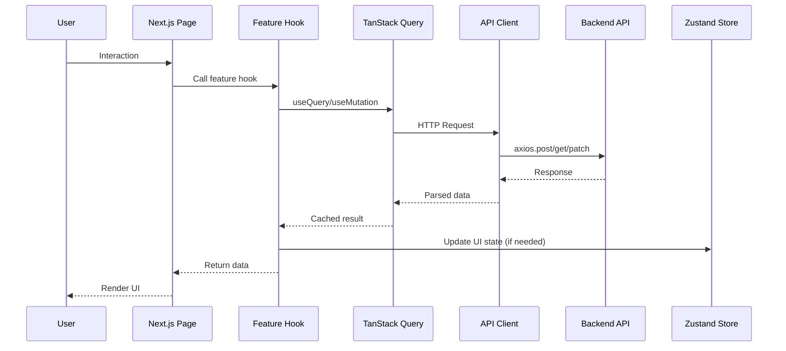
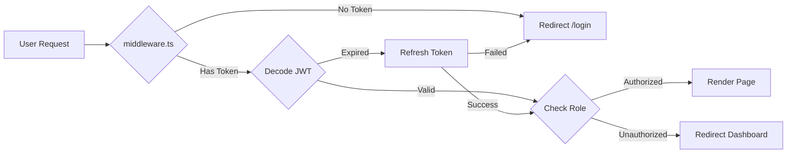
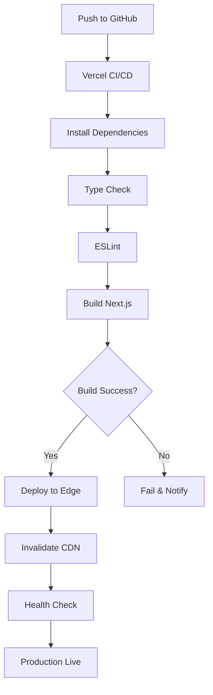

# Frontend System Architecture - Complete Overview

**Document**: System Architecture Flowchart
**Version**: 2.0.0
**Date**: October 16, 2026
**Purpose**: Visualize the complete frontend architecture implementing Feature-Sliced Design

---

## 🏗️ Architecture Overview

The Abundance Zone Platform v2.0 frontend implements a **Feature-Sliced Design (FSD)** architecture with clear separation of concerns across 7 layers.

### Architecture Principles

1. **Feature-First Organization** - Code organized by business features, not technical roles
2. **Unidirectional Dependencies** - Higher layers depend on lower layers, never vice versa
3. **Public API Surface** - Each feature exposes only necessary interfaces
4. **Isolated State** - Feature-specific state management with shared global state
5. **Type Safety** - End-to-end TypeScript with runtime validation

---

## 📊 System Architecture Diagram

```mermaid
graph TB
    subgraph "External Layer"
        API[Backend API<br/>https://abundance-zone-api.fly.dev]
        FCM[Firebase Cloud<br/>Messaging]
        SSE[Server-Sent<br/>Events]
    end

    subgraph "App Layer - Next.js 15 App Router"
        AUTH["(auth) Route Group<br/>├─ /login<br/>├─ /register<br/>└─ /forgot-password"]
        DASH["(dashboard) Route Group<br/>├─ /dashboard<br/>├─ /youths<br/>├─ /events<br/>├─ /attendance<br/>├─ /finance<br/>├─ /analytics<br/>└─ /settings"]
        MIDDLEWARE[middleware.ts<br/>Role-Based Access Control]
    end

    subgraph "Feature Layer - Business Logic"
        AUTH_FEATURE[auth Feature<br/>├─ useAuth()<br/>├─ useLogin()<br/>└─ AuthProvider]
        YOUTH_FEATURE[youths Feature<br/>├─ useYouths()<br/>├─ useYouthForm()<br/>└─ YouthsProvider]
        EVENT_FEATURE[events Feature<br/>├─ useEvents()<br/>├─ useRSVP()<br/>└─ EventsProvider]
        ATTENDANCE_FEATURE[attendance Feature<br/>├─ useAttendance()<br/>├─ useBulkCheckIn()<br/>└─ AttendanceProvider]
        ANALYTICS_FEATURE[analytics Feature<br/>├─ useAnalytics()<br/>├─ useInsights()<br/>└─ AnalyticsProvider]
    end

    subgraph "Entities Layer - Domain Models"
        USER_ENTITY[User Entity<br/>types, schemas, validation]
        YOUTH_ENTITY[Youth Entity<br/>types, schemas, validation]
        EVENT_ENTITY[Event Entity<br/>types, schemas, validation]
        ATTENDANCE_ENTITY[Attendance Entity<br/>types, schemas, validation]
    end

    subgraph "Shared Layer - Cross-Feature Code"
        API_CLIENT[API Client<br/>├─ axios instance<br/>├─ interceptors<br/>└─ error handling]
        QUERY_CLIENT[TanStack Query<br/>├─ cache config<br/>├─ retry logic<br/>└─ optimistic updates]
        UI_KIT[UI Components<br/>├─ Button<br/>├─ Input<br/>├─ Dialog<br/>└─ 50+ primitives]
        HOOKS[Shared Hooks<br/>├─ useDebounce<br/>├─ useLocalStorage<br/>└─ useMediaQuery]
        UTILS[Utilities<br/>├─ formatters<br/>├─ validators<br/>└─ helpers]
    end

    subgraph "State Management"
        ZUSTAND[Zustand Stores<br/>├─ authStore<br/>├─ uiStore<br/>└─ notificationStore]
        TANSTACK[TanStack Query<br/>Server State Cache]
    end

    %% External Connections
    API -->|REST API| API_CLIENT
    FCM -->|Push Notifications| AUTH_FEATURE
    SSE -->|Real-time Events| EVENT_FEATURE

    %% App Layer Flow
    AUTH --> AUTH_FEATURE
    DASH --> YOUTH_FEATURE
    DASH --> EVENT_FEATURE
    DASH --> ATTENDANCE_FEATURE
    DASH --> ANALYTICS_FEATURE
    MIDDLEWARE -->|Auth Check| AUTH_FEATURE

    %% Feature Dependencies
    AUTH_FEATURE --> USER_ENTITY
    YOUTH_FEATURE --> YOUTH_ENTITY
    EVENT_FEATURE --> EVENT_ENTITY
    ATTENDANCE_FEATURE --> ATTENDANCE_ENTITY

    %% Shared Layer Usage
    AUTH_FEATURE --> API_CLIENT
    YOUTH_FEATURE --> API_CLIENT
    EVENT_FEATURE --> API_CLIENT
    ATTENDANCE_FEATURE --> API_CLIENT
    ANALYTICS_FEATURE --> API_CLIENT

    AUTH_FEATURE --> QUERY_CLIENT
    YOUTH_FEATURE --> QUERY_CLIENT
    EVENT_FEATURE --> QUERY_CLIENT

    AUTH_FEATURE --> UI_KIT
    YOUTH_FEATURE --> UI_KIT
    EVENT_FEATURE --> UI_KIT

    %% State Management
    AUTH_FEATURE --> ZUSTAND
    YOUTH_FEATURE --> TANSTACK
    EVENT_FEATURE --> TANSTACK

    style API fill:#4CAF50
    style FCM fill:#FFA726
    style SSE fill:#42A5F5
    style MIDDLEWARE fill:#FF5722
    style ZUSTAND fill:#9C27B0
    style TANSTACK fill:#FF4081
```

---

## 🗂️ Directory Structure

```
frontend/
├── src/
│   ├── app/                          # Next.js App Router (Layer 1)
│   │   ├── (auth)/                   # Public route group
│   │   │   ├── login/
│   │   │   │   └── page.tsx
│   │   │   ├── register/
│   │   │   │   └── page.tsx
│   │   │   └── layout.tsx
│   │   ├── (dashboard)/              # Protected route group
│   │   │   ├── dashboard/
│   │   │   │   └── page.tsx          # Role-specific dashboards
│   │   │   ├── youths/
│   │   │   │   ├── page.tsx
│   │   │   │   ├── [id]/
│   │   │   │   │   └── page.tsx
│   │   │   │   └── new/
│   │   │   │       └── page.tsx
│   │   │   ├── events/
│   │   │   ├── attendance/
│   │   │   ├── finance/
│   │   │   ├── analytics/
│   │   │   └── layout.tsx
│   │   ├── layout.tsx                # Root layout
│   │   ├── providers.tsx             # Global providers
│   │   └── globals.css
│   │
│   ├── features/                     # Feature Layer (Layer 2)
│   │   ├── auth/
│   │   │   ├── api/
│   │   │   │   ├── login.ts
│   │   │   │   ├── register.ts
│   │   │   │   └── refresh.ts
│   │   │   ├── hooks/
│   │   │   │   ├── useAuth.ts
│   │   │   │   ├── useLogin.ts
│   │   │   │   └── useLogout.ts
│   │   │   ├── components/
│   │   │   │   ├── LoginForm.tsx
│   │   │   │   └── RegisterForm.tsx
│   │   │   ├── stores/
│   │   │   │   └── authStore.ts
│   │   │   ├── types.ts
│   │   │   └── index.ts              # Public API
│   │   ├── youths/
│   │   │   ├── api/
│   │   │   ├── hooks/
│   │   │   ├── components/
│   │   │   ├── types.ts
│   │   │   └── index.ts
│   │   ├── events/
│   │   ├── attendance/
│   │   ├── finance/
│   │   ├── analytics/
│   │   └── notifications/
│   │
│   ├── entities/                     # Entities Layer (Layer 3)
│   │   ├── user/
│   │   │   ├── model.ts              # Zod schema
│   │   │   ├── types.ts              # TypeScript types
│   │   │   └── index.ts
│   │   ├── youth/
│   │   ├── event/
│   │   ├── attendance/
│   │   └── branch/
│   │
│   ├── shared/                       # Shared Layer (Layer 4)
│   │   ├── api/
│   │   │   ├── client.ts             # Axios instance
│   │   │   ├── interceptors.ts
│   │   │   └── endpoints.ts
│   │   ├── ui/                       # Shadcn/ui components
│   │   │   ├── button.tsx
│   │   │   ├── input.tsx
│   │   │   ├── dialog.tsx
│   │   │   └── ... (50+ components)
│   │   ├── hooks/
│   │   │   ├── useDebounce.ts
│   │   │   ├── useLocalStorage.ts
│   │   │   └── useMediaQuery.ts
│   │   ├── lib/
│   │   │   ├── utils.ts
│   │   │   ├── cn.ts
│   │   │   └── formatters.ts
│   │   └── types/
│   │       ├── api.ts
│   │       └── common.ts
│   │
│   ├── middleware.ts                 # Route protection
│   └── env.ts                        # Environment validation
│
├── public/
│   ├── icons/
│   └── images/
│
├── .env.example
├── .env.local
├── next.config.ts
├── tailwind.config.ts
├── tsconfig.json
└── package.json
```

---

## 🔄 Data Flow Architecture



---

## 🎯 Key Architectural Decisions

### 1. Feature-Sliced Design (FSD)

**Decision**: Organize by features, not technical layers
**Rationale**:

- Better scalability - new features are isolated
- Easier code navigation - all feature code in one place
- Clear boundaries - prevents spaghetti code
- Team collaboration - multiple devs can work on different features

### 2. Next.js App Router

**Decision**: Use App Router over Pages Router
**Rationale**:

- Server Components for better performance
- Streaming and Suspense support
- Nested layouts for shared UI
- Built-in loading and error states
- Better TypeScript support

### 3. Zustand + TanStack Query

**Decision**: Split state management responsibilities
**Rationale**:

- Zustand: UI state (theme, modals, sidebar)
- TanStack Query: Server state (API data, caching)
- Avoids Redux boilerplate
- Automatic cache invalidation
- Optimistic updates built-in

### 4. TypeScript + Zod

**Decision**: Runtime and compile-time type safety
**Rationale**:

- TypeScript: Compile-time checks
- Zod: Runtime validation + type inference
- Single source of truth for schemas
- API response validation
- Form validation integration

### 5. Shadcn/ui + Radix UI

**Decision**: Copy-paste component library
**Rationale**:

- Full control over code
- No dependency on package updates
- Customizable to brand
- Accessible by default (Radix primitives)
- Tailwind CSS integration

---

## 🔐 Security Architecture



### Security Layers

1. **Middleware Layer** - Route-level access control
2. **API Client Layer** - Automatic token refresh
3. **Component Layer** - Conditional rendering by role
4. **Hook Layer** - Permission checks before mutations

---

## 📦 Build & Deploy Architecture



---

## 🎨 Design System Integration

All components follow the design system defined in `/shared/ui/`:

- **Consistent Styling**: Tailwind utility classes
- **Accessibility**: ARIA labels, keyboard navigation
- **Responsiveness**: Mobile-first breakpoints
- **Dark Mode**: CSS variables + next-themes

---

## 📊 Performance Optimization

### Code Splitting

- Automatic route-based splitting (Next.js)
- Dynamic imports for heavy components
- Lazy-loaded modals and dialogs

### Caching Strategy

- TanStack Query: 5-minute stale time
- Next.js: Static generation where possible
- Service Worker: Offline caching (PWA)

### Bundle Optimization

- Tree-shaking enabled
- Dynamic imports for charts (Recharts)
- Image optimization (next/image)

---

## 🧪 Testing Strategy

### Unit Tests

- Components: React Testing Library
- Hooks: @testing-library/react-hooks
- Utils: Jest

### Integration Tests

- Feature flows: Playwright
- API mocking: MSW (Mock Service Worker)

### E2E Tests

- Critical paths: Playwright
- Role-based journeys

---

**Next Document**: `02-DATA-FLOW-ARCHITECTURE.md` for detailed request/response flows.
