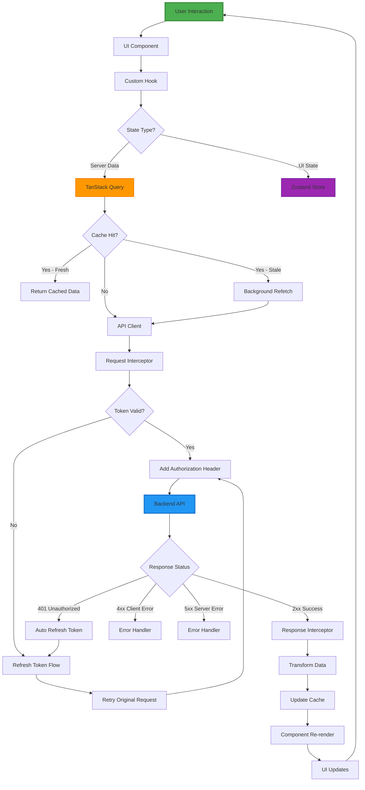

# Data Flow Architecture - Request/Response Flows

**Document**: Data Flow Architecture Flowchart  
**Version**: 2.0.0  
**Date**: October 16, 2026  
**Purpose**: Complete request/response flows across all architectural layers

---

## 🎯 Overview

This document details how data flows through the Abundance Zone Platform frontend, from user interaction to API response and back to the UI.

---

## 📊 Complete Data Flow Diagram



---

## 🔄 Key Data Flow Scenarios

### 1. Initial Load (Cache Miss)
- User navigates to page
- Component mounts
- TanStack Query checks cache → MISS
- API call initiated with auth token
- Backend returns data
- Data cached and component renders

### 2. Cached Load (Cache Hit - Fresh)
- Component mounts
- TanStack Query checks cache → HIT (Fresh)
- Instant render with cached data
- No API call needed

### 3. Stale Data with Background Refetch
- Component mounts
- Cache HIT but data is stale
- Render stale data immediately (instant UI)
- Background refetch triggered
- UI updates silently when fresh data arrives

### 4. Mutation with Optimistic Update
- User submits form
- Optimistic update: Add data to cache immediately
- UI updates instantly
- API call in background
- On success: Keep optimistic data
- On error: Rollback + show error

### 5. Token Expired Auto-Refresh
- API call with expired token
- 401 response received
- Interceptor catches error
- Auto refresh token
- Retry original request with new token
- User sees seamless experience

---

## 📡 Layer Responsibilities

### Layer 1: UI Components
- Render UI based on data
- Handle user events
- Display loading/error states

### Layer 2: Custom Hooks
- Abstract TanStack Query
- Provide clean API to components
- Handle query keys

### Layer 3: TanStack Query
- Cache management
- Background refetching
- Automatic retry
- Optimistic updates

### Layer 4: API Client (Axios)
- HTTP configuration
- Request/response transformation
- Interceptors (auth, errors)

### Layer 5: Zustand Store
- UI state (theme, sidebar)
- Auth state (tokens, user)
- Global app state

### Layer 6: Backend API
- Business logic
- Data validation
- Database operations

---

## 🔐 Authentication Integration

### Token Flow
1. Access Token: Stored in Zustand (memory only)
2. Refresh Token: LocalStorage (via Zustand persist)
3. Auto-refresh on 401 response
4. Automatic retry of failed requests

### Request Interceptor
```typescript
apiClient.interceptors.request.use((config) => {
  const token = useAuthStore.getState().accessToken;
  if (token) {
    config.headers.Authorization = `Bearer ${token}`;
  }
  return config;
});
```

### Response Interceptor
```typescript
apiClient.interceptors.response.use(
  (response) => response,
  async (error) => {
    if (error.response?.status === 401) {
      await refreshToken();
      return apiClient(error.config); // Retry
    }
    return Promise.reject(error);
  }
);
```

---

## 🎯 Cache Strategy

### Stale Time
- **Fast-changing data**: 1-2 minutes (notifications, attendance)
- **Moderate data**: 5 minutes (youths, events)
- **Slow-changing data**: 10 minutes (branches, departments)

### Cache Time (Garbage Collection)
- Default: 10 minutes after last use
- Ensures memory cleanup

### Refetch Triggers
- Window focus
- Network reconnect
- Manual invalidation
- Time-based intervals

---

## 🚨 Error Handling

### Error Types
1. **Network Errors**: Automatic retry with exponential backoff
2. **401 Unauthorized**: Auto token refresh + retry
3. **403 Forbidden**: Show permission error
4. **404 Not Found**: Show not found message
5. **422 Validation**: Show form-level errors
6. **500 Server Error**: Show generic error + retry button

### Error Boundary
- Catches component errors
- Shows fallback UI
- Logs to monitoring service

---

## 📈 Performance Optimizations

### 1. Request Deduplication
Multiple components requesting same data → Single API call

### 2. Prefetching
```typescript
queryClient.prefetchQuery(['youth', id]);
```

### 3. Pagination
```typescript
keepPreviousData: true // Smooth page transitions
```

### 4. Infinite Scroll
```typescript
useInfiniteQuery() // Automatic page loading
```

---

**Next Document**: `03-STATE-MANAGEMENT-FLOW.md`
