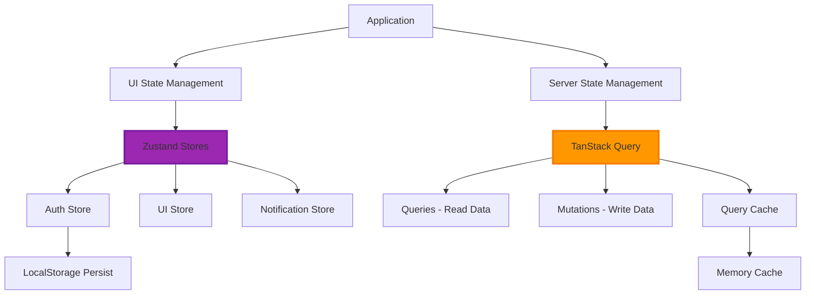

# State Management Flow - Zustand + TanStack Query

**Document**: State Management Flow  
**Version**: 2.0.0  
**Date**: October 16, 2026  
**Purpose**: Complete state management architecture and patterns

---

## 🎯 Overview

This document details the state management strategy using **Zustand** for UI state and **TanStack Query** for server state, ensuring clear separation of concerns and optimal performance.

---

## 📊 State Management Architecture



---

## 🗂️ State Separation Strategy

### UI State (Zustand)
**What belongs here:**
- Theme preferences (light/dark)
- Sidebar open/closed
- Modal visibility
- Form wizard step
- Selected items
- Notification preferences

**What does NOT belong here:**
- API data (youths, events, etc.)
- User profile from backend
- Any data from server

### Server State (TanStack Query)
**What belongs here:**
- All API data (GET requests)
- Mutations (POST, PUT, DELETE)
- Cache management
- Background refetching
- Optimistic updates

---

## 🏪 Zustand Store Patterns

### 1. Auth Store (with Persistence)

```typescript
// stores/auth-store.ts
import { create } from 'zustand';
import { persist } from 'zustand/middleware';

interface AuthState {
  accessToken: string | null;
  refreshToken: string | null;
  user: User | null;
  
  // Actions
  setTokens: (tokens: { accessToken: string; refreshToken: string }) => void;
  setUser: (user: User) => void;
  logout: () => void;
  refreshAccessToken: () => Promise<void>;
}

export const useAuthStore = create<AuthState>()(
  persist(
    (set, get) => ({
      accessToken: null,
      refreshToken: null,
      user: null,
      
      setTokens: (tokens) => set({ ...tokens }),
      
      setUser: (user) => set({ user }),
      
      logout: () => {
        set({ accessToken: null, refreshToken: null, user: null });
        // Clear TanStack Query cache
        queryClient.clear();
      },
      
      refreshAccessToken: async () => {
        const refreshToken = get().refreshToken;
        if (!refreshToken) throw new Error('No refresh token');
        
        const response = await fetch(`${API_URL}/auth/refresh`, {
          method: 'POST',
          headers: { 'Content-Type': 'application/json' },
          body: JSON.stringify({ refreshToken }),
        });
        
        if (!response.ok) throw new Error('Token refresh failed');
        
        const data = await response.json();
        set({ accessToken: data.accessToken });
      },
    }),
    {
      name: 'auth-storage', // LocalStorage key
      partialize: (state) => ({
        refreshToken: state.refreshToken, // Only persist refresh token
        user: state.user,
      }),
    }
  )
);
```

### 2. UI Store (No Persistence)

```typescript
// stores/ui-store.ts
import { create } from 'zustand';

interface UIState {
  theme: 'light' | 'dark';
  sidebarOpen: boolean;
  mobileSidebarOpen: boolean;
  
  // Actions
  toggleTheme: () => void;
  toggleSidebar: () => void;
  setMobileSidebarOpen: (open: boolean) => void;
}

export const useUIStore = create<UIState>((set) => ({
  theme: 'light',
  sidebarOpen: true,
  mobileSidebarOpen: false,
  
  toggleTheme: () => set((state) => ({
    theme: state.theme === 'light' ? 'dark' : 'light',
  })),
  
  toggleSidebar: () => set((state) => ({
    sidebarOpen: !state.sidebarOpen,
  })),
  
  setMobileSidebarOpen: (open) => set({ mobileSidebarOpen: open }),
}));
```

### 3. Notification Store

```typescript
// stores/notification-store.ts
import { create } from 'zustand';

interface Notification {
  id: string;
  type: 'success' | 'error' | 'warning' | 'info';
  title: string;
  message: string;
  duration?: number;
}

interface NotificationState {
  notifications: Notification[];
  
  // Actions
  addNotification: (notification: Omit<Notification, 'id'>) => void;
  removeNotification: (id: string) => void;
  clearAll: () => void;
}

export const useNotificationStore = create<NotificationState>((set) => ({
  notifications: [],
  
  addNotification: (notification) => {
    const id = Math.random().toString(36);
    set((state) => ({
      notifications: [...state.notifications, { ...notification, id }],
    }));
    
    // Auto-remove after duration
    if (notification.duration !== 0) {
      setTimeout(() => {
        set((state) => ({
          notifications: state.notifications.filter((n) => n.id !== id),
        }));
      }, notification.duration || 5000);
    }
  },
  
  removeNotification: (id) => set((state) => ({
    notifications: state.notifications.filter((n) => n.id !== id),
  })),
  
  clearAll: () => set({ notifications: [] }),
}));
```

---

## 🔄 TanStack Query Patterns

### Query Configuration

```typescript
// lib/query-client.ts
import { QueryClient } from '@tanstack/react-query';

export const queryClient = new QueryClient({
  defaultOptions: {
    queries: {
      staleTime: 5 * 60 * 1000, // 5 minutes
      cacheTime: 10 * 60 * 1000, // 10 minutes
      refetchOnWindowFocus: true,
      refetchOnReconnect: true,
      retry: 3,
      retryDelay: (attemptIndex) => Math.min(1000 * 2 ** attemptIndex, 30000),
    },
    mutations: {
      retry: 1,
    },
  },
});
```

### Query Hooks Pattern

```typescript
// features/youths/api/queries.ts
import { useQuery, useMutation, useQueryClient } from '@tanstack/react-query';
import { youthsApi } from './api-client';

// Query keys factory
export const youthKeys = {
  all: ['youths'] as const,
  lists: () => [...youthKeys.all, 'list'] as const,
  list: (filters: YouthFilters) => [...youthKeys.lists(), filters] as const,
  details: () => [...youthKeys.all, 'detail'] as const,
  detail: (id: string) => [...youthKeys.details(), id] as const,
};

// List query
export const useYouths = (filters?: YouthFilters) => {
  return useQuery({
    queryKey: youthKeys.list(filters || {}),
    queryFn: () => youthsApi.getAll(filters),
  });
};

// Detail query
export const useYouth = (id: string) => {
  return useQuery({
    queryKey: youthKeys.detail(id),
    queryFn: () => youthsApi.getById(id),
    enabled: !!id, // Only run if ID exists
  });
};

// Create mutation
export const useCreateYouth = () => {
  const queryClient = useQueryClient();
  
  return useMutation({
    mutationFn: youthsApi.create,
    onSuccess: () => {
      // Invalidate and refetch
      queryClient.invalidateQueries({ queryKey: youthKeys.lists() });
    },
  });
};

// Update mutation with optimistic update
export const useUpdateYouth = () => {
  const queryClient = useQueryClient();
  
  return useMutation({
    mutationFn: ({ id, data }: { id: string; data: UpdateYouthRequest }) => 
      youthsApi.update(id, data),
    
    onMutate: async ({ id, data }) => {
      // Cancel outgoing refetches
      await queryClient.cancelQueries({ queryKey: youthKeys.detail(id) });
      
      // Snapshot previous value
      const previous = queryClient.getQueryData(youthKeys.detail(id));
      
      // Optimistically update cache
      queryClient.setQueryData(youthKeys.detail(id), (old: Youth) => ({
        ...old,
        ...data,
      }));
      
      return { previous };
    },
    
    onError: (err, { id }, context) => {
      // Rollback on error
      if (context?.previous) {
        queryClient.setQueryData(youthKeys.detail(id), context.previous);
      }
    },
    
    onSettled: (data, error, { id }) => {
      // Always refetch after error or success
      queryClient.invalidateQueries({ queryKey: youthKeys.detail(id) });
    },
  });
};
```

---

## 🎯 Best Practices

### DO's ✅
- ✅ Use Zustand for UI state only
- ✅ Use TanStack Query for server state
- ✅ Persist only necessary data (refresh token, user preferences)
- ✅ Use query keys factory for consistency
- ✅ Implement optimistic updates for better UX
- ✅ Invalidate queries after mutations

### DON'Ts ❌
- ❌ Store API data in Zustand
- ❌ Persist access tokens (security risk)
- ❌ Mix UI and server state
- ❌ Manually manage loading states (use TanStack Query)
- ❌ Forget to invalidate queries

---

**Next Document**: 05-ROUTING-ARCHITECTURE.md
