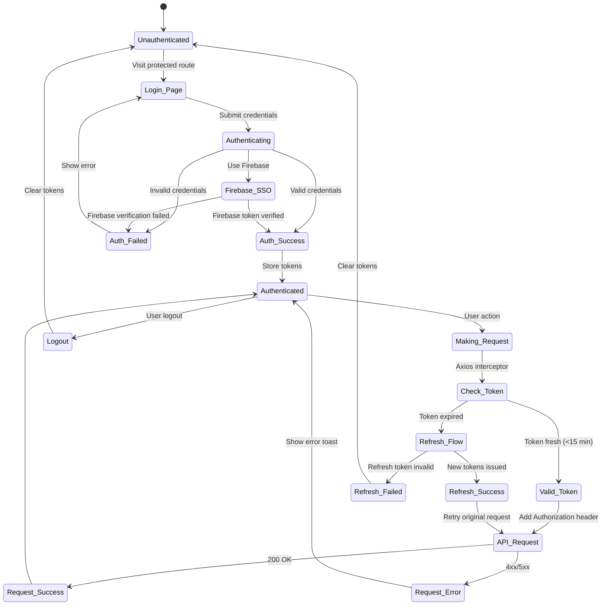
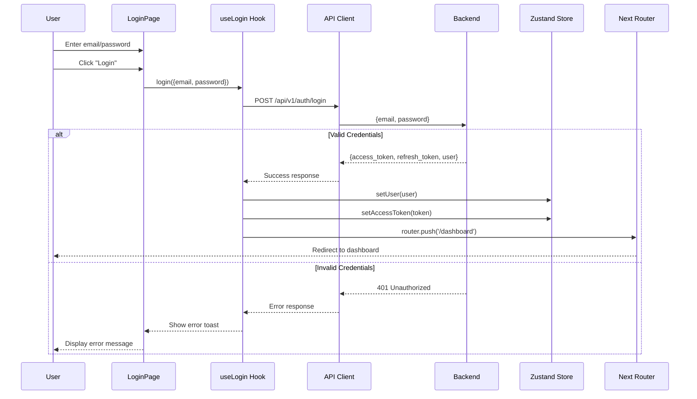
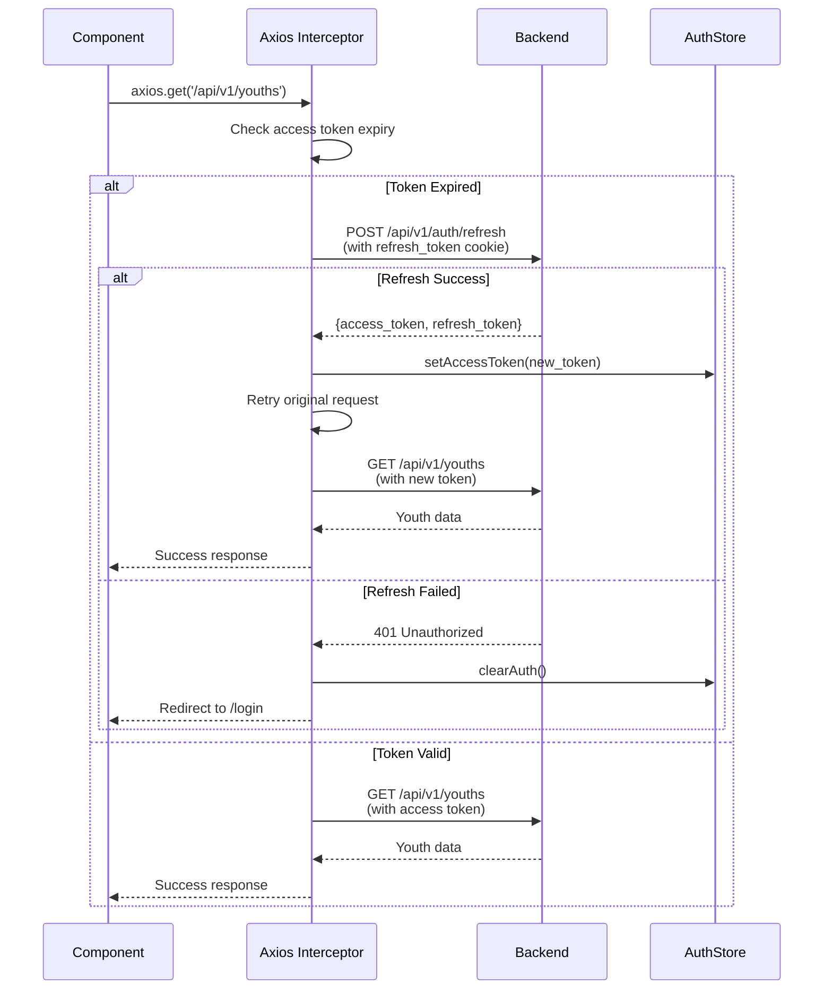
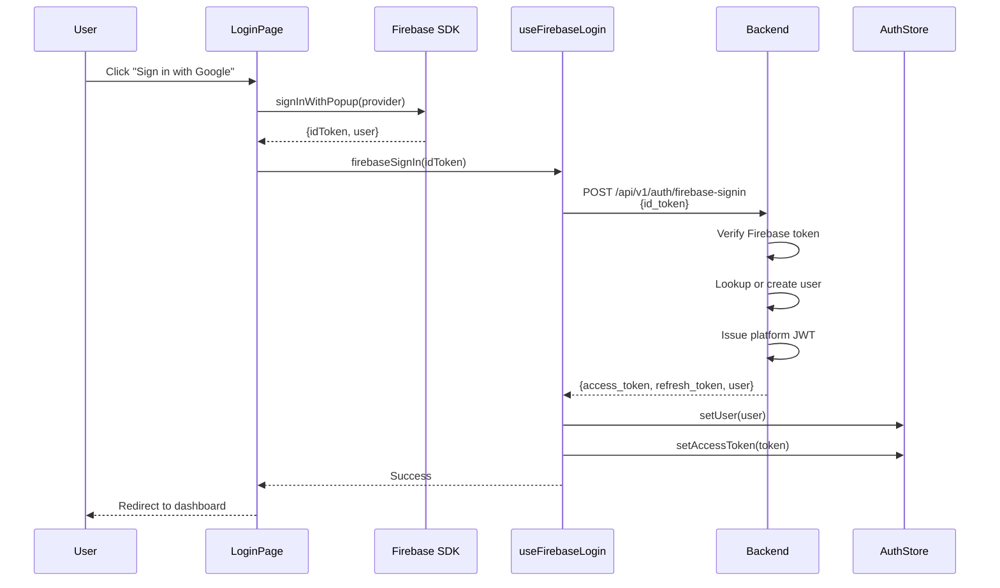

# Authentication Flow - Complete Implementation

**Document**: Authentication Implementation Flowchart
**Version**: 2.0.0
**Date**: October 16, 2026
**Backend API**: /api/v1/auth/* (11 endpoints)

---

## 🔐 Authentication Overview

The Abundance Zone Platform implements a **JWT-based authentication system** with:
- Access tokens (15-minute expiry) - stored in memory
- Refresh tokens (7-day expiry) - stored in httpOnly cookies
- Automatic token rotation on refresh
- Firebase SSO integration (Google, Apple, Phone OTP)
- Single-use refresh tokens with reuse detection

---

## 📊 Complete Authentication Flow



---

## 🔄 Login Flow Sequence



---

## 🔄 Token Refresh Flow



---

## 🔥 Firebase SSO Flow



---

## 📂 Frontend Implementation Structure

### 1. Authentication Feature (`src/features/auth/`)

```typescript
// src/features/auth/api/login.ts
export async function loginApi(credentials: LoginCredentials) {
  const response = await apiClient.post('/api/v1/auth/login', credentials);
  return response.data;
}

// src/features/auth/hooks/useLogin.ts
export function useLogin() {
  const authStore = useAuthStore();
  const router = useRouter();

  return useMutation({
    mutationFn: loginApi,
    onSuccess: (data) => {
      authStore.setUser(data.user);
      authStore.setAccessToken(data.access_token);
      router.push('/dashboard');
      toast.success('Welcome back!');
    },
    onError: (error) => {
      toast.error(error.message);
    },
  });
}

// src/features/auth/components/LoginForm.tsx
export function LoginForm() {
  const { mutate: login, isPending } = useLogin();
  const form = useForm<LoginFormValues>({
    resolver: zodResolver(loginSchema),
  });

  const onSubmit = (values: LoginFormValues) => {
    login(values);
  };

  return (
    <form onSubmit={form.handleSubmit(onSubmit)}>
      {/* Form fields */}
    </form>
  );
}
```

### 2. Zustand Auth Store (`src/features/auth/stores/authStore.ts`)

```typescript
interface AuthState {
  user: User | null;
  accessToken: string | null;
  isAuthenticated: boolean;
  
  setUser: (user: User) => void;
  setAccessToken: (token: string) => void;
  clearAuth: () => void;
}

export const useAuthStore = create<AuthState>((set) => ({
  user: null,
  accessToken: null,
  isAuthenticated: false,

  setUser: (user) => set({ user, isAuthenticated: true }),
  setAccessToken: (token) => set({ accessToken: token }),
  clearAuth: () => set({ user: null, accessToken: null, isAuthenticated: false }),
}));
```

### 3. Axios Interceptors (`src/shared/api/interceptors.ts`)

```typescript
// Request interceptor - add access token
apiClient.interceptors.request.use(
  (config) => {
    const token = useAuthStore.getState().accessToken;
    if (token) {
      config.headers.Authorization = `Bearer ${token}`;
    }
    return config;
  },
  (error) => Promise.reject(error)
);

// Response interceptor - handle token refresh
apiClient.interceptors.response.use(
  (response) => response,
  async (error) => {
    const originalRequest = error.config;

    if (error.response?.status === 401 && !originalRequest._retry) {
      originalRequest._retry = true;

      try {
        // Attempt token refresh
        const response = await apiClient.post('/api/v1/auth/refresh');
        const { access_token } = response.data;

        // Update store
        useAuthStore.getState().setAccessToken(access_token);

        // Retry original request
        originalRequest.headers.Authorization = `Bearer ${access_token}`;
        return apiClient(originalRequest);
      } catch (refreshError) {
        // Refresh failed - logout user
        useAuthStore.getState().clearAuth();
        window.location.href = '/login';
        return Promise.reject(refreshError);
      }
    }

    return Promise.reject(error);
  }
);
```

### 4. Middleware (`src/middleware.ts`)

```typescript
import { NextResponse } from 'next/server';
import type { NextRequest } from 'next/server';
import { jwtDecode } from 'jwt-decode';

const publicPaths = ['/login', '/register', '/forgot-password'];
const roleDashboards = {
  SUPER_ADMIN: '/dashboard/admin',
  BRANCH_COORDINATOR: '/dashboard/coordinator',
  DEPARTMENT_LEADER: '/dashboard/leader',
  YOUTH_MEMBER: '/dashboard/member',
};

export function middleware(request: NextRequest) {
  const { pathname } = request.nextUrl;
  const token = request.cookies.get('az_session')?.value;

  // Public paths - allow if not authenticated
  if (publicPaths.some((path) => pathname.startsWith(path))) {
    if (token) {
      // Already authenticated - redirect to dashboard
      return NextResponse.redirect(new URL('/dashboard', request.url));
    }
    return NextResponse.next();
  }

  // Protected paths - require authentication
  if (!token) {
    return NextResponse.redirect(new URL('/login', request.url));
  }

  try {
    const decoded = jwtDecode<{ role: string; exp: number }>(token);
    
    // Check token expiry
    if (decoded.exp * 1000 < Date.now()) {
      return NextResponse.redirect(new URL('/login', request.url));
    }

    // Role-based access control
    const allowedRole = getRoleForPath(pathname);
    if (allowedRole && !allowedRole.includes(decoded.role)) {
      // Redirect to role's default dashboard
      const dashboard = roleDashboards[decoded.role as keyof typeof roleDashboards];
      return NextResponse.redirect(new URL(dashboard, request.url));
    }

    return NextResponse.next();
  } catch (error) {
    // Invalid token
    return NextResponse.redirect(new URL('/login', request.url));
  }
}

export const config = {
  matcher: ['/((?!api|_next/static|_next/image|favicon.ico).*)'],
};
```

---

## 🧪 Authentication Test Cases

### Unit Tests
```typescript
describe('useLogin', () => {
  it('should store user and token on successful login', async () => {
    const { result } = renderHook(() => useLogin());
    
    act(() => {
      result.current.mutate({ email: 'test@test.com', password: 'password' });
    });

    await waitFor(() => {
      expect(useAuthStore.getState().isAuthenticated).toBe(true);
      expect(useAuthStore.getState().user).toBeDefined();
    });
  });

  it('should show error toast on failed login', async () => {
    // Test implementation
  });
});
```

### Integration Tests
```typescript
describe('Login Flow', () => {
  it('should redirect to dashboard after successful login', async () => {
    render(<LoginPage />);
    
    const emailInput = screen.getByLabelText('Email');
    const passwordInput = screen.getByLabelText('Password');
    const submitButton = screen.getByRole('button', { name: 'Login' });

    await userEvent.type(emailInput, 'admin@test.com');
    await userEvent.type(passwordInput, 'password');
    await userEvent.click(submitButton);

    await waitFor(() => {
      expect(window.location.pathname).toBe('/dashboard');
    });
  });
});
```

---

## 📋 API Endpoints Used

| Endpoint | Method | Purpose |
|----------|--------|---------|
| `/api/v1/auth/login` | POST | Email/password authentication |
| `/api/v1/auth/register` | POST | New user registration |
| `/api/v1/auth/refresh` | POST | Token refresh |
| `/api/v1/auth/logout` | POST | Logout current session |
| `/api/v1/auth/logout-all` | POST | Logout all devices |
| `/api/v1/auth/firebase-signin` | POST | Firebase SSO authentication |
| `/api/v1/auth/request-password-reset` | POST | Request password reset email |
| `/api/v1/auth/reset-password` | POST | Complete password reset |
| `/api/v1/auth/verify-email` | POST | Email verification |
| `/api/v1/auth/resend-verification` | POST | Resend verification email |
| `/api/v1/auth/me` | GET | Get current user profile |

---

## 🔒 Security Considerations

### Token Storage
- ✅ **Access Token**: Stored in Zustand (memory) - XSS safe
- ✅ **Refresh Token**: httpOnly cookie - XSS safe
- ❌ **Never** store tokens in localStorage

### Token Rotation
- Single-use refresh tokens prevent token reuse attacks
- Backend detects token reuse and revokes all user sessions

### CSRF Protection
- Refresh tokens in httpOnly cookies are CSRF-safe
- API uses Authorization header for access tokens

### Password Requirements
- Minimum 8 characters
- At least 1 uppercase, 1 lowercase, 1 number
- Validated with Zod schema

---

**Next Document**: `10-AUTH-IMPLEMENTATION.md` for complete authentication feature implementation guide.
