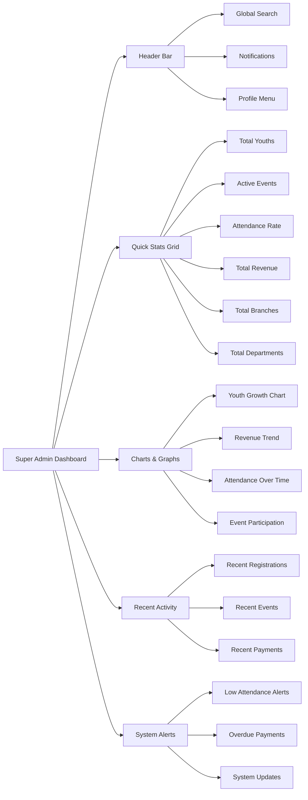
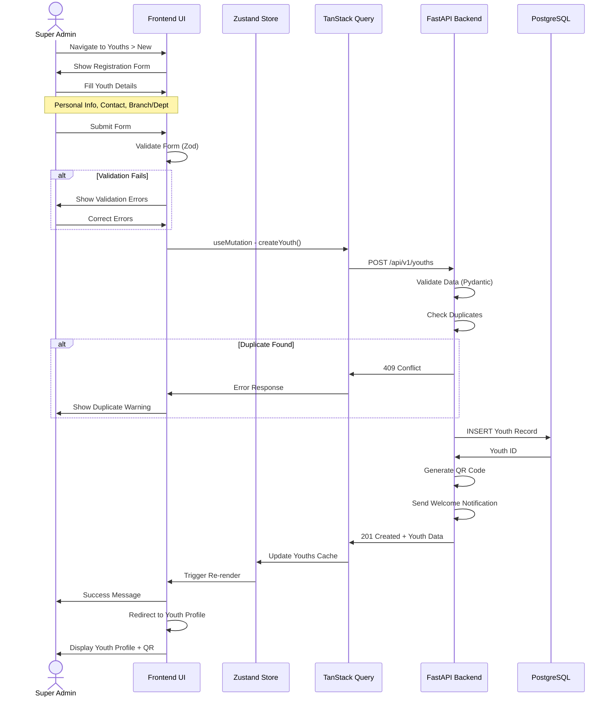
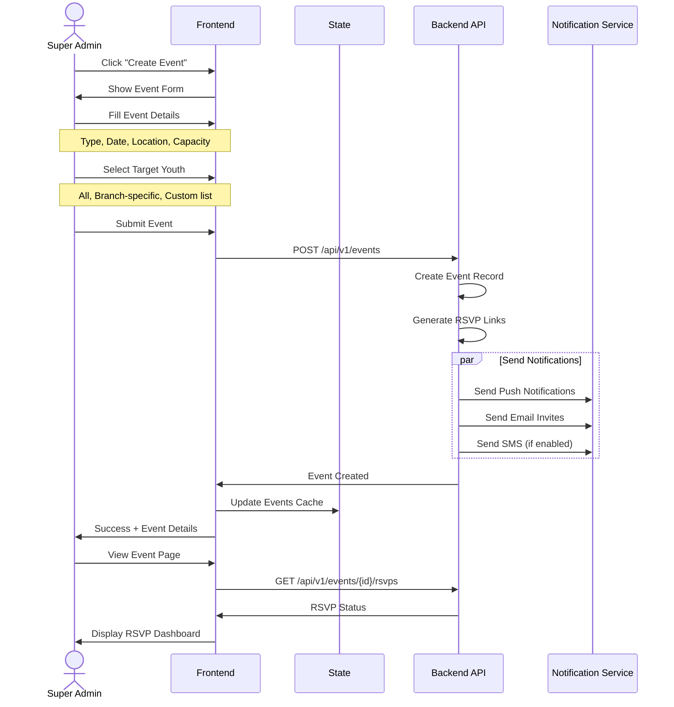
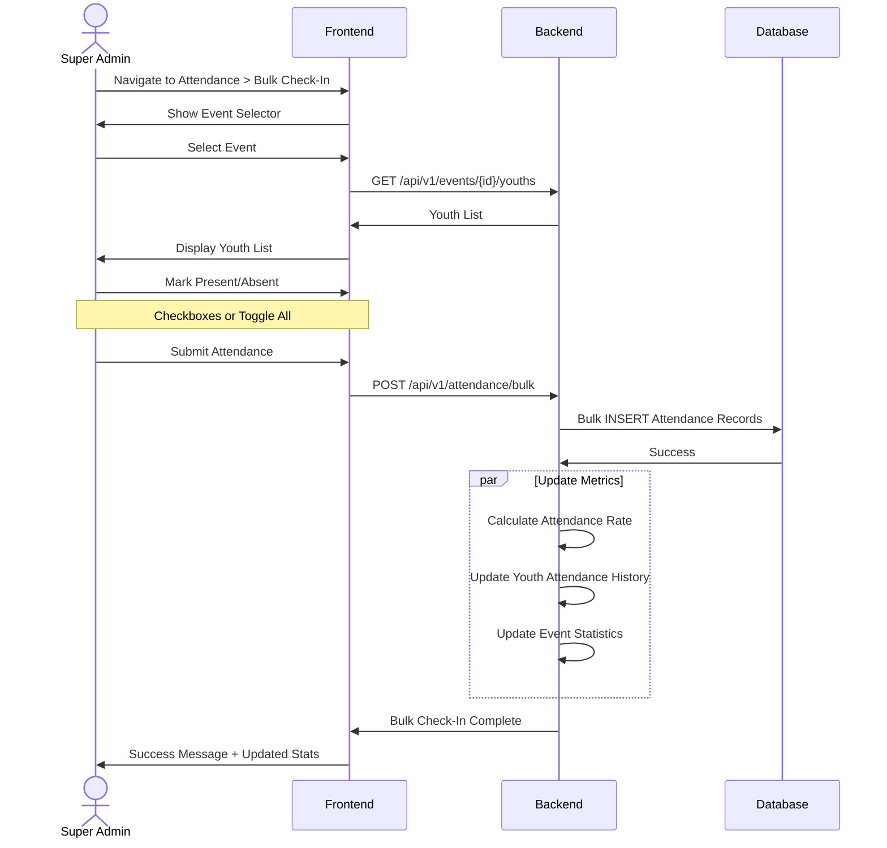
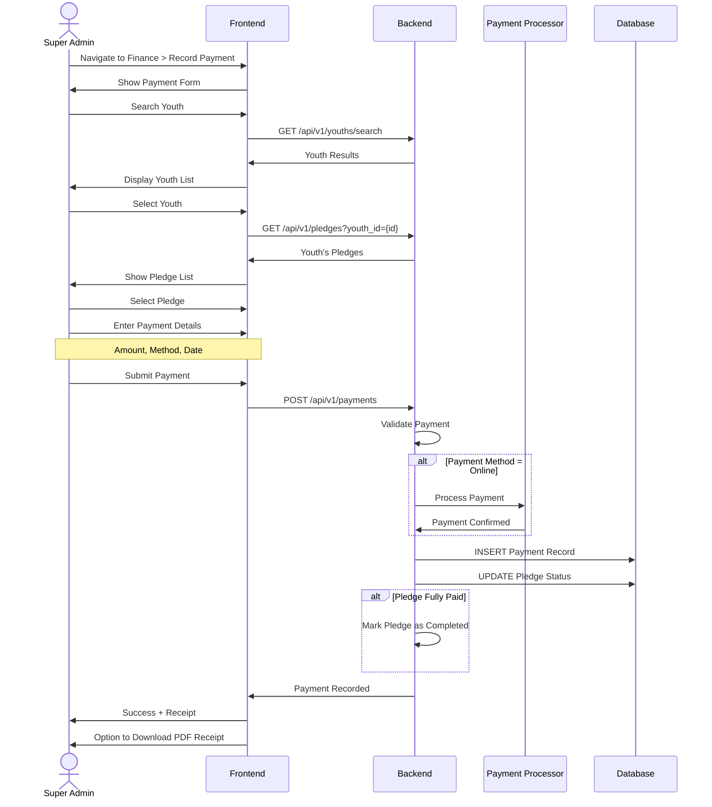

# Super Admin Journey - Complete User Flow

**Document**: Super Admin User Journey Flowchart  
**Version**: 2.0.0  
**Date**: October 16, 2026  
**Role**: SUPER_ADMIN (Highest privilege level)

---

## 🎯 Super Admin Overview

**Super Admin** is the highest privilege level with access to:
- ✅ All platform features and data
- ✅ System-wide analytics and insights
- ✅ Multi-branch management
- ✅ User role assignment
- ✅ Financial oversight across all branches
- ✅ Platform configuration and settings
- ✅ Data export and reporting

---

## 🗺️ Complete Journey Map

```mermaid
graph TB
    START([User Visits Platform]) --> LOGIN[Login Page]
    LOGIN --> AUTH{Authenticate}
    
    AUTH -->|Invalid| LOGIN_ERROR[Show Error Message]
    LOGIN_ERROR --> LOGIN
    
    AUTH -->|Valid - SUPER_ADMIN| ADMIN_DASH[Super Admin Dashboard]
    
    ADMIN_DASH --> OVERVIEW[Dashboard Overview]
    OVERVIEW --> QUICK_STATS[View Quick Stats]
    OVERVIEW --> RECENT_ACTIVITY[View Recent Activity]
    OVERVIEW --> ALERTS[Check System Alerts]
    
    ADMIN_DASH --> NAV_CHOICE{Choose Navigation}
    
    NAV_CHOICE --> YOUTH_MGMT[Youth Management]
    NAV_CHOICE --> EVENT_MGMT[Event Management]
    NAV_CHOICE --> ATTENDANCE_MGMT[Attendance Management]
    NAV_CHOICE --> FINANCE_MGMT[Finance Management]
    NAV_CHOICE --> ANALYTICS[Analytics & Insights]
    NAV_CHOICE --> SETTINGS[Settings & Config]
    
    %% Youth Management Flow
    YOUTH_MGMT --> YOUTH_LIST[View All Youths]
    YOUTH_LIST --> YOUTH_FILTER[Filter by Branch/Dept/Status]
    YOUTH_LIST --> YOUTH_SEARCH[Search Youth]
    YOUTH_LIST --> YOUTH_ACTIONS{Select Action}
    
    YOUTH_ACTIONS --> VIEW_YOUTH[View Youth Profile]
    YOUTH_ACTIONS --> EDIT_YOUTH[Edit Youth Details]
    YOUTH_ACTIONS --> CREATE_YOUTH[Create New Youth]
    YOUTH_ACTIONS --> BULK_IMPORT[Bulk Import Youths]
    YOUTH_ACTIONS --> EXPORT_YOUTH[Export Youth Data]
    
    VIEW_YOUTH --> YOUTH_PROFILE[View Complete Profile]
    YOUTH_PROFILE --> YOUTH_ATTENDANCE_HISTORY[View Attendance History]
    YOUTH_PROFILE --> YOUTH_EVENT_HISTORY[View Event Participation]
    YOUTH_PROFILE --> YOUTH_PAYMENT_HISTORY[View Payment History]
    
    EDIT_YOUTH --> UPDATE_PERSONAL[Update Personal Info]
    EDIT_YOUTH --> UPDATE_CONTACT[Update Contact Details]
    EDIT_YOUTH --> UPDATE_BRANCH[Reassign Branch/Department]
    EDIT_YOUTH --> UPDATE_STATUS[Change Status]
    UPDATE_PERSONAL --> SAVE_YOUTH[Save Changes]
    UPDATE_CONTACT --> SAVE_YOUTH
    UPDATE_BRANCH --> SAVE_YOUTH
    UPDATE_STATUS --> SAVE_YOUTH
    
    CREATE_YOUTH --> YOUTH_FORM[Fill Youth Registration Form]
    YOUTH_FORM --> VALIDATE_YOUTH{Validate Data}
    VALIDATE_YOUTH -->|Invalid| FORM_ERRORS[Show Validation Errors]
    FORM_ERRORS --> YOUTH_FORM
    VALIDATE_YOUTH -->|Valid| SUBMIT_YOUTH[Submit Youth Record]
    SUBMIT_YOUTH --> YOUTH_CREATED[Youth Created Successfully]
    
    %% Event Management Flow
    EVENT_MGMT --> EVENT_LIST[View All Events]
    EVENT_LIST --> EVENT_FILTER[Filter by Branch/Date/Type]
    EVENT_LIST --> EVENT_CALENDAR[View Calendar View]
    EVENT_LIST --> EVENT_ACTIONS{Select Action}
    
    EVENT_ACTIONS --> VIEW_EVENT[View Event Details]
    EVENT_ACTIONS --> CREATE_EVENT[Create New Event]
    EVENT_ACTIONS --> EDIT_EVENT[Edit Event]
    EVENT_ACTIONS --> CANCEL_EVENT[Cancel Event]
    
    VIEW_EVENT --> EVENT_DETAILS[View Event Info]
    EVENT_DETAILS --> EVENT_ATTENDEES[View Attendees]
    EVENT_DETAILS --> EVENT_RSVP[Manage RSVPs]
    EVENT_DETAILS --> EVENT_ATTENDANCE[Record Attendance]
    
    CREATE_EVENT --> EVENT_FORM[Fill Event Form]
    EVENT_FORM --> EVENT_TYPE[Select Event Type]
    EVENT_FORM --> EVENT_BRANCH[Assign Branch/Department]
    EVENT_FORM --> EVENT_DATETIME[Set Date & Time]
    EVENT_FORM --> EVENT_LOCATION[Set Location]
    EVENT_FORM --> EVENT_CAPACITY[Set Capacity]
    EVENT_FORM --> VALIDATE_EVENT{Validate Event}
    VALIDATE_EVENT -->|Invalid| EVENT_ERRORS[Show Errors]
    EVENT_ERRORS --> EVENT_FORM
    VALIDATE_EVENT -->|Valid| SUBMIT_EVENT[Create Event]
    SUBMIT_EVENT --> EVENT_CREATED[Event Created]
    
    %% Attendance Management Flow
    ATTENDANCE_MGMT --> ATTENDANCE_VIEW[Attendance Dashboard]
    ATTENDANCE_VIEW --> ATTENDANCE_ACTIONS{Select Action}
    
    ATTENDANCE_ACTIONS --> CHECKIN[Manual Check-In]
    ATTENDANCE_ACTIONS --> BULK_CHECKIN[Bulk Check-In]
    ATTENDANCE_ACTIONS --> ATTENDANCE_REPORTS[View Reports]
    ATTENDANCE_ACTIONS --> ATTENDANCE_TRENDS[View Trends]
    
    CHECKIN --> SELECT_EVENT_CHECKIN[Select Event]
    SELECT_EVENT_CHECKIN --> SCAN_QR[Scan Youth QR Code]
    SCAN_QR --> VERIFY_YOUTH{Verify Youth}
    VERIFY_YOUTH -->|Valid| RECORD_CHECKIN[Record Check-In]
    VERIFY_YOUTH -->|Invalid| CHECKIN_ERROR[Show Error]
    CHECKIN_ERROR --> SCAN_QR
    RECORD_CHECKIN --> CHECKIN_SUCCESS[Check-In Successful]
    
    BULK_CHECKIN --> SELECT_EVENT_BULK[Select Event]
    SELECT_EVENT_BULK --> YOUTH_LIST_BULK[View Youth List]
    YOUTH_LIST_BULK --> MARK_PRESENT[Mark Attendance]
    MARK_PRESENT --> SAVE_BULK[Save Bulk Attendance]
    
    ATTENDANCE_REPORTS --> REPORT_FILTER[Filter by Branch/Date/Youth]
    REPORT_FILTER --> REPORT_VIEW[View Report]
    REPORT_VIEW --> EXPORT_REPORT[Export Report]
    
    %% Finance Management Flow
    FINANCE_MGMT --> FINANCE_DASH[Finance Dashboard]
    FINANCE_DASH --> FINANCE_ACTIONS{Select Action}
    
    FINANCE_ACTIONS --> VIEW_PLEDGES[View All Pledges]
    FINANCE_ACTIONS --> RECORD_PAYMENT[Record Payment]
    FINANCE_ACTIONS --> FINANCE_REPORTS[Financial Reports]
    FINANCE_ACTIONS --> BRANCH_FINANCE[Branch-wise Finance]
    
    VIEW_PLEDGES --> PLEDGE_FILTER[Filter Pledges]
    PLEDGE_FILTER --> PLEDGE_STATUS[Filter by Status]
    PLEDGE_STATUS --> PLEDGE_LIST[View Pledge List]
    PLEDGE_LIST --> PLEDGE_DETAIL[View Pledge Details]
    
    RECORD_PAYMENT --> SELECT_YOUTH_PAY[Select Youth]
    SELECT_YOUTH_PAY --> SELECT_PLEDGE[Select Pledge]
    SELECT_PLEDGE --> PAYMENT_FORM[Fill Payment Details]
    PAYMENT_FORM --> PAYMENT_AMOUNT[Enter Amount]
    PAYMENT_FORM --> PAYMENT_METHOD[Select Method]
    PAYMENT_FORM --> PAYMENT_DATE[Select Date]
    PAYMENT_FORM --> VALIDATE_PAYMENT{Validate}
    VALIDATE_PAYMENT -->|Invalid| PAY_ERROR[Show Errors]
    PAY_ERROR --> PAYMENT_FORM
    VALIDATE_PAYMENT -->|Valid| SUBMIT_PAYMENT[Record Payment]
    SUBMIT_PAYMENT --> PAYMENT_SUCCESS[Payment Recorded]
    
    FINANCE_REPORTS --> REPORT_TYPE{Select Report Type}
    REPORT_TYPE --> REVENUE_REPORT[Revenue Report]
    REPORT_TYPE --> PLEDGE_REPORT[Pledge Summary]
    REPORT_TYPE --> OUTSTANDING_REPORT[Outstanding Payments]
    REVENUE_REPORT --> VIEW_FINANCE_DATA[View Financial Data]
    PLEDGE_REPORT --> VIEW_FINANCE_DATA
    OUTSTANDING_REPORT --> VIEW_FINANCE_DATA
    VIEW_FINANCE_DATA --> EXPORT_FINANCE[Export Report]
    
    %% Analytics Flow
    ANALYTICS --> ANALYTICS_DASH[Analytics Dashboard]
    ANALYTICS_DASH --> ANALYTICS_CHOICE{Select Analytics}
    
    ANALYTICS_CHOICE --> YOUTH_ANALYTICS[Youth Analytics]
    ANALYTICS_CHOICE --> EVENT_ANALYTICS[Event Analytics]
    ANALYTICS_CHOICE --> ATTENDANCE_ANALYTICS[Attendance Analytics]
    ANALYTICS_CHOICE --> FINANCE_ANALYTICS[Finance Analytics]
    ANALYTICS_CHOICE --> AI_INSIGHTS[AI-Powered Insights]
    
    YOUTH_ANALYTICS --> YOUTH_GROWTH[Growth Trends]
    YOUTH_ANALYTICS --> YOUTH_DEMOGRAPHICS[Demographics]
    YOUTH_ANALYTICS --> YOUTH_ENGAGEMENT[Engagement Metrics]
    
    EVENT_ANALYTICS --> EVENT_PARTICIPATION[Participation Rates]
    EVENT_ANALYTICS --> EVENT_TRENDS[Event Trends]
    EVENT_ANALYTICS --> EVENT_POPULAR[Popular Events]
    
    ATTENDANCE_ANALYTICS --> ATTENDANCE_RATE[Overall Attendance Rate]
    ATTENDANCE_ANALYTICS --> ATTENDANCE_BY_BRANCH[By Branch]
    ATTENDANCE_ANALYTICS --> ATTENDANCE_BY_EVENT[By Event Type]
    
    FINANCE_ANALYTICS --> REVENUE_TRENDS[Revenue Trends]
    FINANCE_ANALYTICS --> PLEDGE_FULFILLMENT[Pledge Fulfillment Rate]
    FINANCE_ANALYTICS --> BRANCH_REVENUE[Branch-wise Revenue]
    
    AI_INSIGHTS --> PREDICTIVE[Predictive Insights]
    AI_INSIGHTS --> RISK_ANALYSIS[Risk Analysis]
    AI_INSIGHTS --> RECOMMENDATIONS[Recommendations]
    
    %% Settings Flow
    SETTINGS --> SETTINGS_MENU{Select Setting}
    
    SETTINGS_MENU --> PROFILE_SETTINGS[Profile Settings]
    SETTINGS_MENU --> SECURITY_SETTINGS[Security Settings]
    SETTINGS_MENU --> NOTIFICATION_SETTINGS[Notification Settings]
    SETTINGS_MENU --> SYSTEM_SETTINGS[System Configuration]
    
    PROFILE_SETTINGS --> UPDATE_PROFILE[Update Personal Info]
    PROFILE_SETTINGS --> CHANGE_AVATAR[Change Avatar]
    UPDATE_PROFILE --> SAVE_PROFILE[Save Profile]
    CHANGE_AVATAR --> SAVE_PROFILE
    
    SECURITY_SETTINGS --> CHANGE_PASSWORD[Change Password]
    SECURITY_SETTINGS --> ENABLE_2FA[Enable 2FA]
    SECURITY_SETTINGS --> SESSION_MGMT[Manage Sessions]
    
    NOTIFICATION_SETTINGS --> EMAIL_PREFS[Email Preferences]
    NOTIFICATION_SETTINGS --> PUSH_PREFS[Push Notification Prefs]
    NOTIFICATION_SETTINGS --> SMS_PREFS[SMS Preferences]
    
    SYSTEM_SETTINGS --> BRANCH_CONFIG[Branch Configuration]
    SYSTEM_SETTINGS --> ROLE_MGMT[Role Management]
    SYSTEM_SETTINGS --> PLATFORM_CONFIG[Platform Settings]
    
    %% Logout Flow
    ADMIN_DASH --> LOGOUT{Logout}
    LOGOUT --> CONFIRM_LOGOUT[Confirm Logout]
    CONFIRM_LOGOUT --> CLEAR_SESSION[Clear Session]
    CLEAR_SESSION --> LOGIN
    
    style ADMIN_DASH fill:#2196F3,stroke:#1976D2,stroke-width:3px
    style YOUTH_MGMT fill:#4CAF50,stroke:#388E3C,stroke-width:2px
    style EVENT_MGMT fill:#FF9800,stroke:#F57C00,stroke-width:2px
    style ATTENDANCE_MGMT fill:#9C27B0,stroke:#7B1FA2,stroke-width:2px
    style FINANCE_MGMT fill:#F44336,stroke:#D32F2F,stroke-width:2px
    style ANALYTICS fill:#00BCD4,stroke:#0097A7,stroke-width:2px
    style SETTINGS fill:#607D8B,stroke:#455A64,stroke-width:2px
```



---

## 📊 Dashboard View Breakdown

### Super Admin Dashboard Components



---

## 🔄 Key User Flows

### Flow 1: Youth Registration (Complete Process)



### Flow 2: Event Creation with RSVP



### Flow 3: Bulk Attendance Check-In



### Flow 4: Financial Payment Recording



---

## 🎨 UI Component Hierarchy

### Youth Management Page Structure

```
YouthManagementPage
├── YouthsHeader
│   ├── PageTitle
│   ├── SearchBar
│   └── ActionButtons
│       ├── CreateYouthButton
│       ├── BulkImportButton
│       └── ExportButton
├── YouthsFilters
│   ├── BranchFilter (Dropdown)
│   ├── DepartmentFilter (Dropdown)
│   ├── StatusFilter (Multi-select)
│   └── DateRangeFilter
├── YouthsTable
│   ├── TableHeader
│   │   ├── SelectAllCheckbox
│   │   └── SortableColumns
│   ├── TableBody
│   │   └── YouthRow (foreach youth)
│   │       ├── Avatar
│   │       ├── Name
│   │       ├── Branch/Department
│   │       ├── Contact
│   │       ├── Status Badge
│   │       └── ActionMenu
│   │           ├── View Profile
│   │           ├── Edit
│   │           ├── Download QR
│   │           └── Deactivate
│   └── TableFooter
│       └── Pagination
└── BulkActionsBar (when rows selected)
    ├── ExportSelected
    ├── SendNotification
    └── BulkStatusChange
```

### Event Management Page Structure

```
EventManagementPage
├── EventsHeader
│   ├── PageTitle
│   ├── ViewToggle (Calendar/List)
│   └── CreateEventButton
├── EventsFilters
│   ├── BranchFilter
│   ├── EventTypeFilter
│   ├── DateRangeFilter
│   └── StatusFilter
├── EventsContent
│   ├── CalendarView (if selected)
│   │   ├── MonthNavigator
│   │   ├── CalendarGrid
│   │   └── EventPopover (on hover)
│   └── ListView (if selected)
│       └── EventCard (foreach event)
│           ├── EventImage
│           ├── EventDetails
│           │   ├── Title
│           │   ├── Date & Time
│           │   ├── Location
│           │   └── RSVP Count
│           ├── StatusBadge
│           └── ActionButtons
│               ├── View Details
│               ├── Edit
│               └── Cancel Event
└── Pagination (for List View)
```

---

## 🔐 Permission Matrix for Super Admin

| Feature | Create | Read | Update | Delete | Export | Bulk Actions |
|---------|--------|------|--------|--------|--------|--------------|
| **Youths** | ✅ | ✅ | ✅ | ✅ | ✅ | ✅ |
| **Events** | ✅ | ✅ | ✅ | ✅ | ✅ | ✅ |
| **Attendance** | ✅ | ✅ | ✅ | ✅ | ✅ | ✅ |
| **Finance** | ✅ | ✅ | ✅ | ✅ | ✅ | ✅ |
| **Branches** | ✅ | ✅ | ✅ | ✅ | ✅ | ❌ |
| **Departments** | ✅ | ✅ | ✅ | ✅ | ✅ | ❌ |
| **Users** | ✅ | ✅ | ✅ | ✅ | ✅ | ✅ |
| **Roles** | ✅ | ✅ | ✅ | ✅ | ❌ | ❌ |
| **Analytics** | ❌ | ✅ | ❌ | ❌ | ✅ | ❌ |
| **System Settings** | ❌ | ✅ | ✅ | ❌ | ❌ | ❌ |

---

## 📈 Analytics Dashboard for Super Admin

```mermaid
graph TB
    ANALYTICS[Analytics Dashboard] --> OVERVIEW[Overview Section]
    ANALYTICS --> DETAILED[Detailed Analytics]
    
    OVERVIEW --> KPIS[Key Performance Indicators]
    KPIS --> YOUTH_COUNT[Total Youth Count]
    KPIS --> ATTENDANCE_AVG[Average Attendance]
    KPIS --> REVENUE_TOTAL[Total Revenue]
    KPIS --> EVENT_COUNT[Total Events]
    
    OVERVIEW --> TRENDS[Trend Charts]
    TRENDS --> YOUTH_GROWTH[Youth Growth Trend]
    TRENDS --> REVENUE_TREND[Revenue Trend]
    TRENDS --> ATTENDANCE_TREND[Attendance Trend]
    
    DETAILED --> BRANCH_ANALYTICS[Branch Analytics]
    DETAILED --> DEPT_ANALYTICS[Department Analytics]
    DETAILED --> FINANCIAL_ANALYTICS[Financial Analytics]
    DETAILED --> ENGAGEMENT_ANALYTICS[Engagement Analytics]
    
    BRANCH_ANALYTICS --> BRANCH_COMPARE[Compare Branches]
    BRANCH_ANALYTICS --> BRANCH_PERFORMANCE[Performance Metrics]
    
    DEPT_ANALYTICS --> DEPT_GROWTH[Department Growth]
    DEPT_ANALYTICS --> DEPT_ENGAGEMENT[Department Engagement]
    
    FINANCIAL_ANALYTICS --> PLEDGE_ANALYSIS[Pledge Analysis]
    FINANCIAL_ANALYTICS --> PAYMENT_ANALYSIS[Payment Analysis]
    FINANCIAL_ANALYTICS --> REVENUE_FORECAST[Revenue Forecast]
    
    ENGAGEMENT_ANALYTICS --> EVENT_PARTICIPATION[Event Participation]
    ENGAGEMENT_ANALYTICS --> ATTENDANCE_PATTERNS[Attendance Patterns]
    ENGAGEMENT_ANALYTICS --> RETENTION_RATE[Retention Rate]
```



---

## 🔔 Notification Scenarios for Super Admin

| Scenario | Notification Type | Trigger | Priority | Action Required |
|----------|-------------------|---------|----------|-----------------|
| **New Youth Registration** | Push + Email | Youth created | Low | Review profile |
| **Event Created** | Push | Event created by coordinator | Low | None |
| **Low Attendance Alert** | Push + Email | Attendance < 50% | High | Investigate |
| **Overdue Payments** | Email | Payment 7 days overdue | Medium | Follow-up |
| **System Update Available** | In-App | New version released | Low | Schedule update |
| **Branch Coordinator Request** | Push + Email | Resource/permission request | Medium | Approve/Deny |
| **Financial Milestone** | Email | Revenue target reached | Low | Celebrate 🎉 |
| **Data Export Ready** | Push + Email | Export processing complete | Low | Download |
| **Security Alert** | Push + Email + SMS | Suspicious activity | Critical | Immediate action |
| **Bulk Import Complete** | Push | Bulk youth import finished | Low | Review results |

---

## 🛠️ Super Admin Settings & Configuration

### Profile Settings
- Update personal information
- Change avatar/profile picture
- Set notification preferences
- Configure dashboard layout

### Security Settings
- Change password
- Enable/disable 2FA
- View active sessions
- Review login history
- Set session timeout

### System Configuration
- Branch management (create, edit, archive)
- Department management
- User role assignment
- Platform-wide settings
- Email/SMS configuration
- Payment gateway settings

### Data Management
- Schedule automated backups
- Export platform data
- Import bulk data
- Data retention policies
- Audit log access

---

## 📱 Mobile App Experience for Super Admin

### Mobile-Specific Features
- **Quick Actions**: Floating action button for common tasks
- **Push Notifications**: Real-time alerts
- **Offline Mode**: View cached data
- **QR Scanner**: Quick youth check-in
- **Voice Search**: Hands-free youth lookup
- **Biometric Auth**: Fingerprint/Face ID login

### Mobile Navigation
```
Bottom Navigation Bar:
├── Dashboard (Home icon)
├── Youths (Users icon)
├── Events (Calendar icon)
├── Quick Action (Plus icon - floating)
└── More (Menu icon)

More Menu:
├── Attendance
├── Finance
├── Analytics
├── Settings
└── Logout
```

---

## ⚡ Quick Actions & Shortcuts

| Action | Keyboard Shortcut | Context Menu | Quick Action Button |
|--------|-------------------|--------------|---------------------|
| Create Youth | `Ctrl/Cmd + N` | ✅ | ✅ |
| Search Youth | `Ctrl/Cmd + K` | ✅ | ❌ |
| Create Event | `Ctrl/Cmd + E` | ✅ | ✅ |
| Check-In | `Ctrl/Cmd + I` | ✅ | ✅ |
| Record Payment | `Ctrl/Cmd + P` | ✅ | ✅ |
| Export Data | `Ctrl/Cmd + Shift + E` | ✅ | ❌ |
| View Analytics | `Ctrl/Cmd + A` | ✅ | ❌ |
| Settings | `Ctrl/Cmd + ,` | ✅ | ❌ |
| Logout | `Ctrl/Cmd + L` | ✅ | ❌ |

---

## 🎯 Success Metrics for Super Admin

### Key Metrics to Monitor
1. **Youth Growth Rate**: Month-over-month percentage increase
2. **Attendance Rate**: Average across all events
3. **Revenue Achievement**: Actual vs. pledged amounts
4. **Event Participation**: Average attendees per event
5. **Branch Performance**: Comparative metrics
6. **User Engagement**: Active users, session duration
7. **Retention Rate**: Youth retention over time
8. **Financial Health**: Revenue trends, outstanding amounts

### Dashboard Widgets
- Youth Growth Chart (Line)
- Attendance Heatmap (Calendar)
- Revenue Funnel (Funnel)
- Branch Comparison (Bar)
- Event Participation (Pie)
- Payment Status (Donut)
- Top Performers (Leaderboard)
- Recent Activity (Timeline)

---

**Next Document**: `07-BRANCH-COORDINATOR-JOURNEY.md` - Branch Coordinator user journey with branch-level management focus.
