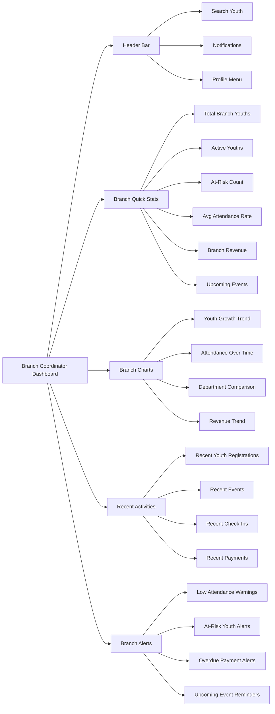
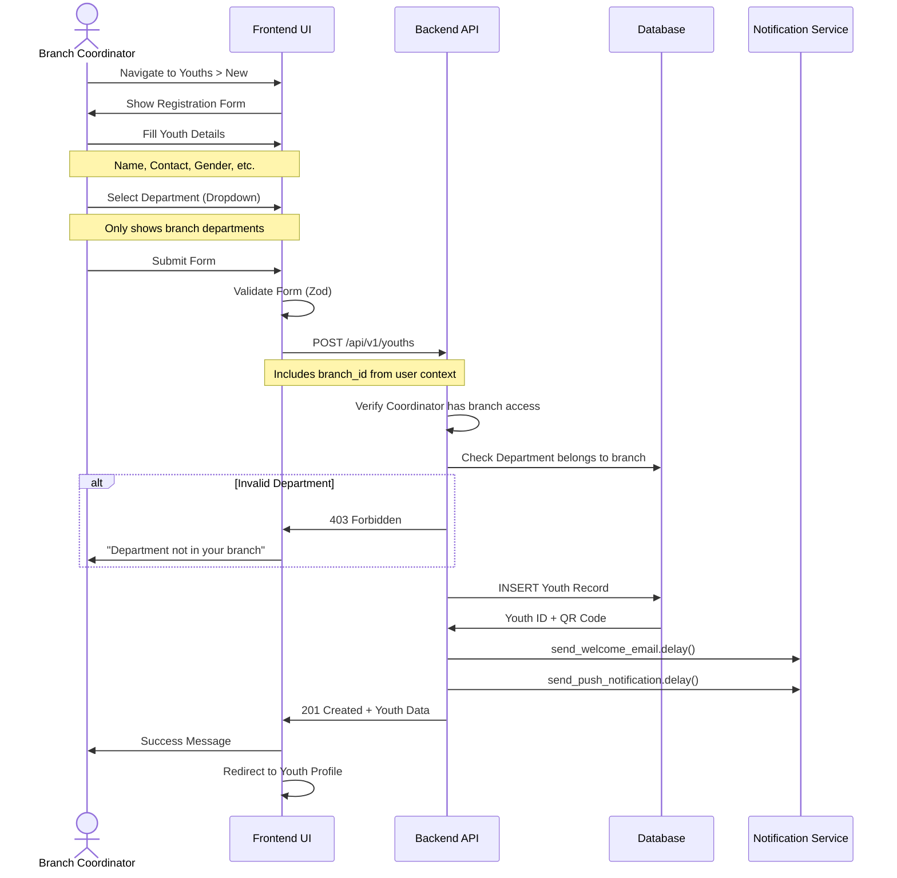
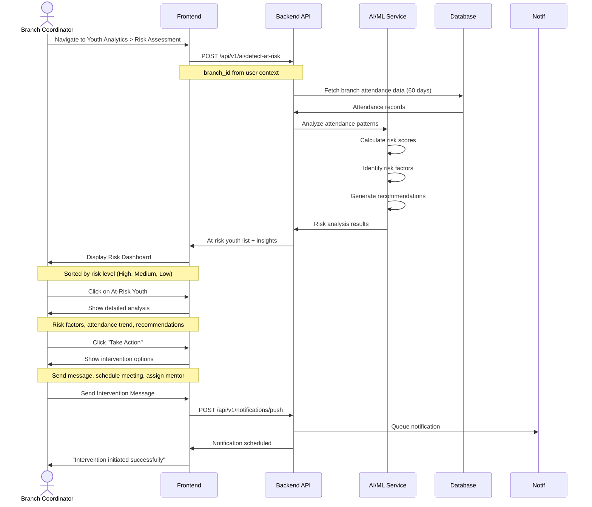
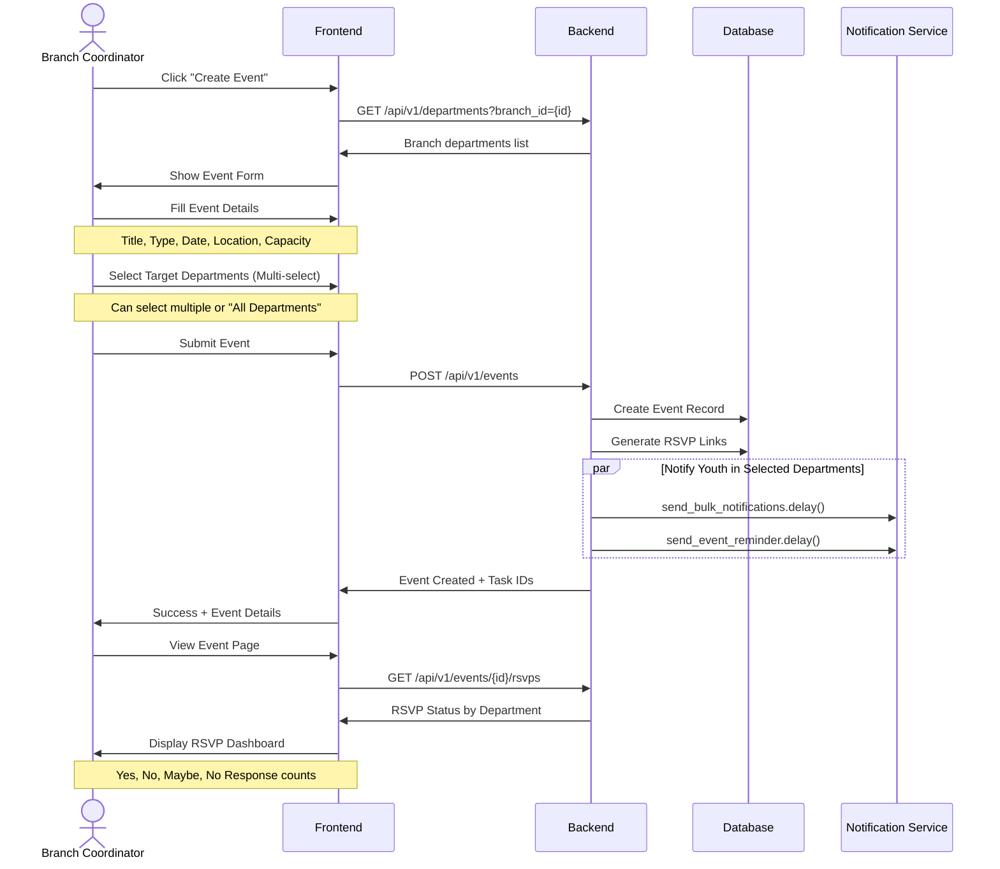
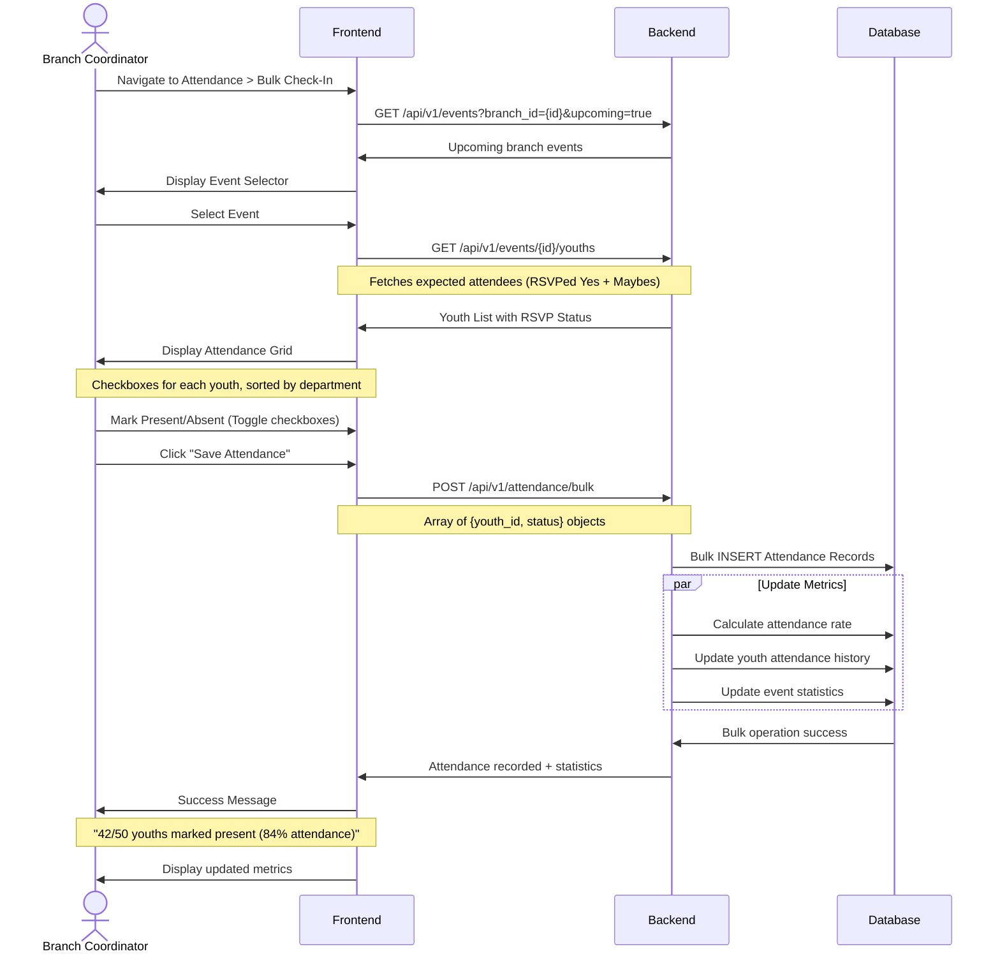
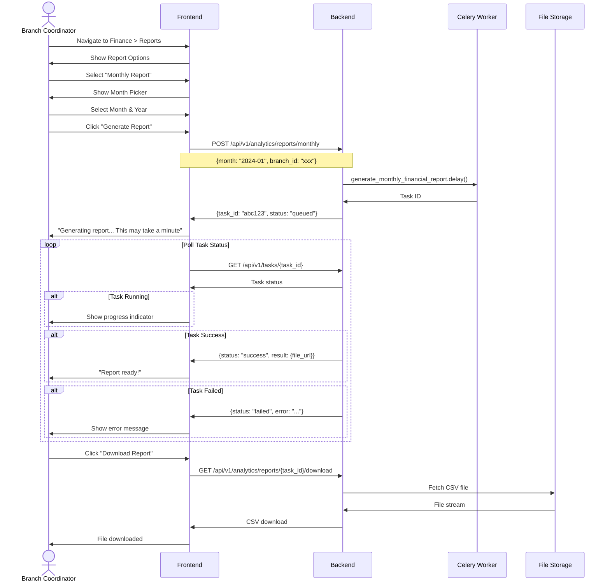

**Document**: Branch Coordinator User Journey Flowchart
**Version**: 2.0.0
**Date**: October 16, 2026
**Role**: BRANCH_COORDINATOR (Branch-level management)

---

## 🎯 Branch Coordinator Overview

**Branch Coordinator** manages a single branch with access to:

- ✅ Branch-level youth management (assigned branch only)
- ✅ Event creation and management for their branch
- ✅ Attendance tracking and reporting (branch-scoped)
- ✅ Financial oversight for their branch
- ✅ Department leader oversight
- ✅ Branch-level analytics and insights
- ✅ Push notification capabilities (branch-scoped)
- ❌ NO access to other branches or system-wide settings

---

## 🗺️ Complete Journey Map

```mermaid
graph TB
    START([User Visits Platform]) --> LOGIN[Login Page]
    LOGIN --> AUTH{Authenticate}
  
    AUTH -->|Invalid| LOGIN_ERROR[Show Error Message]
    LOGIN_ERROR --> LOGIN
  
    AUTH -->|Valid - BRANCH_COORDINATOR| COORD_DASH[Branch Coordinator Dashboard]
  
    COORD_DASH --> OVERVIEW[Branch Dashboard Overview]
    OVERVIEW --> BRANCH_STATS[View Branch Statistics]
    OVERVIEW --> MY_BRANCH_ACTIVITY[View Branch Activity]
    OVERVIEW --> BRANCH_ALERTS[Check Branch Alerts]
  
    COORD_DASH --> NAV_CHOICE{Choose Navigation}
  
    NAV_CHOICE --> YOUTH_MGMT[Youth Management]
    NAV_CHOICE --> EVENT_MGMT[Event Management]
    NAV_CHOICE --> ATTENDANCE_MGMT[Attendance Management]
    NAV_CHOICE --> FINANCE_MGMT[Finance Management]
    NAV_CHOICE --> DEPT_MGMT[Department Management]
    NAV_CHOICE --> ANALYTICS[Branch Analytics]
    NAV_CHOICE --> NOTIFICATIONS[Notifications]
    NAV_CHOICE --> SETTINGS[Settings]
  
    %% Youth Management Flow (Branch-Scoped)
    YOUTH_MGMT --> YOUTH_LIST[View Branch Youths Only]
    YOUTH_LIST --> YOUTH_FILTER[Filter by Department/Status]
    YOUTH_LIST --> YOUTH_SEARCH[Search Branch Youth]
    YOUTH_LIST --> YOUTH_ACTIONS{Select Action}
  
    YOUTH_ACTIONS --> VIEW_YOUTH[View Youth Profile]
    YOUTH_ACTIONS --> EDIT_YOUTH[Edit Youth Details]
    YOUTH_ACTIONS --> CREATE_YOUTH[Register New Youth]
    YOUTH_ACTIONS --> BULK_IMPORT[Bulk Import]
    YOUTH_ACTIONS --> EXPORT_YOUTH[Export Branch Youth]
    YOUTH_ACTIONS --> AI_RISK[View AI Risk Assessment]
  
    VIEW_YOUTH --> YOUTH_PROFILE[View Youth Details]
    YOUTH_PROFILE --> YOUTH_ATTENDANCE[View Attendance History]
    YOUTH_PROFILE --> YOUTH_EVENTS[View Event Participation]
    YOUTH_PROFILE --> YOUTH_PAYMENTS[View Payment History]
    YOUTH_PROFILE --> YOUTH_ENGAGEMENT[View Engagement Score]
  
    AI_RISK --> RISK_DASHBOARD[Risk Assessment Dashboard]
    RISK_DASHBOARD --> AT_RISK_YOUTHS[View At-Risk Youths]
    RISK_DASHBOARD --> RISK_FACTORS[View Risk Factors]
    RISK_DASHBOARD --> RECOMMENDATIONS[View AI Recommendations]
    RISK_DASHBOARD --> TAKE_ACTION[Initiate Intervention]
  
    CREATE_YOUTH --> YOUTH_FORM[Fill Registration Form]
    YOUTH_FORM --> SELECT_DEPT[Assign to Department]
    YOUTH_FORM --> VALIDATE_YOUTH{Validate Data}
    VALIDATE_YOUTH -->|Invalid| FORM_ERRORS[Show Errors]
    FORM_ERRORS --> YOUTH_FORM
    VALIDATE_YOUTH -->|Valid| SUBMIT_YOUTH[Create Youth]
    SUBMIT_YOUTH --> YOUTH_CREATED[Youth Created]
    YOUTH_CREATED --> SEND_WELCOME[Send Welcome Notification]
  
    %% Event Management Flow
    EVENT_MGMT --> EVENT_LIST[View Branch Events]
    EVENT_LIST --> EVENT_FILTER[Filter by Date/Type]
    EVENT_LIST --> EVENT_CALENDAR[Calendar View]
    EVENT_LIST --> EVENT_ACTIONS{Select Action}
  
    EVENT_ACTIONS --> VIEW_EVENT[View Event Details]
    EVENT_ACTIONS --> CREATE_EVENT[Create New Event]
    EVENT_ACTIONS --> EDIT_EVENT[Edit Event]
    EVENT_ACTIONS --> CANCEL_EVENT[Cancel Event]
    EVENT_ACTIONS --> EVENT_RSVP_MGMT[Manage RSVPs]
  
    CREATE_EVENT --> EVENT_FORM[Fill Event Form]
    EVENT_FORM --> EVENT_TYPE[Select Event Type]
    EVENT_FORM --> EVENT_DATETIME[Set Date & Time]
    EVENT_FORM --> EVENT_LOCATION[Set Location]
    EVENT_FORM --> EVENT_CAPACITY[Set Capacity]
    EVENT_FORM --> TARGET_DEPTS[Select Target Departments]
    EVENT_FORM --> VALIDATE_EVENT{Validate Event}
    VALIDATE_EVENT -->|Invalid| EVENT_ERRORS[Show Errors]
    EVENT_ERRORS --> EVENT_FORM
    VALIDATE_EVENT -->|Valid| SUBMIT_EVENT[Create Event]
    SUBMIT_EVENT --> EVENT_CREATED[Event Created]
    EVENT_CREATED --> SEND_INVITES[Send Event Invites]
    SEND_INVITES --> PUSH_NOTIF[Push Notifications]
    SEND_INVITES --> EMAIL_NOTIF[Email Notifications]
  
    EVENT_RSVP_MGMT --> VIEW_RSVPS[View RSVP Status]
    VIEW_RSVPS --> RSVP_YES[Yes Responses]
    VIEW_RSVPS --> RSVP_NO[No Responses]
    VIEW_RSVPS --> RSVP_MAYBE[Maybe Responses]
    VIEW_RSVPS --> NO_RESPONSE[No Response]
    NO_RESPONSE --> SEND_REMINDER[Send RSVP Reminder]
  
    %% Attendance Management Flow
    ATTENDANCE_MGMT --> ATTENDANCE_VIEW[Attendance Dashboard]
    ATTENDANCE_VIEW --> ATTENDANCE_ACTIONS{Select Action}
  
    ATTENDANCE_ACTIONS --> CHECKIN[Check-In Youth]
    ATTENDANCE_ACTIONS --> BULK_CHECKIN[Bulk Check-In]
    ATTENDANCE_ACTIONS --> ATTENDANCE_REPORTS[Generate Reports]
    ATTENDANCE_ACTIONS --> ATTENDANCE_TRENDS[View Trends]
    ATTENDANCE_ACTIONS --> AI_ATTENDANCE[AI Predictions]
  
    CHECKIN --> SELECT_EVENT[Select Event]
    SELECT_EVENT --> SCAN_QR[Scan QR Code]
    SCAN_QR --> VERIFY_YOUTH{Verify Youth}
    VERIFY_YOUTH -->|Valid| RECORD_CHECKIN[Record Check-In]
    VERIFY_YOUTH -->|Not Found| CHECKIN_ERROR[Show Error]
    VERIFY_YOUTH -->|Wrong Branch| BRANCH_ERROR[Branch Mismatch Error]
    RECORD_CHECKIN --> CHECKIN_SUCCESS[Success Confirmation]
  
    BULK_CHECKIN --> SELECT_EVENT_BULK[Select Event]
    SELECT_EVENT_BULK --> YOUTH_LIST_BULK[Display Youth List]
    YOUTH_LIST_BULK --> MARK_ATTENDANCE[Mark Present/Absent]
    MARK_ATTENDANCE --> SAVE_BULK[Save Bulk Attendance]
  
    ATTENDANCE_REPORTS --> REPORT_TYPE{Select Report Type}
    REPORT_TYPE --> DAILY_REPORT[Daily Report]
    REPORT_TYPE --> WEEKLY_REPORT[Weekly Analytics]
    REPORT_TYPE --> MONTHLY_REPORT[Monthly Report]
    REPORT_TYPE --> CUSTOM_REPORT[Custom Date Range]
    DAILY_REPORT --> GENERATE_CSV[Generate CSV]
    WEEKLY_REPORT --> GENERATE_CSV
    MONTHLY_REPORT --> GENERATE_CSV
    CUSTOM_REPORT --> GENERATE_CSV
    GENERATE_CSV --> DOWNLOAD_REPORT[Download Report]
  
    AI_ATTENDANCE --> PREDICT_RISK[Predict Attendance Risk]
    PREDICT_RISK --> RISK_RESULTS[View Risk Analysis]
    RISK_RESULTS --> INTERVENTION_PLAN[Create Intervention Plan]
  
    %% Finance Management Flow
    FINANCE_MGMT --> FINANCE_DASH[Branch Finance Dashboard]
    FINANCE_DASH --> FINANCE_ACTIONS{Select Action}
  
    FINANCE_ACTIONS --> VIEW_PLEDGES[View Branch Pledges]
    FINANCE_ACTIONS --> RECORD_PAYMENT[Record Payment]
    FINANCE_ACTIONS --> FINANCE_REPORTS[Financial Reports]
    FINANCE_ACTIONS --> PAYMENT_TRACKING[Track Payments]
  
    VIEW_PLEDGES --> PLEDGE_FILTER[Filter by Status/Youth]
    PLEDGE_FILTER --> PLEDGE_STATUS{Pledge Status}
    PLEDGE_STATUS --> ACTIVE_PLEDGES[Active Pledges]
    PLEDGE_STATUS --> OVERDUE_PLEDGES[Overdue Pledges]
    PLEDGE_STATUS --> COMPLETED_PLEDGES[Completed Pledges]
  
    RECORD_PAYMENT --> SELECT_YOUTH_PAY[Select Youth]
    SELECT_YOUTH_PAY --> SELECT_PLEDGE_PAY[Select Pledge]
    SELECT_PLEDGE_PAY --> PAYMENT_FORM[Enter Payment Details]
    PAYMENT_FORM --> PAYMENT_METHOD[Select Method]
    PAYMENT_FORM --> PAYMENT_AMOUNT[Enter Amount]
    PAYMENT_FORM --> PAYMENT_DATE[Select Date]
    PAYMENT_FORM --> UPLOAD_RECEIPT[Upload Receipt (Optional)]
    PAYMENT_FORM --> VALIDATE_PAYMENT{Validate}
    VALIDATE_PAYMENT -->|Invalid| PAY_ERROR[Show Errors]
    PAY_ERROR --> PAYMENT_FORM
    VALIDATE_PAYMENT -->|Valid| SUBMIT_PAYMENT[Record Payment]
    SUBMIT_PAYMENT --> PAYMENT_SUCCESS[Payment Recorded]
    PAYMENT_SUCCESS --> SEND_RECEIPT[Send Confirmation]
  
    FINANCE_REPORTS --> MONTHLY_FINANCE[Monthly Financial Report]
    MONTHLY_FINANCE --> REVENUE_SUMMARY[Revenue Summary]
    MONTHLY_FINANCE --> PLEDGE_SUMMARY[Pledge Summary]
    MONTHLY_FINANCE --> OUTSTANDING_AMOUNTS[Outstanding Amounts]
    MONTHLY_FINANCE --> EXPORT_FINANCE[Export CSV]
  
    %% Department Management Flow
    DEPT_MGMT --> DEPT_LIST[View Branch Departments]
    DEPT_LIST --> DEPT_ACTIONS{Select Action}
  
    DEPT_ACTIONS --> VIEW_DEPT[View Department]
    DEPT_ACTIONS --> CREATE_DEPT[Create Department]
    DEPT_ACTIONS --> EDIT_DEPT[Edit Department]
    DEPT_ACTIONS --> ASSIGN_LEADER[Assign Leader]
  
    VIEW_DEPT --> DEPT_DETAILS[Department Details]
    DEPT_DETAILS --> DEPT_MEMBERS[View Members]
    DEPT_DETAILS --> DEPT_YOUTHS[View Department Youths]
    DEPT_DETAILS --> DEPT_STATS[View Statistics]
  
    CREATE_DEPT --> DEPT_FORM[Fill Department Form]
    DEPT_FORM --> DEPT_NAME[Enter Name]
    DEPT_FORM --> DEPT_DESC[Enter Description]
    DEPT_FORM --> SELECT_LEADER[Select Leader]
    DEPT_FORM --> VALIDATE_DEPT{Validate}
    VALIDATE_DEPT -->|Invalid| DEPT_ERRORS[Show Errors]
    DEPT_ERRORS --> DEPT_FORM
    VALIDATE_DEPT -->|Valid| SUBMIT_DEPT[Create Department]
    SUBMIT_DEPT --> DEPT_CREATED[Department Created]
  
    %% Branch Analytics Flow
    ANALYTICS --> ANALYTICS_DASH[Branch Analytics Dashboard]
    ANALYTICS_DASH --> ANALYTICS_CHOICE{Select Analytics}
  
    ANALYTICS_CHOICE --> YOUTH_ANALYTICS[Youth Analytics]
    ANALYTICS_CHOICE --> EVENT_ANALYTICS[Event Analytics]
    ANALYTICS_CHOICE --> ATTENDANCE_ANALYTICS[Attendance Analytics]
    ANALYTICS_CHOICE --> FINANCE_ANALYTICS[Finance Analytics]
    ANALYTICS_CHOICE --> AI_INSIGHTS[AI Insights]
  
    YOUTH_ANALYTICS --> YOUTH_GROWTH[Growth Trends]
    YOUTH_ANALYTICS --> YOUTH_DEMOGRAPHICS[Demographics]
    YOUTH_ANALYTICS --> YOUTH_ENGAGEMENT[Engagement Metrics]
    YOUTH_ANALYTICS --> DEPT_COMPARISON[Department Comparison]
  
    EVENT_ANALYTICS --> EVENT_PARTICIPATION[Participation Rates]
    EVENT_ANALYTICS --> EVENT_TRENDS[Event Trends]
    EVENT_ANALYTICS --> POPULAR_EVENTS[Popular Events]
    EVENT_ANALYTICS --> RSVP_ANALYTICS[RSVP Analytics]
  
    ATTENDANCE_ANALYTICS --> BRANCH_ATTENDANCE_RATE[Branch Attendance Rate]
    ATTENDANCE_ANALYTICS --> DEPT_ATTENDANCE[By Department]
    ATTENDANCE_ANALYTICS --> EVENT_ATTENDANCE[By Event Type]
    ATTENDANCE_ANALYTICS --> ATTENDANCE_HEATMAP[Attendance Heatmap]
  
    FINANCE_ANALYTICS --> BRANCH_REVENUE[Branch Revenue]
    FINANCE_ANALYTICS --> PLEDGE_FULFILLMENT[Pledge Fulfillment]
    FINANCE_ANALYTICS --> PAYMENT_TRENDS[Payment Trends]
  
    AI_INSIGHTS --> PREDICTIVE_INSIGHTS[Predictive Analytics]
    AI_INSIGHTS --> RISK_ANALYSIS[Risk Analysis]
    AI_INSIGHTS --> ACTION_RECOMMENDATIONS[Action Recommendations]
    AI_INSIGHTS --> ENGAGEMENT_PATTERNS[Engagement Patterns]
  
    %% Notifications Flow
    NOTIFICATIONS --> NOTIF_ACTIONS{Select Action}
  
    NOTIF_ACTIONS --> SEND_PUSH[Send Push Notification]
    NOTIF_ACTIONS --> SEND_BULK[Send Bulk Notification]
    NOTIF_ACTIONS --> SEND_TOPIC[Send Topic Notification]
    NOTIF_ACTIONS --> SCHEDULE_NOTIF[Schedule Notification]
    NOTIF_ACTIONS --> MANAGE_TOPICS[Manage Topics]
  
    SEND_PUSH --> SELECT_RECIPIENTS[Select Recipients]
    SELECT_RECIPIENTS --> NOTIF_FORM[Fill Notification Form]
    NOTIF_FORM --> NOTIF_TITLE[Enter Title]
    NOTIF_FORM --> NOTIF_BODY[Enter Message]
    NOTIF_FORM --> NOTIF_PRIORITY[Set Priority]
    NOTIF_FORM --> VALIDATE_NOTIF{Validate}
    VALIDATE_NOTIF -->|Invalid| NOTIF_ERRORS[Show Errors]
    NOTIF_ERRORS --> NOTIF_FORM
    VALIDATE_NOTIF -->|Valid| SUBMIT_NOTIF[Send Notification]
    SUBMIT_NOTIF --> NOTIF_SENT[Notification Sent]
  
    SEND_BULK --> SELECT_DEPT_BULK[Select Departments]
    SELECT_DEPT_BULK --> BULK_NOTIF_FORM[Fill Bulk Form]
    BULK_NOTIF_FORM --> SUBMIT_BULK[Send to All]
  
    SEND_TOPIC --> SELECT_TOPIC[Select Topic]
    SELECT_TOPIC --> TOPIC_NOTIF_FORM[Fill Topic Form]
    TOPIC_NOTIF_FORM --> SUBMIT_TOPIC[Broadcast to Topic]
  
    SCHEDULE_NOTIF --> NOTIF_SCHEDULE_FORM[Fill Schedule Form]
    NOTIF_SCHEDULE_FORM --> SCHEDULE_DATE[Select Date/Time]
    NOTIF_SCHEDULE_FORM --> SCHEDULE_SUBMIT[Schedule Notification]
  
    %% Settings Flow
    SETTINGS --> SETTINGS_MENU{Select Setting}
  
    SETTINGS_MENU --> PROFILE_SETTINGS[Profile Settings]
    SETTINGS_MENU --> SECURITY_SETTINGS[Security Settings]
    SETTINGS_MENU --> NOTIFICATION_PREFS[Notification Preferences]
    SETTINGS_MENU --> BRANCH_SETTINGS[Branch Settings]
  
    PROFILE_SETTINGS --> UPDATE_PROFILE[Update Personal Info]
    PROFILE_SETTINGS --> CHANGE_AVATAR[Change Avatar]
  
    SECURITY_SETTINGS --> CHANGE_PASSWORD[Change Password]
    SECURITY_SETTINGS --> ENABLE_2FA[Enable 2FA]
    SECURITY_SETTINGS --> VIEW_SESSIONS[View Active Sessions]
  
    NOTIFICATION_PREFS --> EMAIL_PREFS[Email Preferences]
    NOTIFICATION_PREFS --> PUSH_PREFS[Push Preferences]
  
    BRANCH_SETTINGS --> VIEW_BRANCH_INFO[View Branch Info]
    BRANCH_SETTINGS --> REQUEST_CHANGES[Request Changes]
  
    %% Logout Flow
    COORD_DASH --> LOGOUT{Logout}
    LOGOUT --> CONFIRM_LOGOUT[Confirm Logout]
    CONFIRM_LOGOUT --> CLEAR_SESSION[Clear Session]
    CLEAR_SESSION --> LOGIN
  
    style COORD_DASH fill:#2196F3,stroke:#1976D2,stroke-width:3px
    style YOUTH_MGMT fill:#4CAF50,stroke:#388E3C,stroke-width:2px
    style EVENT_MGMT fill:#FF9800,stroke:#F57C00,stroke-width:2px
    style ATTENDANCE_MGMT fill:#9C27B0,stroke:#7B1FA2,stroke-width:2px
    style FINANCE_MGMT fill:#F44336,stroke:#D32F2F,stroke-width:2px
    style ANALYTICS fill:#00BCD4,stroke:#0097A7,stroke-width:2px
    style DEPT_MGMT fill:#795548,stroke:#5D4037,stroke-width:2px
    style NOTIFICATIONS fill:#FF5722,stroke:#E64A19,stroke-width:2px
```

---

## 📊 Dashboard Overview

### Branch Coordinator Dashboard Components



---

## 🔄 Key User Flows

### Flow 1: Youth Registration with Department Assignment



### Flow 2: AI-Powered Risk Assessment



### Flow 3: Event Creation with Multi-Department Targeting



### Flow 4: Bulk Attendance Recording



### Flow 5: Monthly Financial Report Generation



---

## 🔐 Permission Matrix for Branch Coordinator

| Feature                      | Create | Read | Update | Delete | Export | Bulk Actions | Scope       |
| ---------------------------- | ------ | ---- | ------ | ------ | ------ | ------------ | ----------- |
| **Youths**             | ✅     | ✅   | ✅     | ❌     | ✅     | ✅           | Branch only |
| **Events**             | ✅     | ✅   | ✅     | ✅     | ✅     | ✅           | Branch only |
| **Attendance**         | ✅     | ✅   | ✅     | ❌     | ✅     | ✅           | Branch only |
| **Finance**            | ✅     | ✅   | ✅     | ❌     | ✅     | ❌           | Branch only |
| **Departments**        | ✅     | ✅   | ✅     | ❌     | ❌     | ❌           | Branch only |
| **Department Leaders** | ❌     | ✅   | ❌     | ❌     | ❌     | ❌           | Branch only |
| **Notifications**      | ✅     | ✅   | ❌     | ❌     | ❌     | ✅           | Branch only |
| **Analytics**          | ❌     | ✅   | ❌     | ❌     | ✅     | ❌           | Branch only |
| **AI/ML**              | ✅     | ✅   | ❌     | ❌     | ❌     | ✅           | Branch only |
| **Other Branches**     | ❌     | ❌   | ❌     | ❌     | ❌     | ❌           | N/A         |
| **System Settings**    | ❌     | ❌   | ❌     | ❌     | ❌     | ❌           | N/A         |

---

## 📈 Branch-Specific Analytics

### Key Metrics Dashboard

```mermaid
graph TB
    METRICS[Branch Metrics] --> YOUTH_METRICS[Youth Metrics]
    METRICS --> EVENT_METRICS[Event Metrics]
    METRICS --> FINANCE_METRICS[Finance Metrics]
    METRICS --> ENGAGEMENT_METRICS[Engagement Metrics]
  
    YOUTH_METRICS --> TOTAL_YOUTH[Total Youth Count]
    YOUTH_METRICS --> ACTIVE_YOUTH[Active Youth]
    YOUTH_METRICS --> AT_RISK_YOUTH[At-Risk Youth]
    YOUTH_METRICS --> GROWTH_RATE[Month-over-Month Growth]
  
    EVENT_METRICS --> TOTAL_EVENTS[Total Events]
    EVENT_METRICS --> ATTENDANCE_RATE[Avg Attendance Rate]
    EVENT_METRICS --> RSVP_RATE[RSVP Response Rate]
    EVENT_METRICS --> EVENT_TYPES[Events by Type]
  
    FINANCE_METRICS --> TOTAL_REVENUE[Total Revenue]
    FINANCE_METRICS --> PLEDGE_FULFILLMENT[Pledge Fulfillment Rate]
    FINANCE_METRICS --> OUTSTANDING[Outstanding Amount]
    FINANCE_METRICS --> PAYMENT_METHODS[Payment Method Breakdown]
  
    ENGAGEMENT_METRICS --> AVG_ENGAGEMENT[Avg Engagement Score]
    ENGAGEMENT_METRICS --> DEPT_ENGAGEMENT[By Department]
    ENGAGEMENT_METRICS --> TREND[Engagement Trend]
```



---

## 🔔 Notification Scenarios

| Scenario                             | Notification Type | Trigger                   | Priority | Audience             |
| ------------------------------------ | ----------------- | ------------------------- | -------- | -------------------- |
| **New Youth Registration**     | Push + Email      | Youth created             | Low      | Coordinator only     |
| **Event Created**              | Push + Email      | Event created             | Normal   | All branch youth     |
| **Event RSVP Reminder**        | Push              | 24h before event, no RSVP | High     | Non-responders       |
| **Low Attendance Alert**       | Push + Email      | Attendance < 60%          | High     | Coordinator only     |
| **At-Risk Youth Identified**   | Email             | AI detection              | High     | Coordinator only     |
| **Payment Received**           | Push              | Payment recorded          | Normal   | Youth + Coordinator  |
| **Overdue Payment**            | Push + Email      | 7 days overdue            | Medium   | Youth + Coordinator  |
| **Department Leader Assigned** | Push + Email      | Leader assigned           | Normal   | Leader + Coordinator |
| **Monthly Report Ready**       | Email             | Report generated          | Low      | Coordinator only     |

---

## 🛠️ Branch Settings & Configuration

### Available Settings

- ✅ Update personal profile information
- ✅ Change password and enable 2FA
- ✅ Configure notification preferences
- ✅ View branch information (read-only)
- ✅ Request branch information changes (requires admin approval)
- ✅ Manage department leaders
- ✅ Configure RSVP default settings
- ✅ Set default event capacity
- ❌ Cannot change branch location or contact
- ❌ Cannot access system-wide settings

---

## 📱 Mobile App Experience

### Quick Actions (Mobile FAB)

- ➕ Register New Youth
- 📅 Create Event
- ✅ Quick Check-In (Camera QR scan)
- 💰 Record Payment
- 📢 Send Notification

### Mobile Navigation (Bottom Bar)

```
├── Dashboard (Home icon)
├── Youths (Users icon)
├── Events (Calendar icon)
├── Quick Action (Plus icon - floating)
└── More (Menu icon)
    ├── Attendance
    ├── Finance
    ├── Departments
    ├── Analytics
    ├── Notifications
    └── Settings
```

---

## ⚡ Quick Actions & Keyboard Shortcuts

| Action            | Keyboard Shortcut        | Context Menu | Quick Action |
| ----------------- | ------------------------ | ------------ | ------------ |
| Register Youth    | `Ctrl/Cmd + N`         | ✅           | ✅           |
| Search Youth      | `Ctrl/Cmd + K`         | ✅           | ❌           |
| Create Event      | `Ctrl/Cmd + E`         | ✅           | ✅           |
| Quick Check-In    | `Ctrl/Cmd + I`         | ✅           | ✅           |
| Record Payment    | `Ctrl/Cmd + P`         | ✅           | ✅           |
| Send Notification | `Ctrl/Cmd + Shift + N` | ✅           | ✅           |
| View Analytics    | `Ctrl/Cmd + A`         | ✅           | ❌           |
| Export Data       | `Ctrl/Cmd + Shift + E` | ✅           | ❌           |

---

## 🎯 Success Metrics for Branch Coordinators

### KPIs to Monitor

1. **Youth Growth**: Month-over-month new registrations
2. **Retention Rate**: Active youth vs. at-risk
3. **Attendance Rate**: Average across all events
4. **Engagement Score**: Branch-wide average
5. **RSVP Response Rate**: Percentage of youth responding
6. **Financial Health**: Revenue vs. pledged amounts
7. **Event Participation**: Average attendees per event
8. **Department Balance**: Youth distribution across departments

---

**Next Document**: `08-DEPARTMENT-LEADER-JOURNEY.md` - Department Leader user journey
