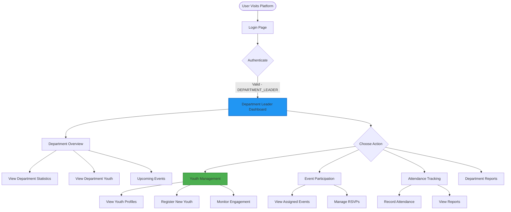

# Department Leader Journey - Complete User Flow

**Document**: Department Leader User Journey  
**Version**: 2.0.0  
**Date**: October 16, 2026  
**Role**: DEPARTMENT_LEADER (Department-level management)

---

## 🎯 Department Leader Overview

**Department Leader** manages a single department with access to:
- ✅ Department youth management (assigned department only)
- ✅ Event participation for department youth
- ✅ Attendance tracking for department
- ✅ Department-level reports
- ✅ Youth engagement monitoring
- ❌ NO finance access
- ❌ NO system-wide analytics

---

## 🗺️ Complete Journey Map

---

## 📊 Dashboard Components

### Quick Stats
- Total department youth
- Active youth count
- This month's attendance rate
- Upcoming events

### Recent Activity
- Recent youth registrations
- Recent event participation
- Recent attendance records

---

## 🔄 Key Features

### 1. Youth Management (Department-Scoped)
- View youth in assigned department only
- Register new youth to department
- View youth profiles and history
- Monitor engagement scores

### 2. Event Participation
- View events assigned to department
- Track RSVP responses
- Encourage participation

### 3. Attendance Tracking
- Record attendance for department youth
- View attendance history
- Generate department reports

### 4. Engagement Monitoring
- Track youth participation trends
- Identify at-risk youth
- View engagement metrics

---

## 🔐 Permission Matrix

| Feature | Create | Read | Update | Delete | Export | Scope |
|---------|--------|------|--------|--------|--------|-------|
| **Youth** | ✅ | ✅ | ✅ | ❌ | ✅ | Department only |
| **Events** | ❌ | ✅ | ❌ | ❌ | ❌ | View only |
| **Attendance** | ✅ | ✅ | ✅ | ❌ | ✅ | Department only |
| **Reports** | ❌ | ✅ | ❌ | ❌ | ✅ | Department only |
| **Finance** | ❌ | ❌ | ❌ | ❌ | ❌ | No access |
| **Analytics** | ❌ | ✅ | ❌ | ❌ | ❌ | Department only |

---

## 🎯 Success Metrics

1. **Department Youth Growth**: New registrations per month
2. **Attendance Rate**: Average attendance percentage
3. **Event Participation**: Percentage of youth attending events
4. **Engagement Score**: Department-wide average
5. **At-Risk Youth**: Number identified and interventions

---

**Next Document**: 09-YOUTH-MEMBER-JOURNEY.md
