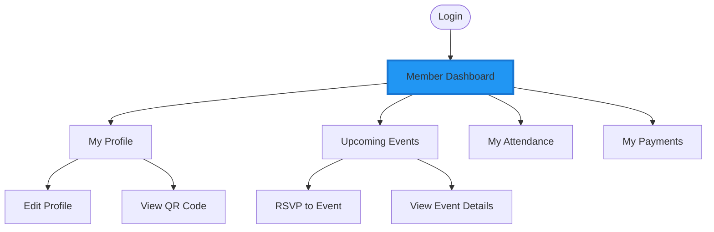

# Youth Member Journey - Complete User Flow

**Document**: Youth Member User Journey  
**Version**: 2.0.0  
**Date**: October 16, 2026  
**Role**: YOUTH_MEMBER (Self-service portal)

---

## 🎯 Youth Member Overview

**Youth Member** has limited self-service access to:
- ✅ View and edit own profile
- ✅ View and RSVP to events
- ✅ View own attendance history
- ✅ View own payment history
- ✅ Receive notifications
- ❌ NO access to other youth profiles
- ❌ NO management features

---

## 🗺️ Journey Map

---

## 📊 Dashboard Features

### Quick Stats (Personal)
- Attendance rate
- Events attended this month
- Upcoming events
- Payment status

### Actions
- Update profile photo
- RSVP to events
- View QR code for check-in
- Update notification preferences

---

## 🔐 Permission Matrix

| Feature | Create | Read | Update | Delete | Scope |
|---------|--------|------|--------|--------|-------|
| **Own Profile** | ❌ | ✅ | ✅ | ❌ | Self only |
| **Events** | ❌ | ✅ | ❌ | ❌ | View only |
| **RSVP** | ✅ | ✅ | ✅ | ✅ | Self only |
| **Attendance** | ❌ | ✅ | ❌ | ❌ | Self only |
| **Payments** | ❌ | ✅ | ❌ | ❌ | Self only |

---

**Next Document**: 10-AUTH-IMPLEMENTATION.md
