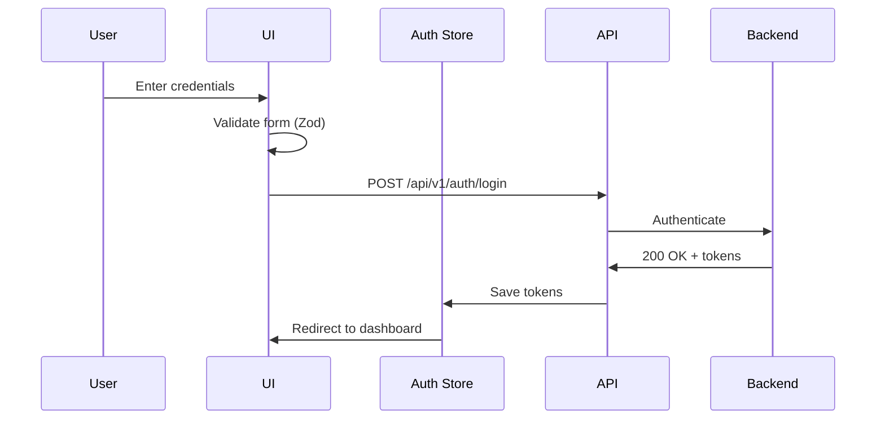

# Authentication Implementation - Complete Guide

**Document**: Auth Implementation Flowchart  
**Version**: 2.0.0  
**Date**: October 16, 2026  
**Purpose**: Login, register, password reset, Firebase SSO implementation

---

## 🎯 Features Covered

1. **Email/Password Login**
2. **User Registration**
3. **Password Reset Flow**
4. **Firebase SSO (Google)**
5. **JWT Token Management**
6. **Auto Token Refresh**

---

## 🔄 Authentication Flow



---

## 📁 File Structure

```
features/auth/
├── api/
│   ├── auth-client.ts           # API calls
│   └── queries.ts               # TanStack Query hooks
├── components/
│   ├── LoginForm.tsx
│   ├── RegisterForm.tsx
│   ├── PasswordResetForm.tsx
│   └── FirebaseSSO.tsx
├── stores/
│   └── auth-store.ts            # Zustand store
├── schemas/
│   └── validation.ts            # Zod schemas
└── index.ts                     # Public API
```

---

## 🔐 Implementation Examples

### Login Hook
```typescript
export const useLogin = () => {
  const setTokens = useAuthStore((state) => state.setTokens);
  
  return useMutation({
    mutationFn: authApi.login,
    onSuccess: (data) => {
      setTokens({
        accessToken: data.accessToken,
        refreshToken: data.refreshToken,
      });
      router.push('/dashboard');
    },
  });
};
```

### Auto Refresh
```typescript
apiClient.interceptors.response.use(
  (response) => response,
  async (error) => {
    if (error.response?.status === 401) {
      await useAuthStore.getState().refreshAccessToken();
      return apiClient(error.config);
    }
    return Promise.reject(error);
  }
);
```

---

## ✅ Security Checklist

- ✅ Access token: Memory only (15 min expiry)
- ✅ Refresh token: LocalStorage (7 day expiry)
- ✅ Auto token refresh on 401
- ✅ HTTPS only
- ✅ CSRF protection
- ✅ Rate limiting

---

**Backend Endpoints Used**:
- POST /api/v1/auth/login
- POST /api/v1/auth/register
- POST /api/v1/auth/refresh
- POST /api/v1/auth/logout
- POST /api/v1/auth/forgot-password
- POST /api/v1/auth/reset-password

**Next Document**: 11-DASHBOARD-IMPLEMENTATION.md
