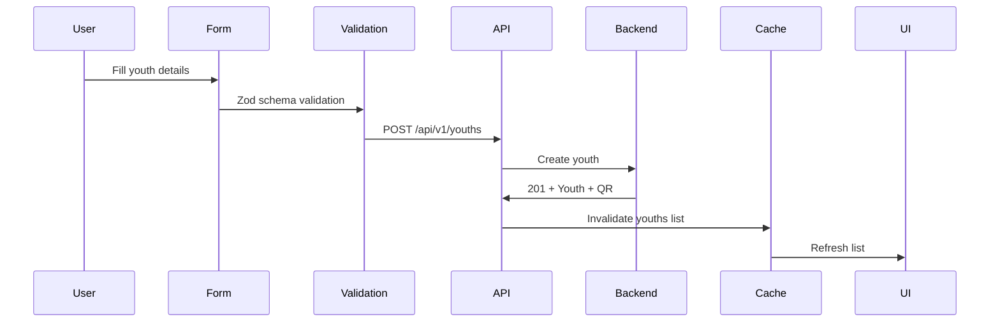

# Youth Management Implementation

**Document**: Youth Management CRUD + AI Risk Assessment  
**Version**: 2.0.0  
**Date**: October 16, 2026

---

## 🎯 Features

1. **CRUD Operations** (Create, Read, Update, Delete)
2. **Search & Filters** (Name, branch, department, status)
3. **Bulk Operations** (Import, export)
4. **AI Risk Assessment** (Attendance-based predictions)
5. **QR Code Generation**

---

## 📁 File Structure

```
features/youths/
├── api/
│   ├── youths-api.ts
│   └── queries.ts
├── components/
│   ├── YouthList.tsx
│   ├── YouthForm.tsx
│   ├── YouthProfile.tsx
│   ├── RiskAssessment.tsx
│   └── QRCodeDisplay.tsx
├── schemas/
│   └── validation.ts
└── hooks/
    ├── useYouths.ts
    ├── useCreateYouth.ts
    └── useRiskPrediction.ts
```

---

## 🔄 Create Youth Flow



---

## 🤖 AI Risk Assessment

**Endpoint**: POST /api/v1/ai/predict-risk

**Request**:
```typescript
{
  youthId: string;
  analysisWindow: number; // days (default: 60)
}
```

**Response**:
```typescript
{
  riskLevel: 'LOW' | 'MEDIUM' | 'HIGH';
  riskScore: number; // 0-100
  factors: string[];
  recommendations: string[];
}
```

---

## 📊 Youth List Features

- Server-side pagination
- Search by name/email/phone
- Filter by branch/department/status
- Sort by various fields
- Bulk select and export
- Column customization

---

**Backend Endpoints**:
- GET /api/v1/youths
- POST /api/v1/youths
- GET /api/v1/youths/:id
- PUT /api/v1/youths/:id
- DELETE /api/v1/youths/:id
- POST /api/v1/ai/predict-risk
- POST /api/v1/ai/detect-at-risk

**Next Document**: 13-EVENT-MANAGEMENT-IMPLEMENTATION.md
