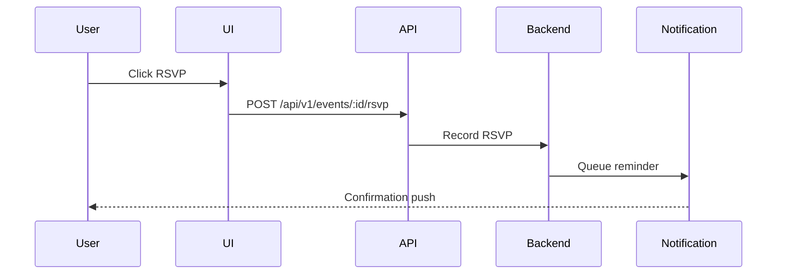

# Event Management Implementation

**Document**: Event Creation, RSVP, Reminders  
**Version**: 2.0.0  
**Date**: October 16, 2026

---

## 🎯 Features

1. **Event CRUD**
2. **Calendar View** (Month/Week/Day)
3. **RSVP Management**
4. **Automated Reminders**
5. **Attendance Integration**

---

## 📁 File Structure

```
features/events/
├── api/
│   ├── events-api.ts
│   └── queries.ts
├── components/
│   ├── EventCalendar.tsx
│   ├── EventForm.tsx
│   ├── EventCard.tsx
│   ├── RSVPManager.tsx
│   └── EventDetails.tsx
└── hooks/
    ├── useEvents.ts
    ├── useCreateEvent.ts
    └── useRSVP.ts
```

---

## 📅 Calendar Integration

Using **React Big Calendar**:
```typescript
import { Calendar } from 'react-big-calendar';

<Calendar
  events={events}
  onSelectEvent={handleSelectEvent}
  onSelectSlot={handleSelectSlot}
  selectable
/>
```

---

## 🔔 RSVP Flow



---

## ⏰ Automated Reminders

**Triggers**:
- 24 hours before event
- 1 hour before event
- Event started

**Channels**:
- Push notification (Firebase FCM)
- Email
- SMS (optional)

---

**Backend Endpoints**:
- GET /api/v1/events
- POST /api/v1/events
- GET /api/v1/events/:id
- PUT /api/v1/events/:id
- DELETE /api/v1/events/:id
- POST /api/v1/events/:id/rsvp
- GET /api/v1/events/:id/rsvps
- POST /api/v1/events/:id/reminders

**Next Document**: 14-ATTENDANCE-IMPLEMENTATION.md
