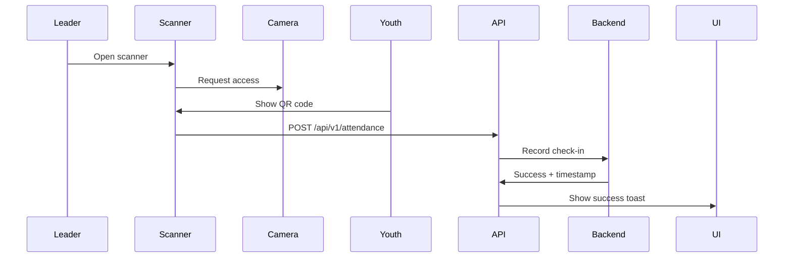

# Attendance Implementation

**Document**: Check-in, Bulk Operations, Reports  
**Version**: 2.0.0  
**Date**: October 16, 2026

---

## 🎯 Features

1. **QR Code Check-in**
2. **Bulk Attendance Recording**
3. **Attendance Reports**
4. **Real-time Statistics**
5. **Export to CSV**

---

## 📁 File Structure

```
features/attendance/
├── api/
│   ├── attendance-api.ts
│   └── queries.ts
├── components/
│   ├── QRScanner.tsx
│   ├── BulkCheckIn.tsx
│   ├── AttendanceTable.tsx
│   ├── AttendanceReport.tsx
│   └── AttendanceChart.tsx
└── hooks/
    ├── useCheckIn.ts
    ├── useBulkCheckIn.ts
    └── useAttendanceReport.ts
```

---

## 📱 QR Check-in Flow



---

## 📊 Bulk Check-in

**UI**:
- Select event
- Display expected attendees
- Checkboxes for each youth
- "Mark All Present" button
- Submit bulk attendance

**Endpoint**: POST /api/v1/attendance/bulk
```typescript
{
  eventId: string;
  attendance: Array<{
    youthId: string;
    status: 'PRESENT' | 'ABSENT' | 'EXCUSED';
  }>;
}
```

---

## 📈 Reports

**Types**:
1. Daily attendance report
2. Weekly analytics
3. Monthly summary
4. Custom date range

**Export**: CSV download

---

**Backend Endpoints**:
- POST /api/v1/attendance
- POST /api/v1/attendance/bulk
- GET /api/v1/attendance
- GET /api/v1/attendance/reports/daily
- GET /api/v1/attendance/reports/weekly
- GET /api/v1/attendance/reports/monthly

**Next Document**: 15-FINANCE-IMPLEMENTATION.md
