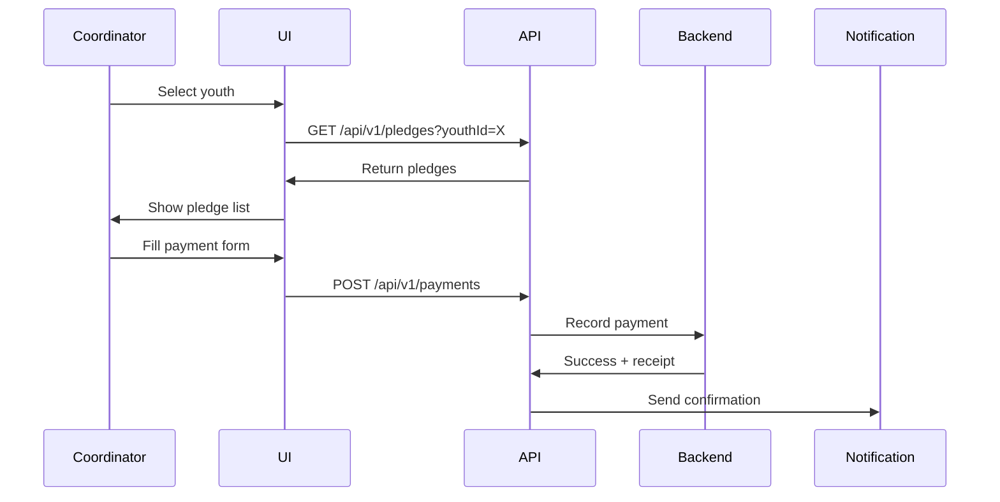

# Finance Implementation

**Document**: Pledges, Payments, OCR Receipts  
**Version**: 2.0.0  
**Date**: October 16, 2026

---

## 🎯 Features

1. **Pledge Tracking**
2. **Payment Recording**
3. **OCR Receipt Upload** (Future)
4. **Financial Reports**
5. **Payment History**

---

## 📁 File Structure

```
features/finance/
├── api/
│   ├── finance-api.ts
│   └── queries.ts
├── components/
│   ├── PledgeList.tsx
│   ├── PaymentForm.tsx
│   ├── PaymentHistory.tsx
│   ├── FinancialReport.tsx
│   └── ReceiptUpload.tsx
└── hooks/
    ├── usePledges.ts
    ├── useRecordPayment.ts
    └── useFinancialReport.ts
```

---

## 💰 Payment Recording Flow



---

## 📄 Payment Schema

```typescript
interface Payment {
  id: string;
  pledgeId: string;
  amount: number;
  paymentMethod: 'CASH' | 'BANK_TRANSFER' | 'ONLINE';
  paymentDate: string;
  receiptUrl?: string;
  notes?: string;
}
```

---

## 📊 Financial Reports

**Types**:
1. Branch revenue report
2. Pledge fulfillment rate
3. Outstanding payments
4. Payment method breakdown

**Access**: SUPER_ADMIN & BRANCH_COORDINATOR only

---

**Backend Endpoints**:
- GET /api/v1/pledges
- POST /api/v1/pledges
- GET /api/v1/payments
- POST /api/v1/payments
- GET /api/v1/finance/reports/monthly

**Next Document**: 16-NOTIFICATIONS-IMPLEMENTATION.md
