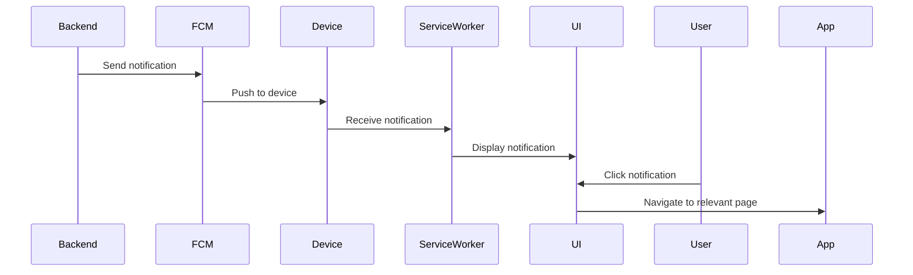

# Notifications Implementation

**Document**: Push Notifications, FCM Integration  
**Version**: 2.0.0  
**Date**: October 16, 2026

---

## 🎯 Features

1. **Push Notifications** (Firebase FCM)
2. **In-App Notification Center**
3. **Toast Notifications** (Sonner)
4. **Notification Preferences**
5. **Topic Subscriptions**

---

## 📁 File Structure

```
features/notifications/
├── api/
│   ├── notifications-api.ts
│   └── queries.ts
├── components/
│   ├── NotificationCenter.tsx
│   ├── NotificationItem.tsx
│   ├── NotificationBell.tsx
│   └── NotificationPreferences.tsx
├── firebase/
│   └── fcm-config.ts
└── hooks/
    ├── useNotifications.ts
    └── useFCM.ts
```

---

## 🔔 FCM Setup

```typescript
// firebase/fcm-config.ts
import { initializeApp } from 'firebase/app';
import { getMessaging, getToken } from 'firebase/messaging';

const app = initializeApp(firebaseConfig);
const messaging = getMessaging(app);

export const requestPermission = async () => {
  const permission = await Notification.requestPermission();
  if (permission === 'granted') {
    const token = await getToken(messaging);
    // Send token to backend
    await api.post('/api/v1/notifications/fcm-token', { token });
  }
};
```

---

## 📱 Notification Types

1. **Event Reminders**
2. **Attendance Alerts**
3. **Payment Confirmations**
4. **System Announcements**
5. **At-Risk Youth Alerts**

---

## 🔄 Notification Flow



---

## 📊 In-App Notification Center

**Features**:
- Unread badge count
- Mark as read
- Delete notifications
- Filter by type
- Real-time updates

---

**Backend Endpoints**:
- POST /api/v1/notifications/push
- POST /api/v1/notifications/bulk
- POST /api/v1/notifications/topic
- POST /api/v1/notifications/fcm-token
- GET /api/v1/notifications
- PUT /api/v1/notifications/:id/read

**Next Document**: 17-AI-CHAT-IMPLEMENTATION.md
