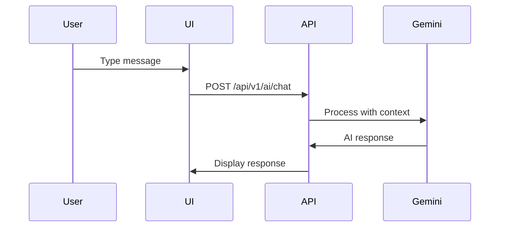

# AI Chat Implementation

**Document**: Context-Aware Chat Assistant  
**Version**: 2.0.0  
**Date**: October 16, 2026

---

## 🎯 Features

1. **Context-Aware Responses**
2. **Bible Verse Search**
3. **Daily Verses**
4. **Youth Insights**
5. **Event Recommendations**

---

## 📁 File Structure

```
features/ai-chat/
├── api/
│   └── ai-api.ts
├── components/
│   ├── ChatInterface.tsx
│   ├── ChatMessage.tsx
│   ├── ChatInput.tsx
│   └── DailyVerse.tsx
└── hooks/
    ├── useChat.ts
    └── useDailyVerse.ts
```

---

## 💬 Chat Interface

```typescript
const ChatInterface = () => {
  const { messages, sendMessage, isLoading } = useChat();
  
  return (
    <div className="flex flex-col h-full">
      <ChatHeader />
      <ChatMessages messages={messages} />
      <ChatInput onSend={sendMessage} disabled={isLoading} />
    </div>
  );
};
```

---

## 🤖 AI Features

**Powered by Google Gemini API**

1. **Youth Insights**:
   - "Show me at-risk youth this month"
   - "What's the attendance trend?"

2. **Bible Verse Search**:
   - "Find verses about love"
   - "Show me Psalm 23"

3. **Event Recommendations**:
   - "Suggest events for high engagement"

---

## 🔄 Chat Flow



---

**Backend Endpoints**:
- POST /api/v1/ai/chat
- GET /api/v1/ai/daily-verse
- POST /api/v1/ai/insights

**Next Document**: 18-ANALYTICS-IMPLEMENTATION.md
